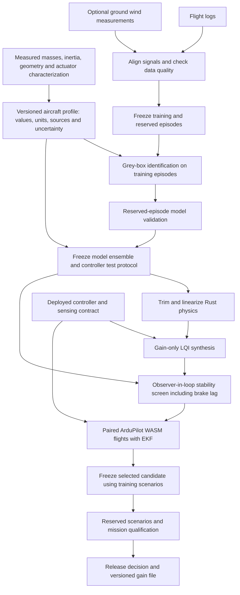

# Offline controller pipeline

AI-assisted implementation. CLI only; the aircraft adapter currently supports the
Trout Lake as-built 132 mm configuration. Future aircraft adapters must regenerate
routing, actuator mapping and trim seeds rather than silently reusing these values.

## Commands

Run `uv sync --project control --locked` from the repository root, then use
`uv run --project control python` for the commands below.
Every output run directory must be new. Errors and failed flights are retained.

1. `python -m microagu_control.pipeline init aircraft.json`
2. `python -m microagu_control.sysid fit session.json fit-run`
3. `python -m microagu_control.sysid validate session.json model-check --fit-result fit-run/fit.json`
4. `python -m microagu_control.pipeline run protocol.json design-run`
5. `python -m microagu_control.pipeline campaign design-run cases.json /absolute/path/arduplane.js viewer campaign-run --workers 2`
6. `python -m microagu_control.pipeline verify-gains design-run/refit/lqi-gains.bin reference.h`

Add `"aircraft_profile": "aircraft.json"` to the sysid session (relative to that session).
Identification and validation consume the same measured inputs; fit artifacts bind
the profile hash and controller synthesis checks it. Older imported fits lack this
binding and must retain their original as-built provenance.

See `research/active/controller-pipeline-2026-10-18/protocol-final.json` and `training.json`
for explicit model variants, synthesis weights and scenarios. Run Node 22 or later
on PATH. The runner copies firmware into an isolated ESM runtime directory and
never overwrites viewer firmware assets. The actual AP/EKF runs in WASM and the
Rust physics runs through its browser binding; Python orchestrates and assesses.

## Aircraft inputs and scope

The profile snapshots the physical coefficients and geometry and records measured
inputs separately, with value, units, source, uncertainty and fixed/fitted status.
Mass, inertia and hinge coordinates feed the physics; invalid mass accounting or
non-positive inertia fails before synthesis. `uncertainty: null` means unknown,
not exact. The current study uses explicitly enumerated model uncertainty, not a
statistical posterior or Monte Carlo coverage of unmeasured geometry uncertainty.
The six fitted coefficients retain the sysid adapter's bounds and meanings.
The 120 ms fitted brake lag is treated as an uncertainty, not a measured servo delay.

This first controller pipeline keeps the deployed observer, normalization, trim,
reference map and sensing fixed. It synthesizes feedback and anti-windup matrices
against different physical linearizations. Synthesis uses quasi-static actuators;
the subsequent closed-loop screen explicitly includes the lag as hidden plant states.
It does not assume canopy truth or add a pitot sensor. The local screen cannot
qualify saturation, unilateral brake behavior, governor dynamics, EKF error or power.
Those require the nonlinear firmware runs. The current screen is around the interior
brake trim of the deployed reference, not a zero-common-brake operating point.

## Artifacts and gates

`run` saves frozen input copies, source/native hashes, physical linearizations,
compatible headers and binary gains, poles for every controller/model pair, and
an explicit decision. The decision never authorizes deployment from linear results.
`campaign` saves exact firmware, case inputs, gain hashes, full trajectories,
controller ownership, metrics and training selection. Missing or failed runs count
as failures. Every campaign requires `reference_repeat`, which loads exactly the
same bytes as `reference`. Excessive repeat variation blocks candidate promotion;
a single repeat is a screening check, not a confidence interval. Stability/envelope, persistent oscillation and saturation gates precede
ranking. Task regressions, oscillation regressions and shaft power regressions are
checked separately. Shaft power is reconstructed from recorded RPM and the Rust
propeller table; it is not measured battery power.

Successful training selection still requires reserved scenarios and mission checks.
The tool does not autonomously publish firmware. A research tune is not a hardware
flight qualification. Model residuals and unquantified physical uncertainty remain
part of the decision even if simulated controller metrics improve.

## Gain-file format and ArduPilot

Version 1 is deliberately gain-only: fixed 16 estimated states, 3 integral states
and 3 actuator outputs. It contains 280 bytes: ASCII `AGULQI01`, a little-endian
CRC32 of the compiled model context, payload CRC32, then 57 feedback and 9
anti-windup IEEE binary32 values in row-major order. The context covers A, B, L,
state/control scales, trim, reference maps, Euler trim, velocity trim and rate trim.
Checksums detect corruption/compatibility, not authenticity. Release manifests use
SHA-256 to identify exact artifacts. A changed observer or state layout requires
matching firmware; this format cannot silently replace it.

Upload `lqi-gains.bin` to the AP filesystem root (MAVFTP can transport it), set
`CP3_FILE=1`, then reboot. The same AP filesystem calls read ChibiOS storage and
WASM MEMFS. The web runtime loads a manifest-declared file before AP starts and
checks its SHA-256. A missing/incompatible/corrupt file prevents LQI engagement
when file mode is required. `CP3_FILE=0` retains compiled gains. Source selection
is latched at engagement; there is no in-flight file reload or parameter-table
rewrite. ChibiOS builds must explicitly enable the experimental custom controller;
this does not change its default hardware build policy.
