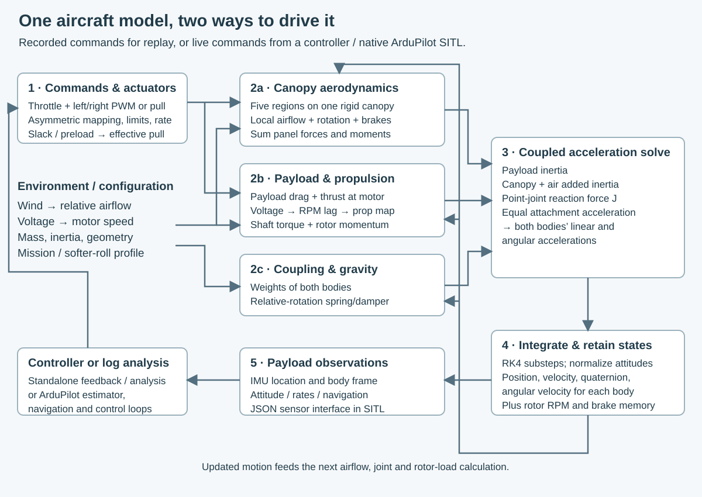

# Designing the Micro-AGU Flight Controller

*Micro-AGU · Controller design, part 2 · [Through Trout Lake](first-flight-controller.md) · [Build](micro-agu-design.md) · [Flight tests](flight-testing.md) · [Controller design](controller-design.md) · [Data and methods](data-and-methods.md)*

Micro-AGU is a powered paraglider: a flexible wing supports a motorized payload on suspension lines. Its autopilot pulls the left and right brakes to steer and changes throttle to climb or descend. The controller and its motion sensors ride on the payload, below the wing.

[Part 1](first-flight-controller.md) follows the initial controller through the Trout Lake missions. Those flights also exposed problems with the early design: turns were less effective than the simulator suggested, and a pitch damper intended to settle the aircraft made its motion worse. Before choosing another set of gains, I needed to understand what was moving and how the control inputs affected it.

This article follows that investigation from flight logs to a model of the suspended aircraft, then uses the model to develop steering and altitude control. The flight data establishes the starting point; the later controller changes are evaluated in simulation.

## From flight logs to a model for controller design

Most aerodynamic forces act on the canopy, while the sensors report the payload's motion. The two can rotate relative to each other. A model that treats them as one rigid aircraft cannot show how that relative motion reaches the controller, or how a correction might reinforce it.

The first step is to make those separate motions visible. The picture below introduces the two bodies; the optional applets then explore the forces and suspension connecting them. Equations and parameter tables accompany each applet for readers who want to inspect the calculation.

This article records a controller-development study. The newer explanatory applets use the current Rust implementation and identify their presets. Historical flight comparisons and controller results retain the configurations used in that study.

### Let the payload and canopy move independently

The model represents the canopy and payload as two rigid bodies connected at one equivalent attachment point. The canopy can rotate relative to the payload, but the two attachment positions must coincide. Each body has its own attitude and angular velocity. Three overall translations, three payload rotations and three relative canopy rotations give **nine mechanical degrees of freedom**.

This separates **what the canopy does** from **what the payload-mounted sensors see**. The canopy generates most of the aerodynamic support and steering forces. The payload carries most of the mass, the motor and the inertial measurement unit (IMU). A throttle or brake change acts on one part of that system first; the suspension transfers forces and moments to the other. Treating them as one rigid aircraft would remove that relative motion before the controller ever saw it.

*Left: the two rigid bodies and their equivalent attachment. Right: the loads on each isolated body. Orange arrows are external loads; green arrows are internal joint reactions. Directions are illustrative, not a solved trim condition. The suspension sketch is not a set of individually simulated lines, and the force arrows are not to scale.*

Explore the motion: how can the canopy rotate while the payload moves differently?

Start with **Relative pitch** in the prescribed-motion view. Watch which body changes attitude and remember that the IMU is attached to the payload. Then try relative roll or yaw. These first views demonstrate the allowed motions; the disturbance-release views show recorded simulation responses.

#### See the separate motions

The motion tour lets you step through the three translations, three payload rotations and three relative canopy rotations. Use front, side or top views, pause, scrub, or slow playback. The default disturbance view releases either the canopy or payload, with a 3°–15° amplitude slider and both stiffness profiles. Select **Closed loop · AUTO** at 9° to see the native autopilot respond after flying a straight waypoint leg at 100 m altitude for 100 seconds. **Open loop · fixed trim** shows the original natural response with throttle and brakes held at equilibrium trim. Throttle, brake pull, altitude deviation and ground-track deviation appear below the motion.

[Explore the joint motions](https://davidingraham.github.io/assets/microagu-viewer/joint-tour.html)

*The first nine segments prescribe one coordinate at a time to explain the degrees of freedom. The final three replay simulated roll, pitch and yaw deflection releases with the mission profile. Prescribed motion is labeled separately from physics. The response view removes shared translation, preserving all rotations and relative displacement at their simulated amplitudes. The canopy is schematic; the carriage uses the SolidWorks model.*

#### What is connected to what?

The joint is an **equivalent point connection**, not a pin that permits only one rotational axis. If $\mathbf{x}_p$ and $\mathbf{x}_c$ are the payload and canopy CG positions, $R_p$ and $R_c$ their attitudes, and $\mathbf{a}_p$ and $\mathbf{a}_c$ the fixed attachment offsets in their respective body frames, the shared-point condition is

$$
\mathbf{x}_p + R_p\mathbf{a}_p
= \mathbf{x}_c + R_c\mathbf{a}_c.
$$

The equations solve for a reaction force $\mathbf{J}$ that makes the two attachment-point accelerations agree, including the rotational acceleration and centripetal terms. The payload receives $+\mathbf{J}$ and the canopy receives $-\mathbf{J}$, each acting through its own attachment-to-CG moment arm. There are three independent relative rotations, but they are not torque-free: an effective spring and damper oppose relative attitude and angular rate. That torque also enters the two bodies with opposite signs. The coefficients represent the suspension's aggregate behavior; they do not model fabric deformation or individual line tensions.

### Follow the forces through the aircraft

The canopy supplies lift and drag. The motor supplies thrust at an offset from the payload's center of gravity. The suspension transfers forces and torques between them. A brake or throttle change therefore affects both bodies, often at different times; the controller must track the route without amplifying their relative motion.

### How the five-panel canopy produces loads

The canopy is one rigid body, with **five equal-area regions** along its curved span where aerodynamic loads are evaluated. The panel centers have different positions and local orientations. Lift and drag are evaluated at each center, then combined into the force and moment on the canopy.

**What to look for:** a brake input changes distributed forces across the curved wing. Their distances from the canopy's center of gravity turn those forces into moments.

Explore canopy aerodynamics: compare symmetric flight with right braking

[Explore the five-panel canopy aerodynamics](https://davidingraham.github.io/assets/microagu-viewer/canopy-panels.html)

*Select symmetric flight or right braking, inspect any panel, and switch between three-quarter and front views. These are frozen operating points calculated by the current Rust plant with the as-built Trout Lake SITL preset: 7 m/s, 4.58° canopy angle of attack, zero sideslip and zero angular rate. They illustrate the force calculation; neither case is claimed to be a trimmed equilibrium or a predicted turn trajectory. The earlier refinement results below retain their historical model provenance.*

For panel $i$, its velocity through the air in local panel coordinates is

$$
\mathbf{v}_i = R_i^T\left[\mathbf{v}_{c,\mathrm{air}} + \boldsymbol{\omega}_c\times\mathbf{r}_i\right].
$$

Here $\mathbf{r}_i$ is the panel center's offset from the canopy CG, $R_i$ maps the panel frame to the canopy frame, and $\mathbf{v}_{c,\mathrm{air}}$ and $\boldsymbol{\omega}_c$ are expressed in canopy coordinates. The blue arrows show incoming airflow, opposite this local velocity. Even in a uniform wind, canopy rotation changes the velocity at the different panel centers.

The two left panels receive left brake pull; the two right panels receive right brake pull; the center panel receives their average. Local angle of attack and brake pull change lift and drag coefficients. The model also applies an effective aerodynamic inclination change proportional to differential brake pull. This is a modeled aerodynamic correction, not five physical hinges or simulated fabric deformation. The front inset shows those effective inclinations; the main surface retains its rigid geometric arc.

The panel forces and their moment arms contribute

$$
\mathbf{F}_{\mathrm{panels}}=\sum_{i=1}^{5}(\mathbf{L}_i+\mathbf{D}_i),
\qquad
\mathbf{M}_{\mathrm{panels}}=\sum_{i=1}^{5}\mathbf{r}_i\times(\mathbf{L}_i+\mathbf{D}_i).
$$

The plant then adds separate whole-canopy side-force and aerodynamic moment terms, based on sideslip, angle of attack, angular rate and differential braking. The figure lists the panel moments and additional aerodynamic moments separately, so the distributed-panel calculation is not mistaken for the entire aerodynamic model. Gravity, suspension reactions and added-air inertia enter elsewhere in the body equations.

### What the joint's springs and dampers represent

The point constraint prevents the equivalent attachment positions from separating. **Rotational stiffness and damping are separate from that positional constraint.** They represent the suspension's aggregate resistance to relative attitude and relative angular velocity; there is no literal metal spring or shock absorber in the model.

A spring responds to relative angle and pulls toward alignment; a damper responds to relative angular rate and removes energy. For yaw, twisting separated suspension groups provides a geometric reason for the restoring torque. The effective attachment geometry can give a stiffness estimate, while damping still needs experimental identification.

**What to look for:** pause at a turning point, where damping vanishes, then at alignment, where the linear spring torque vanishes. In the yaw view, compare the geometry-based estimate with the fitted spring actually used by the preset.

Explore suspension mechanics: spring, damper, parameters and yaw geometry

[Explore the joint springs, dampers and yaw geometry](https://davidingraham.github.io/assets/microagu-viewer/joint-mechanics.html)

*The first animation prescribes a ±15° single-axis rotation with a six-second period, and evaluates the spring and damper torques using the Rust plant's joint routine. It is not a free-response simulation. Pause or scrub to a turning point and to alignment: the spring follows angle, while the damper follows relative rate. The second view is a geometric construction motivating the yaw torque law; its displayed payload rise is not an extra translation simulated by the point joint.*

For a small, isolated relative rotation $\theta_i$ about axis $i$, the torque on the canopy is

$$
\tau_{c,i}=-k_i\theta_i-c_i\Delta\omega_i,
\qquad \tau_{p,i}=-\tau_{c,i}.
$$

Positive $\theta_i$ means the canopy is rotated ahead of the payload about that axis. The spring pulls the bodies toward alignment, stores energy and can return it. The damper opposes their relative angular velocity and dissipates energy. Consequently, spring and damper torques can point in **opposite directions while returning toward alignment**; damping does not always reinforce the spring.

The [as-built Trout Lake SITL preset](../simulation/data/presets/as-built-trout-lake-sitl.json) used in these illustrations has:

| Axis | Stiffness, N·m/rad | Damping, N·m·s/rad | Parameter names |
|---|---:|---:|---|
| Relative roll | 4.862204 | 0.001033185 | `joint_k_roll`, `joint_c_roll` |
| Relative pitch | 0 | 0.045 | `joint_k_pitch`, `joint_c_pitch` |
| Relative yaw | 0.4348934 | 0.060 | `joint_k_yaw`, `joint_c_yaw` |

Zero pitch-joint stiffness means there is no explicit pitch spring in this preset. It does **not** remove pitch dynamics: aerodynamic moments, motor loads, inertia and the positional constraint still couple the bodies. These are effective coefficients for this model and configuration, not independently measured material constants. In particular, the [rigging study](rigging-refinement.md) found damping/geometry tradeoffs and sensitivity to canopy initialization, rather than a unique identification.

The full three-dimensional implementation uses the rotation vector

$$
\boldsymbol{\theta}=\operatorname{Log}(R_p^TR_c)^\vee,
\qquad
\Delta\boldsymbol{\omega}=R_p^T(\boldsymbol{\omega}_c-\boldsymbol{\omega}_p).
$$

It maps the elastic potential's gradient through the rotation-vector Jacobian before applying equal-and-opposite world-frame torques. Thus the single-axis diagram should not be interpreted as three independent Euler-angle springs at large combined rotations. With $A(\boldsymbol{\theta})$ defined by $\dot{\boldsymbol{\theta}}=A\Delta\boldsymbol{\omega}$, the actual torque structure is

$$
\boldsymbol{\tau}_p=R_p\left[A^T\nabla_{\boldsymbol{\theta}}U+C\Delta\boldsymbol{\omega}\right],
\qquad
\boldsymbol{\tau}_c=-\boldsymbol{\tau}_p.
$$

The [joint implementation](../simulation/crates/sim-core/src/joint.rs) is shared by the plant and the [figure's recording generator](../simulation/crates/sim-io/examples/joint_explanation.rs).

For the linear-spring option, $U=\tfrac12\sum_i k_i\theta_i^2$. The damper's net mechanical power across both bodies is

$$
P_d=-\Delta\boldsymbol{\omega}^TC\Delta\boldsymbol{\omega}\leq0.
$$

#### How geometry supplies a yaw-stiffness estimate

Imagine two taut, fixed-length connections between symmetric upper and lower attachment groups—a **bifilar suspension**. Let $2a$ be the lower attachment spacing, $2b$ the effective upper attachment spacing, and $H$ their vertical separation when aligned. Twisting through relative yaw $\psi$ increases the horizontal distance between corresponding attachments. To keep the connection lengths fixed, the payload must rise:

$$
\begin{aligned}
L^2 &= H^2+(b-a)^2,\\
h(\psi)^2 &= L^2-\left(a^2+b^2-2ab\cos\psi\right)\\
&=H^2-2ab(1-\cos\psi),\\
\Delta h(\psi)&=H-h(\psi).
\end{aligned}
$$

That rise stores gravitational potential energy. Its derivative supplies a restoring torque, with the small-angle stiffness emerging directly from mass and geometry:

$$
\begin{aligned}
U_\psi &= m_p g_0\,[H-h(\psi)],\\
\tau_{c,\psi} &= -\frac{m_p g_0ab\sin\psi}{h(\psi)},\\
k_{\psi,0} &= \left.\frac{d^2U_\psi}{d\psi^2}\right|_{\psi=0}
=\frac{m_p g_0ab}{H}.
\end{aligned}
$$

The Rust option `geometry_yaw > 0` substitutes this potential for the linear yaw potential; it **replaces**, rather than adds to, `joint_k_yaw`. In combined rotations it uses the yaw component of the relative rotation vector and the same Jacobian mapping. This is a reduced effective potential, not a full suspension-line solver. The derivation assumes symmetric, taut supports and gravitational loading; it does not resolve transient line tension or fabric deformation.

The illustration uses these inputs:

| Quantity | Preset value | How to obtain or interpret it |
|---|---:|---|
| Lower halfspacing $a$ | 66 mm | Half the measured 132 mm loaded riser attachment spacing; `yaw_payload_halfspacing`. |
| Effective upper halfspacing $b$ | 323.554 mm | Equivalent left/right canopy load-center position; `yaw_canopy_halfspacing`. This value was fitted, not directly measured. |
| Aligned vertical separation $H$ | 850 mm | Separation between the effective attachment planes; `yaw_vertical_separation`. The retained model value needs loaded-geometry verification. |
| Supported payload mass $m_p$ | 1.568 kg | Total mass 1.758 kg minus 0.190 kg canopy mass. |

To obtain $b$ from canopy geometry, locate the suspension attachment groups and their loaded cascades. **Do not substitute half the full canopy span.** For a single equivalent attachment on a circular canopy arc, at angle $\gamma$ from its centerline,

$$
b=R_{\mathrm{arc}}\sin\gamma,
\qquad
R_{\mathrm{arc}}=\frac{b_{\mathrm{arc}}}{2\phi},
$$

where $b_{\mathrm{arc}}$ is arc span and $\phi$ is the canopy half-arc angle. Real line groups distribute load across several pickup points; reducing those to an effective upper pair requires their geometry and load distribution, or an identified effective spacing. Measure $H$ from those effective attachment heights, not from the wing apex or an arbitrary canopy CG.

These stored dimensions give $k_{\psi,0}=0.386312$ N·m/rad. The preset currently has `geometry_yaw = 0` and uses the fitted linear value $0.434893$ N·m/rad—about **12.6% higher**. The [as-built correction](rigging-refinement.md) retained the fitted stiffness product after correcting the lower spacing from 148.6 to 132 mm. The diagram plots both laws without silently treating them as identical or changing the deployed model.

Geometry alone does **not** determine the damping coefficients. A suspended twist-and-release test with known rotational inertia can provide an initial yaw stiffness/damping estimate from oscillation frequency and decay. Flight fitting should then account for aerodynamic damping, coupled modes and sensor location; a payload gyro alone does not directly measure canopy–payload relative motion. The useful path is measured loaded geometry first, a constrained effective-parameter fit second, and independent validation of the resulting motion.

### Why the controller sees coupled motion

The sensor feedback combines all of these effects. A throttle change can pitch the payload before the aircraft climbs. A brake correction can move the canopy and excite payload motion. The spinning propeller adds another coupling: a pitch disturbance can also produce yaw through gyroscopic torque.

Inspect a model check: why does a pitch release also produce yaw?

#### Why a pitch disturbance also produces yaw

In the [interactive joint-response viewer](https://davidingraham.github.io/assets/microagu-viewer/joint-tour.html), select **Open loop**, **Payload-only deflection**, **Pitch release**, **Mission profile**, and **9°**. The carriage pitches and also yaws, even though the brake commands stay fixed. Switch to **Canopy-only deflection** to see the same coupling excited through the wing.

The spinning propeller is the main source of that yaw in these simulated cases. Its angular momentum lies along the motor shaft. When the payload pitches, changing the direction of that momentum produces a gyroscopic reaction torque about the yaw axis. The model applies $\boldsymbol{\tau}_{\mathrm{gyro}}=-\boldsymbol{\omega}_{\mathrm{payload}}\times\mathbf{H}_{\mathrm{rotor}}$.

I checked this by replaying both releases with the rotor angular-momentum terms disabled, while retaining thrust, shaft reaction torque, body inertia, initial state, RPM, and fixed trim controls. Over the eight-second release, the maximum absolute change in **payload yaw from its initial heading** was:

| Initial pitch disturbance | Normal model | Rotor momentum disabled |
|---|---:|---:|
| Payload only, +9° | 7.1° | 0.7° |
| Canopy only, +9° | 11.7° | 0.8° |

That large reduction identifies gyroscopic coupling as the dominant source of the visible yaw in these cases. A canopy disturbance also drives payload pitch, which then excites the rotor coupling. The smaller remaining yaw comes from the rest of the coupled model. This establishes the mechanism in the simulator; its magnitude depends on the estimated rotor inertia and has not been isolated in flight data. The intervention removes both gyroscopic and spin-acceleration reaction terms, rather than switching off propeller thrust or shaft torque. [Numerical results](assets/viewer/joint-tour/pitch-yaw-coupling.json) and the [reproduction script](https://github.com/DavidIngraham/micro-agu/blob/main/research/viewer-studies/check_pitch_yaw_coupling.py) record the comparison.

### Connect the model to the real controller

The current simulator has **one Rust physics core**, with two ways to supply commands:

| How commands are supplied | What the run answers |
|---|---|
| Recorded-input replay | Given the commands flown, does the model reproduce the measured response? |
| Live controller feedback | Given simulated measurements, what commands does the controller choose, and how does the aircraft respond? |

Python experiments, native ArduPilot software-in-the-loop (SITL) and browser WebAssembly (WASM) use interfaces to this shared physics core. In SITL, ArduPilot's estimator and control loops receive simulated payload measurements and return actuator commands. The renderer can show canopy truth without supplying that truth to the flight controller. Standalone experiments may use different observations, so their sensing assumptions must be stated separately.

Inspect the implementation: forces, constraints, integration and sensor feedback

#### How the equations become a simulation step

*One Rust physics core supports recorded-input replay and live feedback. Python experiments, native ArduPilot SITL and browser WASM use adapters around that core; matching runs also requires matching configuration, actuator mapping and sensor handling.*

Each step converts commands into throttle and effective left/right brake pull, with the selected actuator mapping and rate limits. The force routines use the current body motion, wind and rotor speed. The coupled solver combines those loads with the inertia matrices and joint constraint to obtain both bodies' accelerations. RK4 substeps advance their motion, and quaternion normalization maintains valid attitudes. Updated motion then changes the next aerodynamic and joint loads: this is a nonlinear feedback process inside the plant, even when replaying fixed actuator commands.

The implementation stores **26 body-state values**: position (3), attitude quaternion (4), translational velocity (3) and angular velocity (3) for each body. Those are redundant coordinates, not 26 independent degrees of freedom. Unit-quaternion conditions and the shared attachment's position/velocity constraints leave the nine mechanical freedoms and their velocities. Rotor RPM is retained separately, and the actuator wrapper retains brake position. Controller integrators and filters belong to the controller, rather than to these mechanical coordinates.

Finally, the sensor interface samples the **payload**, including the IMU's offset from its CG. Standalone analysis can use ideal observations; SITL constructs payload-frame gyro and specific-force measurements plus navigation quantities for ArduPilot's estimator. Full canopy attitude is available to analysis and rendering, but is not silently supplied as a measured flight-controller input. Wind and voltage are inputs to this model; the constant-voltage mission runs below do not contain a battery-discharge model.

The force model has four main pieces:

| Component | What the simulation calculates | Why it matters to the controller |
|---|---|---|
| Canopy aerodynamics | Lift and drag on five panels across a curved **rigid** wing, using local airflow including rotational velocity; left/right brake pull changes those loads. Panel moment arms and additional aerodynamic moment terms produce roll, pitch and yaw moments. | A brake command can change support, drag and attitude together; it is not a direct turn-rate command. |
| Payload loads | Gravity, air-relative drag, and thrust applied at the motor's offset from the payload CG. | A thrust increase can immediately rotate the payload before changing the aircraft's climb rate. |
| Propeller dynamics | Voltage and throttle set a target RPM with a first-order lag. RPM and axial airflow determine thrust and shaft torque through the propeller map. Rotor angular momentum adds gyroscopic and spin-acceleration reactions. | Throttle response has dynamics, and payload rotation can couple pitch and yaw. |
| Inertia and suspension | Separate body inertias, canopy added-air inertia, the point-joint reaction, and rotational restoring/damping torques. | These determine how the two bodies exchange motion and which oscillations appear in the payload gyro. |

Added-air inertia represents the surrounding air that must accelerate with the canopy. It enters the canopy's coupled translational/rotational mass matrix; it is neither another rigid body nor an extra lift arrow. Likewise, the five panels are aerodynamic integration elements on one canopy, not five articulated wing segments.

The current [Rust simulator documentation](../simulation/README.md) describes the adapters and configuration contract. Historical source links preserve the [mechanics](https://github.com/DavidIngraham/ardupilot/blob/5f483ade60/Tools/simulation/paraglider/dynamics.cpp), [simulation wrapper](https://github.com/DavidIngraham/ardupilot/blob/5f483ade60/Tools/simulation/paraglider/simulator.py) and [SITL sensor interface](https://github.com/DavidIngraham/ardupilot/blob/5f483ade60/Tools/simulation/paraglider/json_backend.py) used by this refinement study. The current diagrams explain the mechanics and are not additional calibration evidence.

### Ground the model in the two flight configurations

The starting evidence was the Hood River and Trout Lake logs: actuator commands, payload attitude and rates, navigation velocity, altitude and battery measurements. They cover different masses and rigging configurations. Those differences must be reconstructed before fitting aerodynamic or suspension coefficients; otherwise the fit can compensate for the wrong aircraft or the wrong control inputs.

Inspect the flight inputs: mass, brake travel, rigging and propulsion assumptions

#### Reconstruct the aircraft before fitting its response

The two flights were not the same aircraft configuration. All-up mass was 1.385 kg without the added ballast and 1.758 kg with it—a 373 g difference, carried at the bottom of the payload. I had also adjusted the rigging. We therefore kept separate flight configurations instead of asking one set of coefficients to explain both through mass alone.

The logged PWM ranges mattered just as much as mass. Both main flights used 800–2100 μs on the left brake and a reversed 900–2400 μs range on the right, with no recorded in-flight changes to those ranges. The nominal conversion using the 55 mm drums and servo mapping gives about 62.4 mm of configured left travel and 72.0 mm on the right. The asymmetry is real; treating both outputs as identical normalized brakes would fit the wrong inputs. Effective slack and preload are separate from physical drum travel. Their fitted values can absorb rigging and canopy asymmetry, so they are not measurements of line length.

*Steady flight windows establish useful throttle/climb relationships. They do not identify the complete transient dynamics. Hood River’s erroneous current readings and false power limiting also prevent treating that flight as a clean propulsion calibration; the missing input capacitor was fixed before Trout Lake.*

The propulsion model uses the reported FFTY 3115-900KV motor and 9×4.5 propeller geometry, with an APC 9×4.5 aerodynamic map as a proxy. It includes rotor speed dynamics, reaction torque, rotor angular momentum and precession, and the reaction to spin acceleration. Rotation is clockwise viewed from behind. Component weights and CAD-informed dimensions supplied approximate mass distribution and inertia; these were engineering estimates where direct measurements were unavailable.

### Fit useful behavior, retain competing explanations

We compared recorded-input responses over ordinary flight windows, examined steady glide/climb and turn equilibria, and checked attitude-rate spectra as well as trajectory error. A good ground track alone could hide the wrong rocking motion. Conversely, matching a rate RMS did not establish that the right physical mode produced it. Trim solving became part of the process so a controller comparison did not begin with an arbitrary force or moment imbalance.

Two profiles survived that work. The **mission profile** better represents ordinary trajectory performance and is the baseline used below. The **dynamic-roll profile** uses a softer roll joint with a corresponding trim correction; it better represents the observed faster roll motion. Keeping both exposes a real uncertainty: joint mechanics, damping, rigging and external excitation are not uniquely recoverable from these flights. The longitudinal screening includes that alternative, while the lateral filter study uses the mission profile.

The resulting model is more useful for controller design because it represents asymmetric brake authority, configuration-dependent trim, propulsion dynamics and the coupled motions missing from the original approximation. It is not a unique identification of the aircraft. Cross-axis phase errors and missing low-frequency yaw energy remain, and the powered Hood River equilibrium has a slow instability in the model. The same two flights guided development, so replay agreement is not independent flight validation.

The controller tests reported below begin from solved airborne trim and concern an inflated canopy with a taut connection. Their results do not establish launch, collapse or landing behavior. The current Rust runtime also includes ground contact and assisted launch, but those additions should not be read back into these historical comparisons. The rigid canopy, approximate stall law and constant-voltage mission runs remain important limits on what the reported tests demonstrate.

[Historical model and configuration notes](https://github.com/DavidIngraham/ardupilot/blob/5f483ade60/Tools/simulation/paraglider/README.txt) preserve the study's calibration assumptions and reproduction details. The [data and methods appendix](data-and-methods.md) separates flight evidence from subsequent model and controller tests.

## One aircraft, two control paths

The model gives us a way to examine the problem encountered in flight: a command can produce both the intended maneuver and rocking between the canopy and payload. Both appear in the sensor feedback. The next task is to choose which motion each control loop should track, and how it should respond to the oscillations accompanying it.

Navigation supplies two requests: a turn along the route and an altitude trajectory. In this study, differential brake pull handles turning, while throttle handles climb and descent. These give us two control paths to design, but they still act on one coupled aircraft. A steering change must therefore be checked for its effect on pitch and altitude, and a throttle change for its effect on steering.

Within each path, the design separates the effort needed to sustain a maneuver from corrections to tracking error and damping of unwanted motion. Feedforward supplies an estimate of the steady effort; feedback corrects the remaining error. The simulation lets us examine whether increasing a correction improves tracking or excites the suspended motion instead.

We start with steering, then apply the same reasoning to altitude control and test the two together in missions. The analysis uses the 1.758 kg Trout Lake configuration, asymmetric brake trim and modeled 9×4.5 pusher propulsion. Symmetric braking is reserved for future landing work in this study.

Model coordinates used in the control analysis

Nine mechanical degrees of freedom do not mean nine linear states. The local plant uses 15 perturbation states after removing absolute position and arbitrary heading, including rotor RPM. Steering filters and integration add three states; altitude, climb integration, pitch filters and reference smoothing add five more to the full longitudinal model. Rotor dynamics and active steering remain in the longitudinal plant.

## Steering: track turn rate, damp roll separately

For steering, the desired motion is a change in heading at the requested rate. Payload roll also contains the rocking motion we want to damp. The controller therefore tracks heading rate and gives roll-rate feedback a separate damping role.

Feedforward supplies the expected differential-brake input. Heading-rate proportional–integral (PI) feedback corrects tracking and asymmetric trim, while payload roll-rate feedback damps rocking. These paths have different jobs and independently adjustable gains.

Navigation's bank-encoded request is converted into heading rate, limited to ±25°/s, smoothed with a 0.1 s time constant, and limited to 40°/s² acceleration.

~~~text
heading_rate = (q sinφ + r cosφ) / cosθ
e = shaped_target − filtered_heading_rate
Sᵥ = clamp(5 / max(Vair, 2), 0.25, 2.5)

u_brake = clip[Sᵥ(0.009 target + 0.005 e − 0.003 filtered_p) + I, −1, +1]
İ = 0.002 e, with |I| ≤ 0.15 and conditional integration
~~~

Here p is body roll rate, q body pitch rate and r body yaw rate; controller rates are in degrees per second. Body roll rate only approximates the Euler bank-angle derivative near level attitude. The brake mixer maps the normalized output to the actual servo ranges.

The small P gain is deliberate. Large heading-rate feedback excited the payload instead of simply making turns more accurate. Feedforward carries most of the steady demand; feedback corrects the residual.

## Lateral classical analysis: why this steering loop works

The steering design needs enough low-frequency authority to track a turn without feeding the suspended modes. To quantify that tradeoff, I linearized the 9-DOF model at the Trout Lake straight, level trim: 1.758 kg, 4.383 m/s, 44.59% throttle, left brake released and right brake at 3.747 mm. That nonzero brake trim matters: small corrections stay on the right-brake branch rather than crossing the mixer’s change of side.

The local model keeps fourteen internal states after removing global position and heading. That is a state count, not fourteen mechanical degrees of freedom. Throttle and equilibrium rotor speed are held fixed for this lateral analysis. With differential brake command $u$, heading rate $\dot\psi$, and body roll rate $p$, the plant is:

$$
\begin{aligned}
\Delta\dot{x} &= A\Delta x+B\Delta u \\
G_\psi(s) &= \frac{\Delta\dot{\psi}}{\Delta u}=C_\psi(sI-A)^{-1}B \\
G_p(s) &= \frac{\Delta p}{\Delta u}=C_p(sI-A)^{-1}B \\
G_\psi(0) &= 98.00\ \text{deg/s per brake fraction} \\
G_p(0) &= -13.05\ \text{deg/s per brake fraction}
\end{aligned}
$$

A one-percent brake-command increment therefore produces about 0.98 deg/s of steady heading rate locally. Inverting that gain, including the speed multiplier, gives a feedforward gain of **0.00894**—almost exactly the selected 0.009. The linear plant therefore gives a physical basis for the feedforward setting, rather than leaving it as an empirical gain.

*The full plant has several coupled modes. Small-amplitude nonlinear sine tests match the sampled linear response within 0.005%; the slight difference from the continuous curve at high frequency is the input hold. This checks the linearization against the simulator.*

### The plant and closed-loop transfer functions

At fixed speed scaling, below the command and actuator limits, the implemented controller becomes:

$$
\begin{aligned}
e(s) &= r(s)-H(s)\dot{\psi}(s) \\
u(s) &= SK_{\mathrm{FF}}r(s)+\left(SK_P+\frac{K_I}{s}\right)e(s)-SK_{\mathrm{RD}}H(s)p(s) \\
K_{\mathrm{FF}} &= 0.009,\quad K_P=0.005,\quad K_I=0.002,\quad K_{\mathrm{RD}}=0.003 \\
S &= \frac{5}{4.383}=1.1408 \\
H(s) &= \frac{25.133}{s+25.133}\quad\text{(4 Hz measurement filter)} \\
r(s) &= \frac{r_{\mathrm{requested}}(s)}{0.1s+1}\quad\text{(command limits inactive)} \\
L(s) &= H(s)\left[\left(SK_P+\frac{K_I}{s}\right)G_\psi(s)+SK_{\mathrm{RD}}G_p(s)\right] \\
\frac{\dot{\psi}(s)}{r_{\mathrm{requested}}(s)} &= \frac{G_\psi(s)\left[S(K_{\mathrm{FF}}+K_P)+K_I/s\right]}{(1+L(s))(0.1s+1)}
\end{aligned}
$$

The integrator is not speed-scaled. Feedforward affects command response but does not move the feedback poles. Also, body roll rate is not zero in every steady banked turn: $p=\dot\phi-\dot\psi\sin\theta$. Roll-rate damping therefore supplies a small steady-turn correction as well as opposing oscillation.

### Poles, zeros and the feedback-gain limit

The selected gains are locally stable, but the original larger feedback gains are unstable in this model. With the selected gains, a lightly damped pair sits at $(-0.986\pm j15.969)\,\mathrm{s}^{-1}$: about 2.54 Hz, with damping ratio 0.062. Scaling all feedback gains together reaches instability at **1.524 times nominal**, a gain margin of **3.66 dB**. Increasing heading-rate P alone reaches the boundary near 0.00791, with I and roll damping held fixed.

*Crosses are open-loop poles, circles are combined-loop zeros, and green squares are the selected closed-loop poles. The mode labels come from eigenvector participation: several motions mix pitch, yaw, and translation. The red star marks the gain-induced instability boundary. The lower-half-plane branches mirror the upper half.*

The slow oscillatory plant mode mixes pitch and forward speed at about 0.34 Hz. Another mixes sideways velocity and canopy yaw around 0.59 Hz; the fastest pair is predominantly relative canopy/payload roll at 5.86 Hz. Feedback changes these coupled motions rather than merely adding damping to a single isolated roll mode.

Zeros need a different interpretation: they describe cancellation in an input–output response, not another natural motion. The combined loop has a right-half-plane zero pair at $(6.944\pm j19.054)\,\mathrm{s}^{-1}$. The individual heading-rate and roll-rate plants have different zeros, so those cannot be substituted as endpoints of this root locus. The output-specific maps below show the distinction. These are properties of the modeled plant, not modes or zeros identified directly from flight.

### Shape feedback without sacrificing feedforward

The filter comparison keeps every gain and model coefficient fixed and changes only measurement filtering. It compares six filters across level flight, climb and descent at ±0.5 m/s, and level turns at ±10 deg/s. Two candidates stood out: lowering the existing low-pass cutoff from 4 to 1 Hz, and adding a broad notch at 2.5 Hz.

$$
\begin{aligned}
H_1(s) &= \frac{6.283}{s+6.283}\quad\text{(1 Hz candidate)} \\
H_N(s) &= H(s)\frac{s^2+6.283s+246.740}{s^2+21.991s+246.740}\quad\text{(notch candidate)}
\end{aligned}
$$

Both retain unity DC gain. Feedforward bypasses the measurement filters, so reducing feedback near the troublesome modes need not make every turn command sluggish.

| Measurement filter | Level-flight gain margin | Lowest margin across five trims |
|---|---:|---:|
| Existing 4 Hz low-pass | 3.66 dB | 2.31 dB |
| 1 Hz low-pass | 8.41 dB | 6.87 dB |
| Broad 2.5 Hz notch | 14.83 dB | 7.04 dB |

*Both candidates reduce the sensitivity peak near the troublesome mode. The notch has the strongest straight-flight margin, but its advantage over the simpler filter narrows in left turns.*

Local command tracking stayed similar. Eighteen nonlinear tests check that result: level flight and both turn directions, each with three filters and either zero or 80 ms of added sensing delay. These used the actual modeled brake travel limits, asymmetric PWM mapping, changing speed scaling, and integral limits. The requested increments were 2 deg/s, continuing in the existing turn direction.

*Solid lines have no added delay; dashed lines have 80 ms. The existing filter develops a large oscillation in the right turn, while both candidates keep tracking. The left-turn baseline remains well behaved, consistent with the asymmetric plant.*

In the delayed right-turn case, final-ten-second heading-rate RMS error was 26.65 deg/s with the existing filter, versus about 0.016 deg/s with either candidate. Without added delay, the 1 Hz filter’s integrated right-turn tracking error changed from 5.10 to 5.12 degrees over the 30-second run. The benefit is more tolerance of feedback phase lag, with little tracking cost in these tests.

### What the native 1 Hz experiment establishes

The native implementation trial includes the full ArduPlane controller, estimator, navigation and altitude loops together. It compares `PG_TURN_FILT = 4` and `1` Hz in calm air, moderate repeatable gusts, and a steady 2 m/s eastward wind. All gains and model coefficients stayed fixed. The 1.758 kg Trout Lake model flew the same mission at 22.2 V, including altitude changes and clockwise and counterclockwise loiters. **All six native AUTO tests passed.**

| Condition | Right-turn heading-rate RMS error, 4 → 1 Hz | Left-turn heading-rate RMS error, 4 → 1 Hz |
|---|---:|---:|
| Calm | 0.36 → 0.26 deg/s | 0.39 → 0.31 deg/s |
| Moderate gusts | 9.93 → 9.66 deg/s | 9.43 → 10.44 deg/s |
| Steady crosswind | 2.39 → 1.93 deg/s | 3.75 → 3.25 deg/s |

These errors compare the requested rate with the unfiltered simulated payload heading rate, rather than rewarding the filter for making its own feedback signal smoother. Across the six settled-loiter comparisons, brake-command content above 1 Hz fell by **34–69%**. Radial tracking stayed essentially unchanged or improved slightly. In gusts, altitude RMS error remained around 0.41 m, and none of the settled loiters saturated the differential-brake command.

*Blue is 1 Hz. Quieter commands are a consistent benefit; better heading-rate tracking is not universal. In particular, the gusty left turn had higher rate error even though radial tracking improved.*

*Matched settings, with each first-loiter entry aligned independently. Most of the remaining gust-driven rate error is below 1 Hz. Reducing high-frequency feedback does not remove that slower motion.*

**The 1 Hz filter is the preferred lateral candidate for the next combined SITL comparison, with the gains unchanged.** The selected full-loop longitudinal study retains the 4 Hz steering baseline so that its results isolate the climb-PI change; the two improvements have not yet been validated together. This is an incremental improvement, not a cure for gust response. These are single paired runs; the repeatable gust field has a different arrival phase when the trajectory changes. They also do not reproduce the earlier artificial 80 ms delay test or remeasure a stability margin. The existing mission replays and published default parameters still use 4 Hz. [Data and methods](data-and-methods.md#native-lateral-filter-trial) records the exact configurations, analysis and scope.

## Altitude: keep TECS's framework, use throttle as the actuator

Standard TECS coordinates total energy and its distribution between height and airspeed using throttle and pitch demand. This parafoil has no elevator-like pitch actuator. Continuous symmetric braking would cost efficiency and wing stability. The adaptation treats airspeed as approximately trimmed and controls vertical speed through throttle.

The outer loop adds an altitude-error correction to the altitude trajectory's rate of change:

$$
v_{z,c}=\dot h_c+\frac{h_c-h}{T_h}
$$

The climb demand is bounded. Throttle feedforward estimates the required power, PI feedback corrects climb-rate error, and filtered payload pitch rate supplies a separate damping correction:

$$
\begin{aligned}
u_T &= u_{\mathrm{FF}}(v_{z,c})+K_Pe_v \\
&\quad+K_I\int e_v\,dt-K_qF_q(s)q_{\mathrm{payload}}
\end{aligned}
$$

### Calibrate feedforward before increasing feedback

At 22.2 V, model trim requires about 44.6% throttle for level flight and 59.9% for a 1 m/s climb. Development settings use 45% trim, 60% maximum throttle, a 1 m/s climb calibration and a 2.5 m/s descent calibration. These calibrate the simulator's local throttle map; they do not replace flight-derived performance estimates.

~~~text
Climb:   u_FF = trim + (v_cmd / climb_limit) × (maximum − trim)
Descent: u_FF = trim + (v_cmd / sink_limit) × (trim − minimum)
~~~

ArduPlane's existing battery compensation scales output as voltage falls. The analysis includes that scaling and the compensated throttle limit returned to TECS. The integrator should not have to compensate for a battery path that was accidentally disabled.

A 0.5 s first-order filter smooths the trajectory derivative used for feedforward. Height feedback and climb/sink limits remain intact. This prevents abrupt altitude capture from becoming a throttle kick.

### Shape damping around the modes

The original ACRA-inspired damper assumed that adding throttle would oppose a nose-down rotation. Thrust above the payload CG initially pitches this payload down. A fast minus-sign damper can reinforce the motion it is intended to suppress.

The [free-body diagram and conceptual animation in part 1](first-flight-controller.md#the-damper-that-could-make-things-worse) show the original assumption and the independent payload response.

### Why reversing the damper was only half the answer

The later simulation reproduced the distinction the flight had exposed: the immediate payload rotation and the aircraft’s eventual climb are different responses. I first tested the obvious correction—reverse the damper sign. It suppressed the fast pitching but could excite slower motion. Disabling the damper, reversing it, and filtering the original sign therefore became separate design alternatives, not steps toward an assumed correct sign.

The sign-comparison and altitude-command animations below show that result directly. The useful design retained negative pitch-rate feedback but reduced its action around the troublesome fast modes with two 1.5 Hz first-order low-pass stages:

$$
\Delta u_T(s)=-0.1\left(\frac{2\pi(1.5)}{s+2\pi(1.5)}\right)^2q_{\mathrm{payload}}(s)
$$

The combined filter reaches −3 dB near 0.97 Hz. Washout is disabled. The correction is bounded to ±0.25 throttle fraction before final throttle limits. This is a frequency-dependent design choice, not a claim that the original fast feedback was correct.

## Longitudinal classical analysis: tune the coupled altitude loop

The full-loop analysis keeps the motor, steering feedback, altitude loop, climb PI and pitch-rate filters together. Seven cases span level flight, climb, descent, lower voltage, a softer roll model and both feedforward slopes. Each is checked at three frozen lateral airspeed scales. A further sensitivity check varies the rotor response rate by ±30%.

Transfer functions come from the linearized state-space model. Numerical results retain poles and modal residues rather than expanding an ill-conditioned high-order polynomial:

~~~text
G_v(s) = C_v (sI − A)⁻¹ B       throttle → upward velocity
G_q(s) = C_q (sI − A)⁻¹ B       throttle → payload pitch rate
G(s)   = Σ residue_j / (s − pole_j)
~~~

With steering closed at nominal level trim, important plant modes include:

| Mode | Poles, s⁻¹ | Design implication |
|---|---|---|
| Slow pitch / forward-speed motion | −0.307 ± j2.152 | About 0.34 Hz; sustained gust response |
| Relative-pitch / vertical motion | −0.969 ± j15.978 | About 2.54 Hz; constrains aggressive feedback |
| Relative pitch and body rates | −5.117 ± j25.402 | About 4.04 Hz; gyro motion is not a single mode |
| Rotor response | −56.94 | Motor dynamics remain part of the plant |

These labels describe dominant participating states, not independent subsystems. The model also contains roll/yaw modes and controller-filter poles.

Zeros depend on the controlled output. The payload pitch-rate transfer has a real right-half-plane zero at +1.543 s⁻¹, consistent with its inverse response. With steering closed, the climb transfer includes right-half-plane zero pairs near +0.193 ± j13.086 and +3.014 ± j29.257 s⁻¹. They constrain high-frequency inversion; they do not imply that low-frequency climb has the same initial wrong-way response as payload pitch. A zero describes cancellation among paths, not an extra oscillation mode.

### Optimize the whole loop

The bounded optimization explored three directions: pitch-damper gain and filter shape, climb-rate PI strength, and altitude-loop speed. Ten configurations were screened across the operating cases; useful alternatives then faced matched nonlinear gust histories.

There are several unity-gain crossings. One phase-margin number would hide that structure. The study retains all crossings, examines the Nyquist locus and checks full closed-loop eigenvalues. Sensitivity peaks show where disturbances or model errors can be amplified; they do not replace nonlinear response checks.

Lowering both pitch-filter cutoffs to 1 Hz improved the worst linear sensitivity peak but produced more pitch motion in both nonlinear gust realizations. Raising them to 2 Hz destabilized two screened cases. Larger damper gains also had an unfavorable motion/effort tradeoff. The pitch settings remain gain 0.1 with two 1.5 Hz stages.

The useful change is stronger climb-rate PI:

~~~text
K_P = positive_throttle_range / (TECS_TIME_CONST × TECS_VERT_ACC)
K_I = TECS_INTEG_GAIN × K_P
~~~

Changing TECS_VERT_ACC from 7 to 3.5 doubles both gains while preserving their ratio. At nominal voltage, K_P becomes 0.03429 throttle fraction per m/s and K_I becomes 0.01029 per metre. This parameter is the gain-scaling denominator in the paraglider path; it is not a newly measured physical acceleration limit.

The outer height time constant remains 10 s, derivative-feedforward smoothing remains 0.5 s, and feedforward calibration is unchanged. Faster altitude feedback improved the small-command tracking score but did not address gust disturbances as directly.

## What the selected longitudinal tuning achieves

For a 0.1 m altitude ramp over two seconds, linear prediction differs from the nonlinear candidate by about 0.2 mm height RMS and 0.011°/s pitch-rate RMS. The nonlinear diagnostic includes discrete updates and piecewise feedforward, using simulated truth rather than the native estimator.

Matched gust histories show the tradeoff:

| Metric | Original gusts: baseline → selected | Different, 50% stronger gusts: baseline → selected |
|---|---:|---:|
| Height error RMS | 0.404 → 0.365 m | 0.531 → 0.480 m |
| Climb-rate RMS | 0.455 → 0.420 m/s | 0.544 → 0.506 m/s |
| Payload pitch standard deviation | 6.17 → 6.24° | 10.14 → 10.16° |
| Pitch-rate RMS | 18.03 → 18.77°/s | 25.08 → 25.58°/s |
| Throttle standard deviation | 2.65 → 3.07 percentage points | 3.91 → 4.43 percentage points |

The choice prioritizes altitude and climb control while accepting modestly more rate motion and throttle effort. No matched run saturates throttle. This is a useful refinement, not a dramatic change in the forced airframe response.

### Native AUTO verification

The selected configuration passed the existing full AUTO test in calm air and synthetic gusts, including altitude changes, both opposing two-turn loiters, home loiter and controller handover. Recorded parameters confirm that only TECS_VERT_ACC changed from the preceding baseline; the backend reported no errors or clipped packets.

| Native result | Baseline → selected |
|---|---:|
| Gusty CW loiter height RMS | 0.408 → 0.375 m |
| Gusty CCW loiter height RMS | 0.435 → 0.379 m |
| Calm CW loiter height RMS | 0.064 → 0.053 m |
| Calm CCW loiter height RMS | 0.080 → 0.089 m |
| Gusty maximum waypoint height error | 2.26 → 2.20 m |
| Calm maximum waypoint height error | 1.71 → 1.66 m |
| Gusty maximum corner overshoot | 1.39 → 1.35 m |
| Calm maximum corner overshoot | 0.36 → 0.63 m |

Settled gusty pitch-rate RMS rises from 19.02 to 20.11°/s clockwise and 18.53 to 20.32°/s counterclockwise. Throttle standard deviation rises from 2.90/2.81 to 3.42/3.42 percentage points. These costs accompany the altitude improvement.

The baseline is the archived passing two-stage-damper run; the candidate uses the same route, model and gust generator. Arrival times differ, so the loiters encounter different gust phases. The matched nonlinear histories isolate the tuning change; the native tests establish integration behavior, rather than statistical superiority across weather.

The [feature branch’s paired mission-development parameter files](https://github.com/DavidIngraham/ardupilot/commit/5f483ade60) now select TECS_VERT_ACC = 3.5. This changes development tuning, not ArduPilot's generic parameter default. The new low-voltage and softer-roll results are local linear checks; the fresh native runs here use the nominal model at 22.2 V.

## Seeing why the damping path matters

These interactive diagnostics retain the earlier climb-feedback setting to isolate the damper configurations. They explain the architecture; they are not recordings of the doubled-PI candidate.

[Compare damper off, original sign, reversed sign and filtered feedback](https://davidingraham.github.io/assets/microagu-viewer/pitch-comparison.html)

*Identical small pitch-rate disturbances: damper off, fast original sign, reversed sign, and two-stage filtering. The camera preserves carriage translation and rotation. Standalone truth-sensed simulation.*

[Compare the four dampers during an altitude command](https://davidingraham.github.io/assets/microagu-viewer/altitude-comparison.html)

*A 100 → 105 m altitude command separates the fast-sign problem from slower instability. Off and two-stage-filtered cases settle; simply reversing the fast damper does not. These are diagnostic alternatives, not flight recordings.*

## The controller flying the aircraft

The calm, gust and crosswind replays below show native AUTO with the same two-stage damper and the preceding climb-feedback gains. They retain the CAD payload, articulated suspension, rotating capstans and propeller, throttle history, brake pull, wind indicator, ground track and altitude side profile. The numerical comparisons above document the subsequent PI refinement.

**Calm air**

[Replay native AUTO in calm air](https://davidingraham.github.io/assets/microagu-viewer/simulation-replay.html?case=calm)

**Moderate synthetic gusts**

[Replay native AUTO in synthetic gusts](https://davidingraham.github.io/assets/microagu-viewer/simulation-replay.html?case=gust)

**Steady 2 m/s eastward wind**

[Replay native AUTO in steady crosswind](https://davidingraham.github.io/assets/microagu-viewer/simulation-replay.html?case=crosswind)

## Bringing the two axes together

The lateral analysis supports strong feedforward, modest heading-rate feedback and less measurement feedback near the coupled modes. The longitudinal analysis supports calibrated throttle feedforward, two-stage pitch filtering and stronger climb-rate PI. Both designs separate command tracking from damping instead of asking a large feedback gain to do everything.

The remaining integration experiment is specific: compare the 1 Hz lateral candidate against the 4 Hz baseline with the selected doubled climb PI, using the same native missions and wind cases. The separate successful trials motivate that combination; they do not establish its combined performance.

## Scope and next steps

This is an up-and-away simulator controller, evaluated on a model informed by the flights. Original flight-tested settings remain distinct from new SITL settings. Launch, canopy collapse, landing flare and flight validation are outside this study. Saturation, estimator delay and model error remain reasons to check nonlinear and native behavior after linear design.

A relative-motion observer remains a possible extension. The present result uses the existing payload gyro and navigation estimates. Next comes aircraft validation and, separately, testing the lateral 1 Hz candidate alongside this longitudinal tuning.

[Data and methods](data-and-methods.md#full-loop-longitudinal-design) records reproduction commands, numerical results, parameter provenance and the archived experimental sequence. Raw trajectories and flight logs remain in Mission Planner.

The [next flight test card](next-flight-test-card.md) turns that validation into a staged sequence, with configuration records, ordinary throttle/turn maneuvers, takeover criteria and a postflight analysis plan.

The follow-up [state-space controller study](controller-state-space.md) builds on these two loops, comparing their joint tuning with actuator/sensor diagnostics and a full-state feedback benchmark under matched tests.
