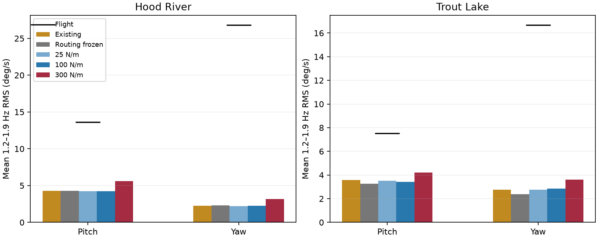
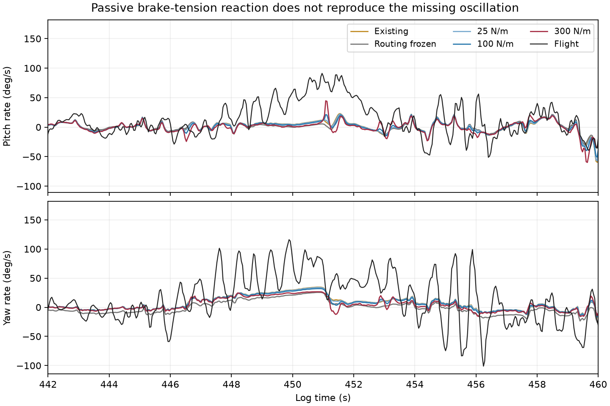
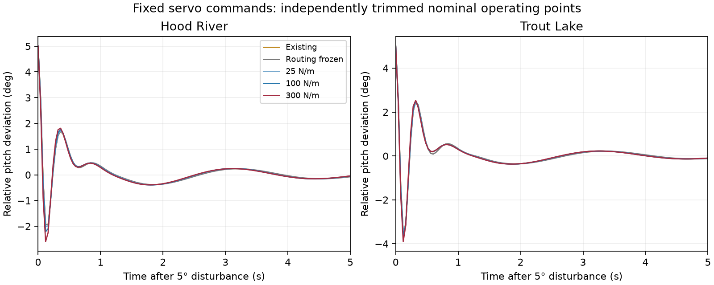

# Brake-tension feedback diagnostic

**The simplest passive brake-tension reaction hypothesis did not reproduce the missing coupled oscillation.** Existing routing feedback materially affects the powered turn, but adding tension reaction alone leaves the fast yaw motion far below the flight data. No tested successfully trimmed case developed a sustained oscillation with fixed servo commands. No physics calibration, LQI gains or deployed simulator was changed.

AI-assisted implementation and analysis, 2026-10-18.

## Question and scope

Can relative pitch change brake pull, which changes aerodynamic loading and mechanical brake-line reactions, producing the observed pitch/yaw oscillation without an oscillating servo command?

This is a mechanism test, not a parameter-identification campaign. Ten previously studied 30-second windows are used: Hood River 438, 760, 800 and 840 seconds; Trout Lake 300, 390, 540, 1440, 2100 and 2760 seconds. Each flight retains its own as-built mass, inertia, suspension geometry and brake offsets, with historical 132 mm riser spacing. These reused windows are not independent validation. Loader train/validation labels are administrative; there is no optimizer.

## Experimental mechanics

The existing model computes each line's routed length from payload and canopy orientation and adjusts effective brake pull. This experiment adds an effective, tension-only elastic resistance:

$$
b_i = \max(0, u_i + L_i - L_{i,0}), \qquad
T_i = k b_i, \qquad
U = \frac{1}{2} k \sum_i b_i^2.
$$

Here $u_i$ is offset-corrected commanded pull in meters. The swept stiffnesses are 25, 100 and 300 N/m, corresponding to 1.8, 7.2 and 21.6 N at 72 mm effective pull. They are hypotheses, not measured line or fabric stiffnesses. This is an effective trailing-edge resistance, not a claim that the suspension line itself stretches by the brake displacement.

Under the existing ideal point constraint, routed length depends on relative orientation. Virtual work gives the internal rotational loads:

$$
\boldsymbol{\tau}_{c}
= -\sum_i T_i\frac{\partial L_i}{\partial\boldsymbol{\theta}_{c}},
\qquad
\boldsymbol{\tau}_{p}=-\boldsymbol{\tau}_{c}.
$$

The route derivative is analytic. These reduced torques include ideal massless routing reactions and are applied before the shared point-constraint solve. This is not a resolved force distribution across deforming risers or canopy fabric. At fixed servo command the mechanical path is conservative: it cannot create energy by itself. Aerodynamic or propulsion feedback could still supply energy to a coupled instability.

A generic optional internal-torque entry point was added to the reusable Rust dynamics. Its ordinary entry point passes exactly zero. The research-only tension law, sweep and integration driver remain in this study; there are no new published parameters or binding/schema changes.

Five variants were evaluated:

- Existing routed model.
- Aerodynamic routing feedback frozen at the replay's initial path length, preserving initial effective pull.
- Existing routing plus each of the three tension stiffnesses.

Freezing a route for a replay is an ablation, not physical rerigging. In constant-command tests, the frozen path is held at the unperturbed trim value across all disturbances.

## Logged-input replay

Fifty prior-model replays completed. Twenty additional Hood River replays used the latest fitted coefficients, including fitted pull gain and command lag.

| Hood River powered turn, 447–456 s | Mean body yaw rate | 1.2–1.9 Hz yaw RMS over replay |
|---|---:|---:|
| Flight | 40.17 deg/s | 29.97 deg/s |
| Existing prior model | 16.23 deg/s | 1.96 deg/s |
| Routing feedback frozen | 8.12 deg/s | 1.96 deg/s |
| Tension 25 N/m | 15.89 deg/s | 1.90 deg/s |
| Tension 100 N/m | 14.79 deg/s | 1.82 deg/s |
| Tension 300 N/m | 11.44 deg/s | 2.07 deg/s |

The spectral metric excludes the initial two seconds and final 0.4 seconds, using the same established Welch procedure as the identification pipeline. Its interval differs from the 447–456 second turn-mean interval.

Routing feedback helps generate the mean powered turn but is not producing the missing fast oscillation in this model. Adding passive tension generally weakens that turn. Using the recent Hood River fit raises the baseline powered-turn replay's fast yaw RMS to 6.71 deg/s; tension variants give 6.50, 6.06 and 5.91 deg/s. That sensitivity does not reverse the conclusion.

Across all windows, the strongest tension case raises mean fast yaw RMS from 2.28 to 3.19 deg/s at Hood River (flight: 26.80), and 2.75 to 3.62 deg/s at Trout Lake (flight: 16.66). It also worsens mean roll-rate RMSE by 7.2% and 13.7%, respectively. Small improvements in some channels at weaker stiffness are not a coherent explanation of the observed motion.

## Constant-command disturbances

We attempted 45 independently trimmed combinations:

- Hood River prior and recent fitted coefficients; Trout Lake prior.
- Common command fractions 0.02, 0.10 and 0.30.
- All five feedback variants.

Each accepted trim was tested with 0, 1, 5 and 15 degree relative-pitch disturbances for 40 seconds, with constant servo commands and no imposed turbulence. The zero-disturbance trajectory is subtracted before evaluating disturbance decay. The fitted brake-command lag has no input transient because commands start at steady actuator pull.

**35 trims passed the unchanged 1e-6 equilibrium-residual threshold**, yielding 35 zero-disturbance controls and 105 disturbed trajectories. Every disturbance decayed. The largest ratio of late (30–40 s) to early (1–5 s) relative-angle RMS was 0.00112, or about 0.112%. The largest late relative-angle RMS was 0.000532 degrees.

**All ten Hood River low-common-command cases failed trim**, including the unchanged baseline, with residuals 0.00236–0.01284. Those operating conditions are unresolved, not classified stable or unstable. The test does not establish absence of a limit cycle near an untrimmed/slack operating point or in a sustained turning condition.

## Verification

- The zero-tension research driver matches the installed Rust baseline to a maximum state-component difference of 1.3e-12 across all ten flight windows.
- Doubling integration substeps from 32 to 64 changes state components by at most 8.9e-6 in the four selected resolution checks. The state components have mixed physical units; this is a numerical comparison, not a physical error metric.
- Three research Rust tests cover slack/zero loads, left/right symmetry, and agreement between reaction torque and elastic-energy virtual work.
- The reusable Rust core test suite passes.
- Repository package-boundary and selected-release integrity checks pass.

## Interpretation

This negative result narrows the hypothesis: **a quasi-static tension-only elastic reaction, added to the existing routing and aerodynamics with the existing suspension damping, is insufficient.** It does not prove that real brake mechanics are irrelevant.

Unmeasured routing geometry, load-dependent servo motion, canopy deformation and its phase lag remain outside this experiment. The existing effective suspension coefficients might already absorb part of brake-line behavior, so double counting remains possible. The fitted Hood River sensitivity addresses one damping choice but does not identify the correct damping. The real tension-vs-deflection relationship could also differ substantially from the swept spring law.

Before adopting extra coefficients, the most useful physical check is a restrained rig measurement of brake force versus commanded pull and payload pitch/roll, including line slack and guide motion. That would establish the sign and magnitude of the missing mechanical path. Additional model work should be tested against both flights and the pitch/yaw phase relationship, not selected only for stronger oscillation.

## Reproduction

Build/test this study with Cargo using its Cargo.toml, then run run.py, checks.py and constant.py with the installed control Python environment. Run report.py with the research environment for Matplotlib. The existing externally stored prepared logs are required; session.json and manifest.json record their locations and hashes.

The study uses the reusable Rust core directly and independently checks parity with the installed Python binding. It does not rebuild or publish browser firmware. Raw inputs and trajectory arrays are reproducible local outputs under inputs/ and traces/, excluded from Git. Numerical summaries, protocols, source, figures and failed trim results are retained.
