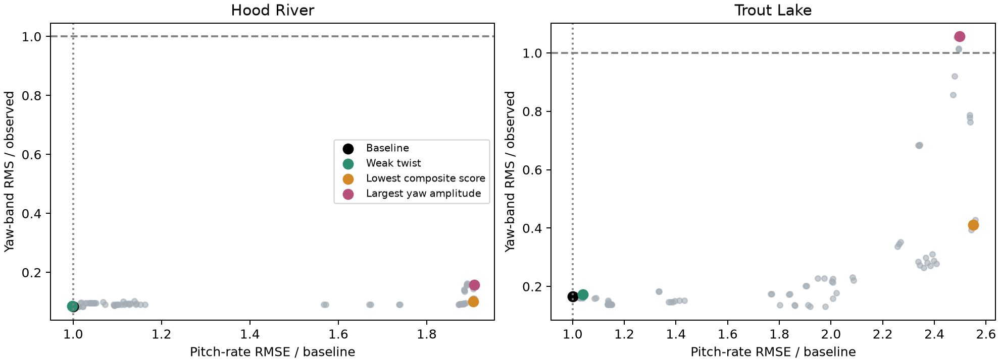

# Minimal asymmetric canopy-twist experiment

AI-assisted research, 2026-10-18. No maintained simulator physics, ArduPilot gains, browser UI or deployment changed.

## Result

The extension can create growing coupled motion, but no tested case is accepted as an explanation of the observed flight response. Weak, stable coupling barely changes the missing oscillation. Strong coupling can reproduce Trout Lake's band amplitude while degrading instantaneous pitch/yaw prediction and failing to reproduce Hood River. The lowest composite score is therefore rejected.

## Model

One deformation coordinate and its rate are added in this research-only Rust executable. Each panel twists in proportion to its normalized span coordinate. Incidence, force direction, center-of-pressure position and local velocity change with twist, including motion-induced local airflow. The undeformed load is subtracted before applying modified loads through the existing external-wrench interface.

The mode coordinate $\eta$ follows

$$
J_\eta\ddot\eta+2\zeta\omega J_\eta\dot\eta+J_\eta\omega^2(\eta+\eta^3/\eta_s^2)=Q_{\rm panels}+Q_\beta.
$$

Here $J_\eta=0.001$ kg m², $\eta_s=0.35$ rad, $\omega=2\pi f$, and $Q_{\rm panels}=\sum_i(\partial\mathbf r_i/\partial\eta)\cdot\mathbf F_i$. The optional phenomenological side-load term is $Q_\beta=J_\eta\omega^2g_\beta\beta(V/4)^2$. Panel pitch is $s_i\eta$, with $s_i=-0.8,-0.4,0,0.4,0.8$. Reported twist angles are modal coordinates; outer modeled panels see 0.8 times that angle.

Stiffness and damping are positive; the cubic spring stiffens the response. There is no prescribed oscillation or negative structural damping. Panel aerodynamic feedback can nevertheless create instability. The generalized panel force matches virtual work for the chosen center-of-pressure displacement.

Elastic-axis-to-center-of-pressure offset has both signs in the sweep. These offsets, modal inertia, unloaded frequency, damping, side-load coefficient and mode shape are unmeasured hypotheses. This is a reduced-order aerodynamic feedback experiment, not a fully energy-consistent flexible multibody implementation: rigid/modal inertial cross terms, deformation changes to added mass, fabric inflation/pressure and sectional aerodynamic pitching moments in the deformation equation are omitted. The rigid canopy pitching-moment law remains active. Instability boundaries must not be treated as physical flutter predictions.

## Protocol

89 variants × ten 30-second historical windows = 890 replays. The first grid contains baseline plus 72 combinations: unloaded frequency 1, 1.6, 2.5 Hz; damping ratio 0.15 or 0.5; signed offset/chord -0.08, -0.03, 0.03, 0.08; side-load gain -0.2, 0, 0.2. A follow-up weak-coupling grid adds 16 cases: 2.5 or 4 Hz, damping 0.3 or 0.7, offsets/chord ±0.005 or ±0.01, zero side-load gain.

Every variant uses shared canopy parameters for both flights, their as-built payload geometries and 132 mm riser spacing, existing initial canopy-attitude inference and measured actuator commands. Initial modal twist/rate are zero. No hidden forcing is fitted to the measured gyro. All windows were previously studied; there is no independent held-out flight or parameter-identification claim.

Sixty replays hit the invalid/>1 rad twist guard and are retained as failed, not silently excluded from counts. The other 830 completed. Completed cases with large deformation are still not automatically credible.

## Flight response

Window-mean uncentered body-rate RMSE and 1.2–1.9 Hz yaw RMS, in deg/s:

| Flight / case | Observed yaw-band RMS | Predicted yaw-band RMS | Pitch RMSE | Yaw RMSE |
|---|---:|---:|---:|---:|
| hood_river / Baseline | 26.80 | 2.28 | 26.79 | 37.99 |
| hood_river / Weak twist | 26.80 | 2.31 | 26.75 | 38.74 |
| hood_river / Lowest composite score | 26.80 | 2.70 | 51.04 | 64.08 |
| hood_river / Largest yaw amplitude | 26.80 | 4.23 | 51.09 | 64.58 |
| trout_lake / Baseline | 16.66 | 2.75 | 17.75 | 25.13 |
| trout_lake / Weak twist | 16.66 | 2.89 | 18.45 | 26.20 |
| trout_lake / Lowest composite score | 16.66 | 6.85 | 45.26 | 53.09 |
| trout_lake / Largest yaw amplitude | 16.66 | 17.60 | 44.33 | 54.50 |

The largest-amplitude case is f1.0-d0.15-a-0.03-b0.2. It generates 17.60 deg/s yaw-band RMS in Trout Lake versus 16.66 observed, but only 4.23 versus 26.80 in Hood River. Pitch RMSE worsens from 17.75 to 44.33 in Trout Lake and 26.79 to 51.09 in Hood River. Yaw errors also increase substantially.

Its mean pitch/yaw phase error improves from 92° to 40° in Trout Lake, but worsens from 87° to 115° in Hood River. It is not a transferable match of the coupling. The lowest-composite-score case improves that score approximately 20% across the ten windows while substantially degrading raw-rate errors; amplitude-sensitive aggregate scoring is not an acceptance gate.

## Equilibrium and stability

Six diagnostic variants were evaluated in both configurations, using 12 mm nominal common effective brake. The differential search spans almost the full both-brakes-engaged range; two positive-offset cases fail equilibrium convergence and receive no modal/decay interpretation. Ten equilibria meet maximum residual 1e-4.

The finite-difference modal chart contains 15 rigid-body coordinates plus twist and twist rate. RPM perturbations are excluded; the nonlinear fixed-command simulations allow causal RPM evolution. Neutral heading and disabled baseline twist coordinates are not treated as physical instability.

| Flight / case | Largest real eigenvalue (1/s) | Associated frequency (Hz) |
|---|---:|---:|
| hood_river / Baseline | 0.000 | 0.000 |
| hood_river / Lowest composite score | 0.284 | 0.000 |
| hood_river / Largest yaw amplitude | 0.288 | 0.000 |
| hood_river / Weak twist | 0.000 | 0.000 |
| trout_lake / Baseline | 0.000 | 0.000 |
| trout_lake / Lowest composite score | 0.243 | 0.000 |
| trout_lake / Largest yaw amplitude | 0.526 | 1.237 |
| trout_lake / Weak twist | 0.000 | 0.000 |

The weak case is locally stable apart from neutral heading and decays after 1°, 5° and 15° modal perturbations and a 5° canopy-pitch perturbation. The lowest-score strong case has nonoscillatory divergence in both configurations; it should not be described as a matched self-sustaining oscillation. The largest-amplitude case has a growing oscillatory mode near 1.10 Hz in Hood River and 1.24 Hz in Trout Lake, along with other unstable behavior. Those are not a demonstrated match to the pervasive ~1.6 Hz component. They also do not establish an explanation for the separately observed 1.16 Hz CRUISE episode.

Forty-second nonlinear perturbation checks are retained in constant-results.json. Late nonzero displacement can include drift toward a different equilibrium or turning condition; it does not by itself establish a limit cycle.

## Verification

Five Rust tests pass: zero-twist panel parity, no symmetric-flow twist forcing, structural restoring/damping signs, mirrored lateral response, and generalized-load virtual work. Disabled-extension logged replay matches the installed native baseline to 1.3e-12 in state coordinates.

160 numerical/initialization checks completed with no failures. Across the six diagnostic variants and ten windows, doubling integration resolution from 32 to 64 substeps changes body rates by at most 0.004136 deg/s.

Initial twist ±5° changes the largest-amplitude case's mean yaw-band RMS from 12.25 to approximately 11.62–12.71 deg/s across both flights. The weak case stays near 2.66 deg/s. This sensitivity does not rescue the cross-configuration mismatch.

## Decision

No promotion or LQI retune. This experiment demonstrates that an added deformation feedback path can produce instability and larger motion, but does not identify the real aircraft mechanism. The assumed twist shape and force path are not supported strongly enough to justify more unrestricted coefficient fitting. Video review should discriminate antisymmetric twist, symmetric camber/breathing, tip motion and payload-relative motion before selecting a more elaborate deformation model.

## Reproduce

Build/test this standalone crate with cargo test --release and cargo build --release. Run run.py, constant.py and checks.py with control/.venv/bin/python; run report.py with research/.venv/bin/python. run.py recomputes the full grid on each invocation. selected-diagnostics.json records the diagnostic selection, not accepted parameter estimates. Dense traces and the binary are ignored; summaries, failures and input hashes are retained.
