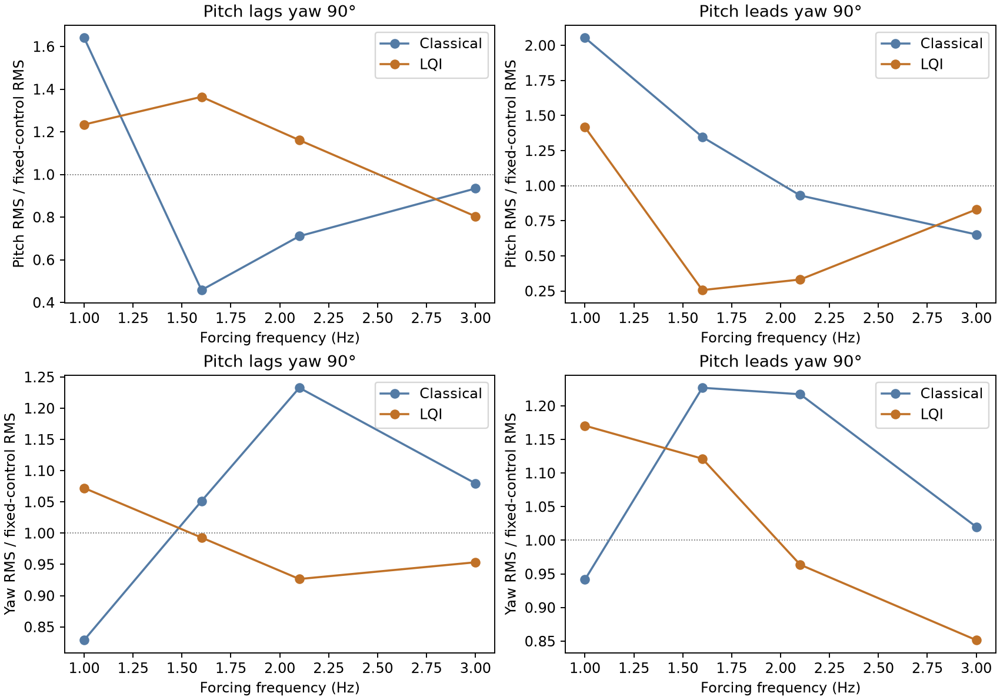
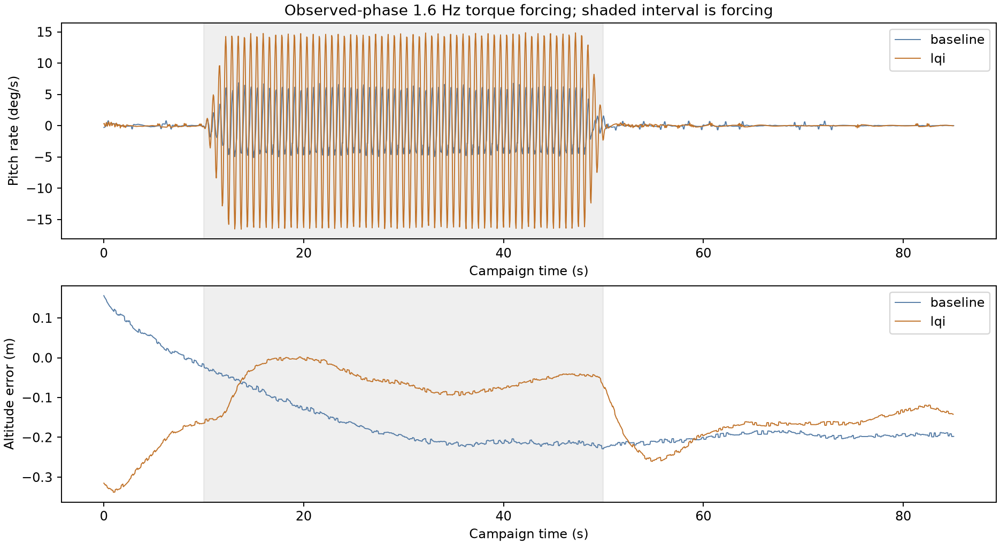
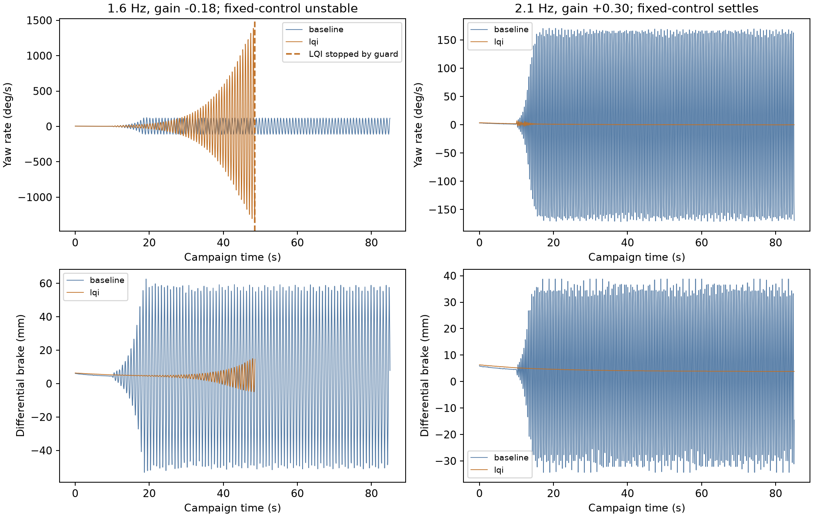

# Controller robustness to a missing coupled mode

The deployed LQI is **not uniformly more robust** than the classical controller. It recovers from all tested periodic torque disturbances, including doubled forcing, but passes more pitch motion at the observed phase near $1.6$ Hz. With a responsive synthetic mode, each controller has cases where it performs substantially better than the other. This is sensitivity evidence, not identification of the missing flight physics or clearance to expand the flight envelope.

No gains, production physics, firmware, or published simulator were changed.

## Campaign

**56 ArduPilot-in-the-loop runs:** 46 initial runs, six boundary/forcing follow-ups, and four responsive-case confirmations. Each launches, settles near $80$ m, selects CRUISE and its controller, then runs up to $85$ simulated seconds. The deployed WASM firmware, selected gain file, EKF3, actuator dynamics and browser sensor path stay in the loop. All logs confirm EKF3 activation and gain-file loading; classical runs disable the custom controller.

The selected as-built Trout Lake configuration has $132$ mm riser spacing. It uses the existing observer, no airspeed sensor and no canopy truth feedback. Weather is calm: this isolates the uncertain mode rather than combining it with turbulence or randomized aircraft parameters.

[Runtime manifest](runtime-manifest.json) pins firmware, production/experimental physics, gains, configuration and relevant source hashes. The selected controller is refit_damped. Torques enter the Rust dynamics before sensor generation; states and gyro measurements are not overwritten.

## Periodic forcing

Fixed-control calibration targets yaw-rate RMS $20$ deg/s, pitch-rate RMS $8$ deg/s, and pitch lagging or leading yaw by $90^\circ$. Lagging represents the measured phase relationship. The same calibrated forcing is used for both controllers.

Torque ramps on during seconds 10–12 and off during 48–50. Response is fitted sinusoidal RMS over seconds 20–45; recovery is assessed over 65–85.

| Pitch lagging yaw | Classical pitch RMS | LQI pitch RMS | Classical yaw RMS | LQI yaw RMS |
|---|---:|---:|---:|---:|
| $1.0$ Hz | $13.1$ deg/s | $9.9$ deg/s | $16.6$ deg/s | $21.4$ deg/s |
| $1.6$ Hz | $3.7$ deg/s | $10.9$ deg/s | $21.0$ deg/s | $19.9$ deg/s |
| $2.1$ Hz | $5.7$ deg/s | $9.3$ deg/s | $24.7$ deg/s | $18.5$ deg/s |
| $3.0$ Hz | $7.5$ deg/s | $6.4$ deg/s | $21.6$ deg/s | $19.1$ deg/s |
| $1.6$ Hz, doubled torque | $11.4$ deg/s | $19.1$ deg/s | $42.6$ deg/s | $39.1$ deg/s |
| $2.1$ Hz, doubled torque | $11.5$ deg/s | $16.6$ deg/s | $44.8$ deg/s | $37.6$ deg/s |

At $1.6$ Hz, reversing phase reverses the pitch ranking: classical $10.8$ deg/s versus LQI $2.1$ deg/s. Frequency alone cannot characterize this uncertainty.

All constant-reference forcing cases finish and return to about $0.1$–$0.2$ deg/s late body-rate fluctuations. At observed-phase $1.6$ Hz, LQI altitude-error RMS is $0.07$ m versus classical $0.20$ m. The pitch-rate results correspond approximately to sinusoidal pitch excursions of $\pm1.5^\circ$ versus $\pm0.5^\circ$, not loss of attitude control.

Repeating that case gives classical pitch/yaw RMS $3.9/22.8$ deg/s and LQI $10.9/19.9$ deg/s. Startup/scheduling variation affects exact values, especially classical yaw; the pitch ranking repeats. These are paired scenarios with limited repeats, not Monte Carlo confidence intervals.

Doubling forcing does not simply double response: classical pitch at $1.6$ Hz rises from $3.7$ to $11.4$ deg/s. These runs preserve nonlinear effects rather than assuming superposition.

## Responsive mode

An imposed sinusoid cannot establish whether control action excites missing dynamics. A second experiment introduces a latent coordinate $q$:

$$
\ddot q+2\zeta\omega\dot q+\omega^2q
=\omega^2\left(\frac{r_{\mathrm{relative}}}{\omega}
+0.2\frac{u_R-u_L}{0.072\,\mathrm{m}}\right).
$$

Here $r_{\mathrm{relative}}$ is canopy-minus-payload angular velocity projected onto payload yaw; $u_R,u_L$ are brake pulls. The coordinate produces payload-body torque and equal-opposite canopy world torque:

$$
\boldsymbol\tau_p=[0,\;0.4gq,\;gq]^T,\qquad
\boldsymbol\tau_c=-R_p\boldsymbol\tau_p.
$$

A small external yaw torque seeds the mode during seconds 10–12; feedback remains active thereafter. Nominal oscillator frequency is $\omega/(2\pi)$, not necessarily the final closed-loop frequency.

This is **phenomenological signed feedback uncertainty**, not a passive structural model or fitted aeroelastic mode. Its gain, damping and brake coupling are not flight measurements. Equal-opposite moments do not establish passivity or a credible energy budget. Extreme excursions are failure indicators, not credible flight predictions.

The initial sweep uses $\zeta=0.05$, $g=\{-0.30,-0.08,+0.08,+0.30\}$ Nm/rad at $1.6$ and $2.1$ Hz. Two maneuver cases use $\zeta=0.20$. Follow-ups bracket the adverse $1.6$ Hz case at $g=-0.12,-0.18$ Nm/rad.

| Responsive case | Fixed controls | Classical | LQI |
|---|---|---|---|
| $1.6$ Hz, $g=-0.12$ | Decays; late yaw $0.025$ deg/s | Late yaw $1.1$ deg/s | Late yaw about $0.1$ deg/s |
| $1.6$ Hz, $g=-0.18$ | Unstable | Sustained motion; late yaw $80.1$ deg/s | Diverges; estimated-attitude guard at $48.6$ s |
| $1.6$ Hz, $g=-0.30$ | Unstable | Guard at $77.3$ s | Custom controller suspended at $27.7$ s |
| $2.1$ Hz, $g=-0.30$ | Unstable | Late yaw $72.6$ deg/s | Late yaw $0.7$ deg/s within this horizon |
| $2.1$ Hz, $g=+0.30$ | Settles | Sustained oscillation; late yaw $118.8$ deg/s | Settles; late yaw about $0.1$ deg/s |

Late RMS here is standard deviation over seconds 65–85, with feedback still enabled. Repeating the adverse boundary gives LQI's guard again at $48.6$ s and classical late yaw $79.1$ deg/s. Repeating positive $2.1$ Hz gives classical $106.6$ deg/s and LQI $0.06$ deg/s. Onset and amplitude vary; the qualitative results repeat.

The adverse $1.6$ Hz case does not establish that LQI destabilizes a stable aircraft: that synthetic plant is already unstable with fixed controls. It demonstrates weaker stabilization of that uncertainty. The positive $2.1$ Hz case does show controller-induced oscillation in this synthetic model because the fixed-control plant settles.

**Completion is not a stability pass.** Of 56 runs, 52 finish and four stop, including a repeated failure. Five completed non-maneuver runs still have late body-rate fluctuations above $5$ deg/s, including repeats. This is a descriptive post-analysis flag, not a preregistered acceptance threshold.

Guards use AP estimated attitude ($60^\circ$ roll, $45^\circ$ pitch), physical height $15$ m, and controller ownership. In severe LQI cases the EKF estimate also departs from truth. At the $-0.18$ boundary true rates exceed $1000$ deg/s while estimated pitch triggers the guard; true pitch peaks near $23^\circ$. This is unacceptable growing motion and estimator/controller failure, not proof of physical pitch exceeding $45^\circ$. The strongest LQI case logs custom-controller suspension.

## Maneuvers, actuators and power

The combined maneuver applies positive then negative turn input with climb then descent, followed by return to the altitude reference. Both finish under forcing. LQI recovers to late pitch-rate fluctuations around $0.1$ deg/s; classical retains about $4.3$ deg/s versus $3.5$ deg/s in its quiet maneuver.

The controller paths have different vertical command limits. This is a matched pilot-input exercise, not an identical altitude-trajectory benchmark. Compare each against its own quiet maneuver.

At observed-phase $1.6$ Hz, total brake travel is $47.5$ mm/s for classical versus $0.9$ mm/s for LQI. Improved altitude tracking need not imply stronger pitch rejection. These results do not isolate observer versus feedback contributions.

In positive $2.1$ Hz responsive feedback, classical reaches simulated brake slew limits in about $60\%$ of sampled intervals over the full run; LQI does not. Nonlinear actuator interaction is part of the result.

Steady forcing cases remain near $74$ W modeled shaft power with small differences. This excludes servo electrical consumption and is not battery power. Classical maneuver samples sometimes leave the propulsion table; those aggregate powers are reported unavailable instead of extrapolated or zero-filled.

## Verification and evidence

- Zero-torque integration matches production exactly in the 100-step parity check.
- Eight nonlinear calibration checks recover approximately $20$ deg/s yaw RMS, ratio $0.40$ and requested phase.
- Halving integration substeps changes representative forcing rates by at most $0.000006$ deg/s and a settling responsive case by $0.012$ deg/s over 55 seconds. This is not an independent convergence proof for every extreme closed-loop run.
- Release hashes match, and all 56 logs confirm EKF3 and gain loading.
- Critical cases were repeated. Full traces and logs are in [evidence.tar.gz](evidence.tar.gz), with [checksums](evidence-manifest.json).
- [Metrics](metrics.json) retain dynamics, tracking, actuators, power and estimator errors. [Summary](summary.json) distinguishes completion from unacceptable late motion.

## Reproduction

Use the existing control/research Python environments, viewer dependencies, Rust WASM target and wasm-bindgen 0.2.114. Tool paths in build.py, campaign.py and followup.py reflect this machine and can be adjusted elsewhere.

1. Extract evidence.tar.gz into this study directory, then run validate.py with the control Python environment.
2. Run build.py to compile isolated physics and copy the selected AP runtime.
3. Run calibrate.mjs with Node, fit-calibration.py with control Python, then verify-calibration.mjs with Node. The Python script checks independent reconstruction within tolerance; forcing-calibration.json freezes the exact campaign input.
4. Run campaign.py, followup.py and confirm.py in that order.
5. Run open-mode.mjs, open-boundary.mjs and numerics.mjs for fixed-control and integration checks.
6. Run assess.py with control Python and plot.py with research Python. pack-evidence.py refreshes the archive when deliberately replacing evidence.

## Decision

Keep the tune and flight envelope unchanged. Next test observer bandwidth/phase, feedback shaping and actuator dynamics separately, targeting the observed lagging-phase pitch response around $1.5$–$2.2$ Hz. Preserve the positive $2.1$ Hz responsive case as a regression test. Require recovery, bounded actuation and acceptable instantaneous motion before optimizing power or a combined score.

The synthetic boundary cannot be translated into flight risk until data constrains coupling gain, damping and direction. This campaign exposes failure modes missed by imposed-disturbance tests alone; it does not settle whether the actual missing mode is aeroelastic.
