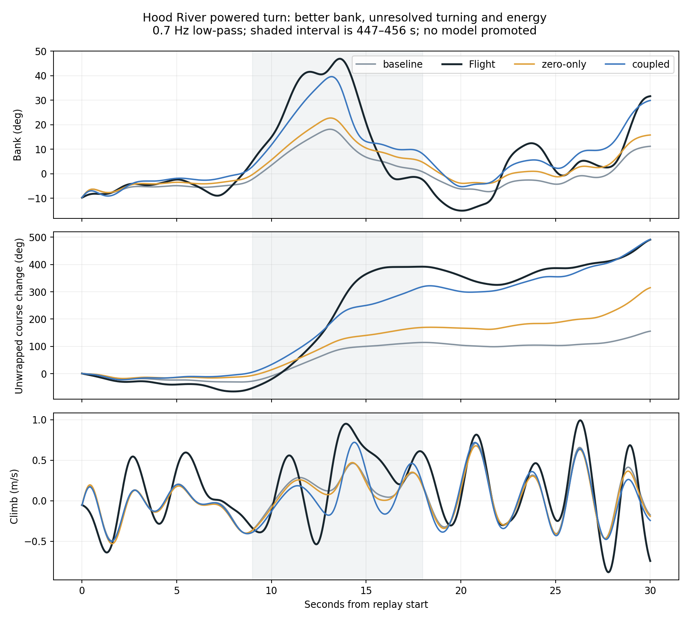
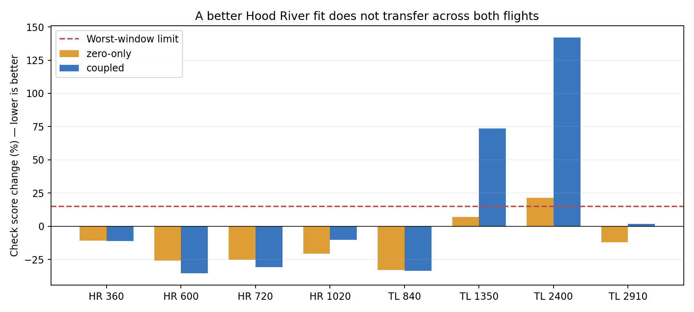

# Coupled brake-load identification, 2026-10-18

**Neither candidate qualifies for promotion.** The combined candidate produces a stronger Hood River powered turn, but worsens the mean check-window score by 12.0% and fails the vertical-motion and cross-flight gates. The deployed model, browser runtime, and LQI gains are unchanged.

## What was tested

The historical **132 mm** riser spacing and each flight's existing mass, geometry, propulsion, and aerodynamic baseline were retained. Only existing Hood River (January 3) and Trout Lake (February 15) flight logs were used. This is not a calibration for the planned 185 mm configuration.

Two optional, default-zero Rust panel-model parameters were added:

- `brake_cp_shift`: aft displacement of the aerodynamic application point, in chord fractions per normalized brake. It changes local flow and the force moment together; there is no independent pitch-torque fit. The displacement uses brake clamped to [0, 1].
- `brake_outboard_fraction`: interpolation from uniform panel brake loading toward weights [2, 0.5, 0, 0.5, 2]. This preserves summed brake loading, not lift or drag (the aerodynamic response is nonlinear).

These are quasi-static effective-load hypotheses, not resolved fabric deformation. The coupled family also fits the existing residual yaw coefficient `Cndelta`. Bounds are CP shift 0–0.3 chords, outboard fraction 0–1, yaw coefficient 0–0.035. Each flight's left/right brake zero may move by at most 3 mm relative to its current calibration. A separate **zero-only** family fits only those four nuisance offsets, to distinguish recalibration from added physics.

Legacy 70-element packed parameters and JSON configurations still work; the new 72-element layout appends both fields. Both default to zero. Python and TypeScript schemas were regenerated; no browser WASM was published.

## Frozen procedure

`protocol.json` records windows, bounds, scales, and gates. Nine 30-second training windows include the powered turn. Eight other historical windows are evaluated at three initial canopy angles, only after both selections are written. These checks have been used in previous research; they are not independent flight validation. The powered turn is training evidence, not a held-out success.

A third-order zero-phase Butterworth filter at 0.7 Hz separates slower motion from faster body-rate residuals at the 25 Hz log sampling rate. The first and last two seconds are excluded from the loss. Course is unwrapped to avoid hiding complete rotations. The nine RMSE channels are scaled by [5 deg, 10 deg/s, 90 deg, 5 deg, 0.4 m/s, 1 m/s, 15 deg/s, 15 deg/s, 15 deg/s]. The loss weights lateral, longitudinal, and fast-rate groups 40/40/20%, with a small squared brake-zero penalty. These engineering weights are not a likelihood or a flight-safety metric.

Each family used two specified starts of bounded Powell search, capped at 96 objective evaluations each. Selection is the best finite evaluated point. This is a budget-limited search, **not evidence of a global optimum or uniquely identified physical parameters**. All evaluated objectives are retained in `optimization.json`. Wind and voltage remain fixed to the replay-start values; measured servo output is treated as brake command, not as a measured line pull.

## Results

| Quantity | Existing model | Brake zero only | Coupled candidate | Flight |
|---|---:|---:|---:|---:|
| Powered-turn course rotation | 141.9 deg | 175.9 deg | 313.2 deg | 443.9 deg |
| Peak absolute bank | 18.4 deg | 23.1 deg | 39.7 deg | 47.7 deg |
| Mean climb | 0.162 m/s | 0.140 m/s | 0.107 m/s | 0.285 m/s |
| Mean relative check score | 1.000 | 0.876 | 1.120 | — |
| Improved check windows | — | 6/8 | 5/8 | — |
| Worst check regression | — | +21.6% | +141.9% | — |

Turn statistics use unfiltered signals during 447–456 s, initialized at 438 s with canopy angle 0.35 rad. Check ratios are averaged over the three initializations and then over windows; they are **not percentages of physical error**. The coupled model's mean lateral group ratio is 2.156, longitudinal 0.827, and fast rates 1.000. In this experiment fast oscillations are essentially unchanged.





The selected coupled parameters are CP shift 0.1314 chords, outboard fraction 0.0100, and residual yaw coefficient 0.02163. Brake-zero changes are HR [-1.890, -1.237] mm and TL [+2.993, +0.753] mm. The Trout Lake left zero is at its allowed boundary. These are conditional fit values, not physical measurements.

## What the ablations tell us

Post-selection ablations are diagnostic only; no new model was selected from them.

| Coupled candidate variant | Course rotation | Peak bank | Mean climb |
|---|---:|---:|---:|
| All fitted terms | 313.2 deg | 39.7 deg | +0.107 m/s |
| Remove CP shift | 397.6 deg | 48.2 deg | -0.012 m/s |
| Remove outboard weighting | 312.3 deg | 39.6 deg | +0.108 m/s |
| Remove residual yaw term | 41.8 deg | 8.0 deg | +0.167 m/s |

Most of the improved turn authority depends on the residual yaw term. The aft load shift improves climb relative to that yaw-dominated configuration, while reducing turning. The fit supplies little support for stronger outboard weighting. It does not establish that these effects are absent on the actual canopy; only that this parameterization/search does not transfer satisfactorily across the available flights.

## Decision and next diagnostic

No model promotion and no LQI retuning. An average improvement from brake zeros alone is insufficient: it fails the worst-window limit and still misses the powered turn. The coupled candidate also fails average, lateral, and turn gates. Publishing it would overstate the evidence.

The next useful diagnostic is to localize the Trout Lake regressions (especially 1350 s and 2400 s) against effective left/right pull, throttle, speed, and brake saturation. A constant residual yaw coefficient may be compensating for nonlinear brake authority, line-routing/slack, or an erroneous command-to-pull mapping. Before adding another aerodynamic degree of freedom, compare short-window angular-acceleration and energy residuals across operating conditions, with bounded wind and brake-zero sensitivity. That should distinguish an input-calibration problem from missing state-dependent aerodynamics better than another long-trajectory scalar fit. A broader search remains possible, but should not be described as validation on these reused windows.

## Verification and reproduction

- Rust core tests pass, including mirror symmetry, aerodynamic power identity, brake-load sum, parameter limits, and legacy JSON/packed compatibility.
- 12 Python binding/routing/JSON backend/surface tests pass.
- Viewer TypeScript checks and production build pass.
- Halving the selected Hood River integration step (32 to 64 substeps per log interval) changes any reported RMSE by at most 1.21e-7 in that channel's units. Numerical integration does not explain the mismatch.
- Input hashes exactly match the earlier as-built calibration campaign.

From the repository root with the updated Rust Python extension installed:

```sh
uv run --project research python research/active/coupled-brake-2026-10-18/run.py
uv run --project research python research/active/coupled-brake-2026-10-18/audit.py
python research/active/coupled-brake-2026-10-18/plot.py
```

Plotting needs Matplotlib; fitting needs NumPy/SciPy and `microagu_sim`. Set `MICROAGU_REPLAY_DATA` to the existing replay input directory if the historical default path is unavailable. Full replay arrays are generated locally and ignored by Git; JSON protocols, selections, metrics, ablations, and figures are retained.
