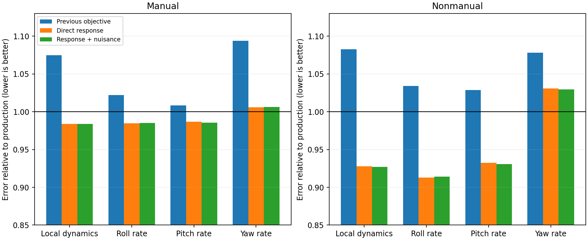
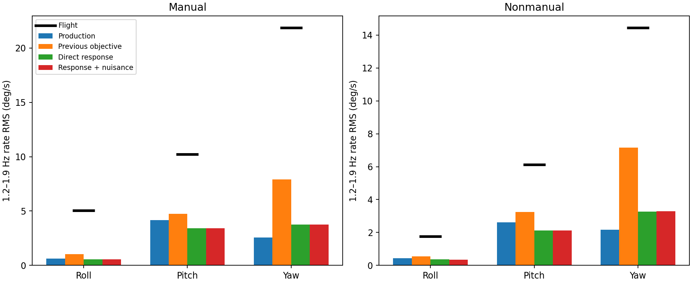
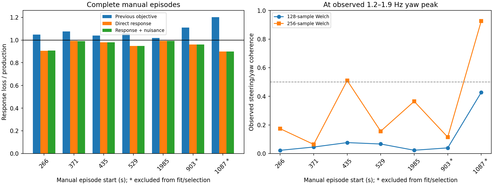

# Improved grey-box identification: first reusable pipeline

The direct-response objective improves local validation dynamics modestly; it does not resolve the missing oscillation response. Bounded wind/initial-state corrections help known-physics synthetic recovery but add little on the real flight. No production physics, firmware, LQI gain or browser deployment changed.

## Implemented

Reusable `microagu_control.sysid` modules provide validated prepared-log sessions, recorded-input Rust replay, the exact legacy objective, a direct-response objective, bounded per-training-window initial-angle/wind corrections, finite-difference least squares, sensitivity diagnostics, episode-isolated free-running evaluation, and `fit`/`validate` CLI operations with input/source manifests. Original inputs are read-only. No research-module imports or hidden deployment actions exist in the package.

This is the analysis foundation, not the complete workbench UI. Direct raw DataFlash ingestion, automatic maneuver discovery, full latent time-varying disturbance estimation, controller synthesis/install UI, and runtime gain loading are not implemented by this change. Prepared NPZ inputs use the existing causal extraction. Ground-wind CSV support is tested synthetically; these historical flights have no measured ground wind input.

## Protocol and scope

Five 20 s training windows from three manual episodes; three manual validation windows from two other episodes and nine non-manual validation windows. Every validation replay is repeated at initial canopy angles 0.25, 0.35 and 0.45 rad. These 36 replays are sensitivity cases, not 36 independent flights. All data are reused historical Trout Lake evidence. Complete declared episodes are separated and time overlap is rejected, but episode labels must be supplied correctly.

Use the same six exploratory parameter bounds and two starts as the previous study. Each start has a 2,000 individual-replay ceiling, counting finite-difference probes. Candidates are frozen by training cost before any validation. Validation never optimizes wind or initial states against its output. The new objective is the mean of normalized, uncentered rate error and Savitzky–Golay angular-acceleration error, plus the previous weak scale-factor regularization:

$$
J_{\mathrm{response}}=\tfrac12\operatorname{mean}[(e_\omega/s_\omega)^2]+\tfrac12\operatorname{mean}[(e_{\dot\omega}/s_{\dot\omega})^2]+J_{\mathrm{prior}}.
$$

The first 2 s and final 0.4 s are excluded as in the legacy study. Rate normalization floors are 1 deg/s; acceleration floors are 5 deg/s². These are engineering weights, not sensor-noise covariances or a calibrated likelihood. Rate/acceleration residuals share information. Spectral amplitude and phase no longer determine the new fit; they remain independent diagnostic outputs.

Optional nuisance variables are one initial canopy-angle offset (bounded +/-0.1 rad) and constant horizontal wind corrections (bounded +/-2 m/s) per training window. Prior scales are 0.1 rad and 2 m/s, with residual weight 0.02. Ground wind, if provided, substitutes a time-aligned slow horizontal mean and an explicit airborne-difference uncertainty. No sample-for-sample ground gust forcing or arbitrary latent force is inferred. Aircraft geometry and mass remain the as-built profile, including 132 mm spacing.

## Baseline reproduction

All five training scores reproduce exactly (maximum absolute difference zero). The legacy fitted parameter vector and objective reproduce the previous gradient study to numerical precision. This separates changes in estimation policy from packaging changes.

## Reserved-window results

Ratios below one improve on the production model. Local dynamics is the previous centered rate/acceleration metric. Response loss is the new uncentered rate/acceleration metric. Amplitude loss is squared log band-RMS mismatch, not the physical amplitude itself.

| Method | Windows | Local dynamics | Response loss | Yaw-rate RMSE | Amplitude loss |
|---|---|---:|---:|---:|---:|
| Previous objective | manual | 1.075 | 1.068 | 1.094 | 0.467 |
| Previous objective | nonmanual | 1.083 | 1.085 | 1.078 | 0.391 |
| Direct response | manual | 0.984 | 0.981 | 1.006 | 1.036 |
| Direct response | nonmanual | 0.928 | 0.929 | 1.031 | 1.021 |
| Response + nuisance | manual | 0.984 | 0.982 | 1.006 | 1.038 |
| Response + nuisance | nonmanual | 0.927 | 0.928 | 1.030 | 1.026 |

Direct-response fitting reduces local error 1.6% in manual windows and 7.2% in non-manual windows, compared with production. The legacy objective increases that error 7.5% and 8.3%. Roll and pitch account for most of the new improvement; yaw-rate RMSE is still 0.6% and 3.1% worse. Oscillation-amplitude loss becomes about 3.6% and 2.1% worse than production, respectively. This is a more useful local-dynamics compromise, not an across-the-board fidelity improvement.

Nuisance fitting changes the real-data validation results only slightly. It therefore remains optional. The source data do not establish that its wind corrections represent real wind; they may absorb other mismatch.

## Fitted parameters and limitations

| Parameter | Previous objective | Direct response | Response + nuisance |
|---|---:|---:|---:|
| Rotor inertia scale | 1.49147 | 0.89135 | 0.89272 |
| Yaw stiffness scale | 0.88316 | 0.81954 | 0.81239 |
| Yaw damping scale | 0.20000 | 0.20032 | 0.20068 |
| Pitch damping scale | 0.20264 | 1.22643 | 1.18468 |
| Pull gain | 1.14999 | 1.06938 | 1.06026 |
| Actuator lag (s) | 0.00049 | 0.12000 | 0.12000 |

Both direct-response fits reach the 120 ms lag upper bound and nearly the yaw-damping lower bound. This is an effective command-response parameter, not a measured servo time constant. It could absorb synchronization, routing, disturbance or model errors. Do not widen bounds or promote the candidate on this evidence alone. `audit.json` reports local response sensitivities and integration-resolution checks. The full conditional Jacobian can be rank deficient at zero lag; that is flagged rather than turned into a confidence interval.

## Known-physics synthetic experiments

Generate trajectories using the real Rust simulator at a known six-parameter vector, then fit with the reusable estimator. Two training windows and a third validation window use historical command patterns; the initial full state is known. This is an implementation/recovery test under the assumed model, not evidence that the real aircraft follows that model.

- **exact**: parameter-error norm in bound-width units 6.03903e-07; held-out response loss with known wind 1.48119e-14.
- **wind_bias_no_nuisance**: parameter-error norm in bound-width units 0.0128878; held-out response loss with known wind 0.000265282.
- **wind_bias_with_nuisance**: parameter-error norm in bound-width units 0.00542068; held-out response loss with known wind 0.000251345.

The noise-free case recovers all six parameters to within 0.0001% of their bound widths. With 0.1 deg/s Gaussian gyro noise and a deliberately biased wind prior (north +0.6 m/s, east -0.4 m/s), nuisance fitting reduces the parameter-error norm by about 58%, but that error was already small. Held-out response loss improves only about 5%. The fitted wind components do not recover the complete imposed bias, so this is not proof of an accurate wind estimator.

## Decision and next step

Keep the legacy baseline available and make direct-response fitting the transparent analysis default. Leave nuisance correction opt-in. Do not deploy these fitted aircraft parameters or retune LQI from them yet: yaw response and oscillation amplitude remain unresolved, with a lag-bound warning. The next physics investigation should audit input timing/routing and the command/yaw discrepancy across complete episodes, then determine whether a dynamic disturbance model is supported. Prospective flight data and ground-wind measurements remain necessary to establish generalization.

## Reproduction

Run `study.py`, `synthetic.py`, and `audit.py` with the simulation analysis environment, then `report.py` with NumPy/Matplotlib. Set `MICROAGU_REPLAY_DATA` to the prepared flight-data folder when needed. `session.json` records explicit input paths, segments and roles. The study asserts baseline equivalence before fitting. See the package README for the reusable CLI. CLI smoke-test artifacts demonstrate actual fit and validation execution; the smoke fit intentionally has a one-replay budget and is not a scientific result.

## Command-response phase audit

Common coherence-screened nominal-initialization windows; mean absolute circular error in degrees. Short-window feedback correlations are descriptive, not causal transfer functions.

| Group | Path | Windows | Production | Legacy | Response | Response + nuisance |
|---|---|---:|---:|---:|---:|---:|
| manual | differential_to_yaw | 0 | n/a | n/a | n/a | n/a |
| manual | common_to_pitch | 0 | n/a | n/a | n/a | n/a |
| nonmanual | differential_to_yaw | 0 | n/a | n/a | n/a | n/a |
| nonmanual | common_to_pitch | 0 | n/a | n/a | n/a | n/a |

## Full-episode follow-up: revise the short-window phase interpretation

The earlier approximately 165-degree command/yaw mismatch is not a robust plant-phase estimate. A 20 s record with a 256-sample Welch window yields only two overlapping averages after trimming. The original coherence threshold alone was insufficient to support that interpretation.

Across the five longer manual episodes, using 128-sample Welch windows and 10–26 overlapping averages, observed steering/yaw coherence at the oscillation peak is only about 0.02–0.08. The phase changes substantially with window length and is not a reliable discriminator between models here. Feedback, nonstationarity, coupled inputs and unmeasured disturbances can explain weak association; these data do not uniquely identify which mechanism dominates. The software now records the averaging count and refuses to label a two-average phase estimate interpretable, even if its coherence exceeds 0.5. A six-average minimum is an explicit quality heuristic, not a statistical significance guarantee or proof of causality. Historical scalar phase metrics remain unchanged for baseline reproduction.

Two additional manual episodes (903.80–926.12 and 1087.20–1106.00 s), excluded from this comparison's fitting/selection and previous 20 s gradient validation, improve direct-response loss by about 4.0% and 10.2% against production. The legacy candidate worsens it by about 11% and 20%. These remain historical same-flight checks; broader prior studies may have examined overlapping data. They strengthen evidence for the direct-response objective while leaving overall physics adequacy unresolved.

Causal source timestamps show 95th-percentile sample ages of about 20 ms for IMU and 40 ms for actuator outputs. There is no 120 ms sample-age discrepancy visible in this audit. This does not measure mechanical servo response, firmware/sensor internal latency, or prove perfect synchronization. The fitted lag remains a bound-limited effective parameter requiring separate physical investigation.
