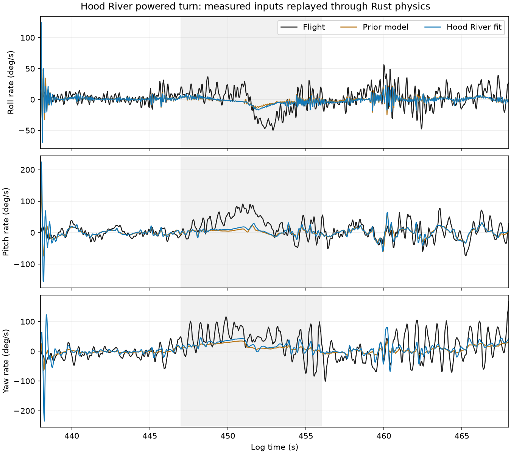

# Hood River configuration through the CLI pipeline

AI-assisted analysis, 2026-10-18. This study fits the 2026-01-03 flight and tests gain-only synthesis on the Hood River aircraft. It does not change the selected model, gains, firmware or browser deployment.

## Configuration and split

The explicit aircraft snapshot uses 1.385 kg total mass, Hood River inertia, 132 mm riser spacing, and the historical right-brake preload (right offset -6 mm). The default Trout Lake aircraft is 1.758 kg. Flight-specific geometry and trim seeds are used throughout; inherited aerodynamic coefficients remain prior estimates, not new measurements.

Training uses three 20-second windows starting at 760, 800 and 840 seconds, all from the MANUAL episode beginning at 745.584870 seconds. Ten evaluation windows come from three separate episodes: five earlier MANUAL windows and five FBWA windows. The 438–468 second powered-turn replay is reserved from this optimization. These are existing, previously studied data, not an independently unseen flight. The single training episode limits generalization.

The fit uses bounded finite-difference least squares, two starts, fixed wind/canopy nuisance corrections, and the existing response objective. Validation repeats each window with initial canopy angles of 0.25, 0.35 and 0.45 radians; these are sensitivity cases, not independent samples.

## Identification result

| Fitted quantity | Relative to prior |
|---|---:|
| Rotor spin inertia | 0.952 |
| Yaw spring stiffness | 0.888 |
| Yaw damping | 0.200 (lower bound) |
| Pitch damping | 0.225 |
| Brake pull gain | 1.150 (near upper bound) |
| Brake lag | 119.9 ms (near 120 ms upper bound) |

Both starts converged; their best training costs were 0.852 and 0.810. The selected cost improves approximately 10% over the nominal starting cost of 0.899. Bound contact and disagreement between starts mean these coefficients should not be interpreted as unique physical measurements.

| Reserved episode | Composite score change | Uncentered response-loss change |
|---|---:|---:|
| Earlier MANUAL | -31.1% | -6.5% |
| First FBWA | -26.5% | -0.5% |
| Second FBWA | -26.7% | -2.0% |

All 30 window/initialization comparisons improve the composite score. Much of that improvement is oscillation-amplitude matching. Rate RMSE changes are modest: the MANUAL episode improves roll/pitch/yaw errors by approximately 1.7/4.4/3.2%; FBWA pitch error worsens approximately 0.7–1.3%. Composite improvement alone is not evidence of an accurate model.

## Powered-turn dynamics

The diagnostic evaluates 447–456 seconds after replay initialization at 438 seconds. Values below use the central initial-angle case.

| Quantity | Flight | Prior model | Fitted model |
|---|---:|---:|---:|
| Mean body pitch rate (deg/s) | 26.6 | 3.6 | 5.7 |
| Mean body yaw rate (deg/s) | 40.2 | 16.2 | 20.9 |
| Body pitch-rate standard deviation (deg/s) | 32.5 | 7.3 | 9.6 |
| Body yaw-rate standard deviation (deg/s) | 40.5 | 9.4 | 13.1 |

Pitch-rate RMSE falls from 37.0 to 34.4 deg/s; yaw-rate RMSE falls from 43.7 to 39.1 deg/s. The model still misses much of the coupled motion and turn response. These are body-axis rates, not heading rate. This conclusion concerns instantaneous dynamics, not accumulated position drift.

## Controller synthesis

Four candidates pass the observer-in-loop local stability screen across seven model variants. The candidate with increased pitch-rate weight, refit_damped, has the highest worst-case oscillatory damping ratio: 0.106 versus 0.0755 for the deployed reference.

The synthesis keeps the deployed observer, normalization, reference map and trim context fixed and changes feedback/anti-windup gains only. It is not a fully regenerated Hood River controller. Local stability is not nonlinear flight qualification.

An initial trim attempt failed because its starting differential command lay on the wrong branch of the unilateral brake map. The maintained solver now tries the opposite branch if its first solve fails the unchanged residual threshold. Hood River then reaches equilibrium to about 1e-13 residual. The failed attempt is retained in design/failure.txt; successful synthesis is in design-v2/.

## Nonlinear AP/EKF campaign

Six flights used the packaged ArduPlane WASM with EKF, no pitot and no canopy truth: prior/fitted Hood River physics crossed with deployed reference, identical reference repeat, and refit_damped. The candidate completed both cases; the reference and repeat failed the prior-model case with “Unexpected controller ownership” at the five-second engagement deadline. Their logs report the custom controller enabled but not running. The recorded diagnostics do not identify which validity condition prevented engagement; this is not proof of aerodynamic instability.

All three fitted-model flights completed. Against the primary reference in that one successful pair, the candidate reduced relative pitch-rate RMS by 22.3% and peak by 38.9%; shaft power changed +0.14%. Climb tracking error changed +0.9%, descent -2.1%, vertical error +5.9%, and crosswind error -43.3%. This single pair cannot establish robust improvement, especially with the failed prior-model reference runs and variability in the identical-reference repeat.

The campaign correctly returns no selected candidate and deploy=false. No reserved scenario or mission qualification was attempted after that failed gate. The useful result is a configuration-correct identification/synthesis run and a concrete engagement problem to investigate before further controller qualification. The model still underpredicts the powered turn, so feedback-gain improvement should not be confused with improved flight-test confidence.

## Reproduction and evidence

Use the installed control CLI from the repository root (uv run --project control python, or control/.venv/bin/python). Commands:

1. python -m microagu_control.pipeline init aircraft.json --flight hood_river
2. python -m microagu_control.sysid fit research/active/hood-river-pipeline-2026-10-18/session.json NEW_FIT
3. python -m microagu_control.sysid validate research/active/hood-river-pipeline-2026-10-18/session.json NEW_VALIDATION --fit-result NEW_FIT/fit.json
4. python -m microagu_control.pipeline run research/active/hood-river-pipeline-2026-10-18/controller-protocol.json NEW_DESIGN
5. python -m microagu_control.pipeline campaign NEW_DESIGN research/active/hood-river-pipeline-2026-10-18/campaign-protocol.json /absolute/path/arduplane.js viewer NEW_CAMPAIGN --workers 3
6. python research/active/hood-river-pipeline-2026-10-18/inspect_turn.py

Update protocol fit paths when creating new fit outputs. Session inputs are external prepared flight-log files; their hashes, physical-profile hash and native/source hashes are recorded in manifests. Raw logs and copied campaign firmware are not committed.

The adapter tests compare both aircraft configurations with their established simulator profiles, and an actual Hood River trim test exercises the opposite brake branch. All 33 control tests pass, including the ArduPilot gain decoder; repository boundary and selected-release integrity checks pass.
