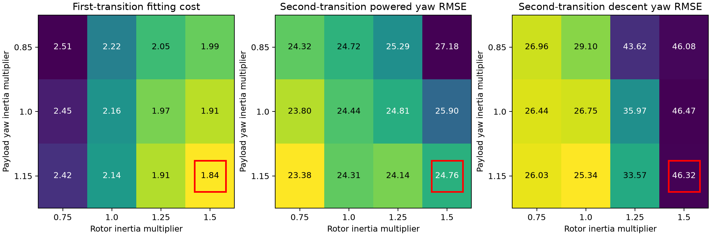

# Inertia-profile identification

## Decision

No promotion. Profiling payload yaw inertia and rotor spin inertia does not resolve the powered/unpowered waveform mismatch. The minimum training objective lies at the high-inertia corner of the tested grid, while every cell worsens first-transition yaw-rate RMSE relative to the unchanged model. The prior improvement from perturbing payload inertia alone disappears after damping and stiffness are refitted.

## Protocol

Reuse the previous study's continuous measured-RPM Rust backend, flight records, residual definition, and initialization. Fit only Trout Lake 3350–3380 s. Profile payload yaw inertia multipliers 0.85, 1.0, 1.15 and rotor spin inertia multipliers 0.75, 1.0, 1.25, 1.5. These are engineering sensitivity ranges, not independently measured confidence bounds. Geometry and mass remain fixed; changing payload yaw inertia also scales the associated products of inertia by the square root of the multiplier to preserve positive definiteness.

At each of 12 cells, fix both inertias and refit yaw stiffness, yaw damping, pitch damping, initial canopy pitch/yaw and horizontal wind corrections using the original bounds and objective. Run two starting points per cell. All 24 fits terminate successfully, totaling 1648 optimizer residual evaluations. This is evidence of local repeatability, not a global-optimum proof.

Freeze the minimum first-transition-cost cell in `selection.json` before replaying any transfer window. Replay the second Trout Lake transition and two Hood River transitions without retuning mechanical parameters. Their nuisance corrections remain zero, as in the prior study. All episodes have been inspected in earlier work, so this is fit-isolated transfer checking, not an unseen dataset. The post-fit pitch/yaw rate nonregression audit is reported independently of the selection objective; it is not used to cherry-pick a validation winner.

## Selected grid point

| Parameter | Multiplier relative to as-built profile |
|---|---:|
| Payload yaw inertia | 1.15 (grid edge) |
| Rotor spin inertia | 1.50 (grid edge) |
| Yaw stiffness | 0.934 |
| Yaw damping | 0.020 (fitting lower bound) |
| Pitch damping | 0.237 |

The two starting points give costs differing by approximately 1e-7 at this cell. Its fitting cost is 1.836, compared with 1.907 at nominal payload inertia and rotor multiplier 1.5. This is a small objective improvement with no demonstrated improvement in transfer waveform fidelity.

## Instantaneous yaw-rate error

All entries are uncentered RMS errors in deg/s. Startup and cut-adjacent exclusions match the previous study.

| Window / phase | Unchanged model | Selected profile fit |
|---|---:|---:|
| First Trout Lake, powered | 32.76 | 40.52 |
| First Trout Lake, descent | 15.18 | 16.99 |
| Second Trout Lake, powered | 23.44 | 24.76 |
| Second Trout Lake, descent | 29.22 | 46.32 |
| First Hood River, powered | 40.52 | 37.18 |
| First Hood River, descent | 13.13 | 13.96 |
| Second Hood River, powered | 49.00 | 52.26 |
| Second Hood River, descent | 12.82 | 15.81 |

No cell avoids worsening both pitch and yaw RMSE in both phases of the fitting transition. In fact, all cells worsen first-transition powered and unpowered yaw RMSE. The objective rewards spectral amplitude/shape strongly enough to accept these waveform errors. This audit prevents interpreting the lower cost as a validated fidelity improvement.

The earlier fixed-parameter sensitivity test found second-descent error 21.36 deg/s when payload yaw inertia was increased 15%. After refitting the remaining parameters at that inertia, the training-selected point gives 46.32 deg/s. Stiffness/damping compensation removes that apparent simple fix. This is direct evidence of parameter confounding under the current objective, not evidence that the physical inertia must be wrong.

## Neighboring fits and robustness

The training cost decreases toward larger rotor inertia across the grid. There is no interior, isolated optimum in the tested range. Yet second-descent error tends to be better at lower rotor inertia. At nominal rotor inertia, refitted candidates yield roughly 25.3–29.1 deg/s on that descent; at rotor multiplier 1.5 they yield roughly 46.1–46.5 deg/s. Selecting the former because of those results would turn the second transition into tuning data, so no such selection is made.

The profile establishes that several inertia/force combinations can trade spectral fit against timing error. It does not provide a posterior distribution or identify true rotor/body inertia. Nor does it prove that missing flexible physics is required: command timing, initial relative angular rates, model phase, and objective weighting remain possible sources of mismatch.

## Stability and numerical checks

The selected model's four equilibria (two configurations, powered and stopped) converge. All non-neutral modes decay; maximum real eigenvalue is below 5e-10 per second, consistent with heading-neutral numerical noise. Trout Lake has stopped-prop yaw motion near 2.20 Hz and a powered mixed mode near 1.61 Hz. The latter's pitch/yaw phase is about -112 degrees and decay rate about 1.77 per second. These are local equilibrium diagnostics, not proof of nonlinear envelope stability or a full flight match.

Four replay resolution checks, 32 versus 64 substeps, differ by at most 0.00466 deg/s. Existing measured-RPM backend parity checks remain applicable; no simulator kernel change was made.

## Next decision

Do not enlarge the inertia search merely to lower the same scalar objective. First make waveform timing and instantaneous-rate agreement constrain candidate acceptance alongside spectral shape. A targeted review of command timing and initial relative angular rates is warranted before another physical-parameter expansion. These two transitions alone are insufficient to validate a unique physical model. Keep production physics and controller gains unchanged.

## Reproduce

Build the Rust executable in the preceding `power-transition-fit-2026-10-18` study. Run `profile.py`, `report.py`, and `checks.py` here with `control/.venv/bin/python`. Run `plot.py` with `research/.venv/bin/python`. The profile imports the previous study's input adapter and fitting functions; source hashes are recorded. Raw flight inputs remain outside Git and retain the previous input hashes.

