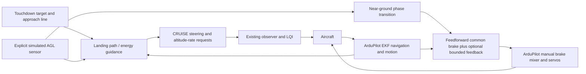
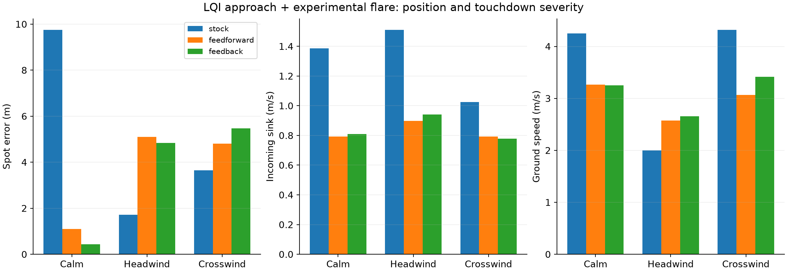
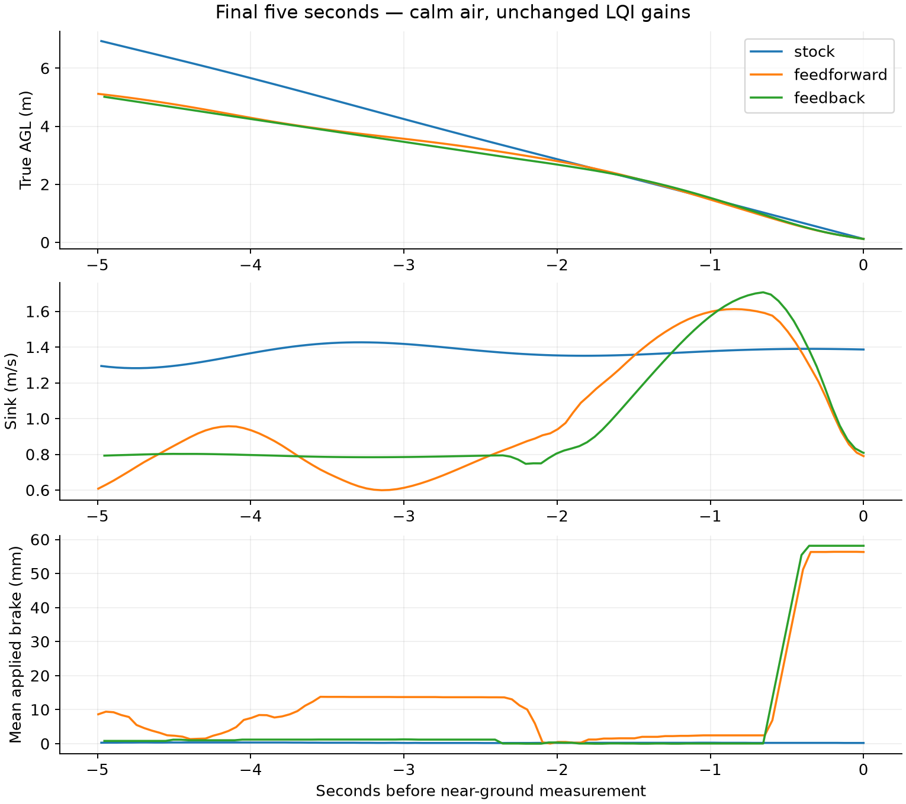
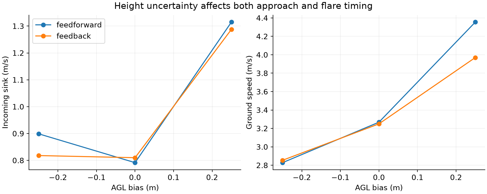

# Existing LQI approach with a landing-specific reference and flare

Research experiment, October 20, 2026. No production firmware, observer gains,
LQI gains, aircraft parameters or deployment changes.

## Architecture tested



This is **not a second LQI**. The approach uses the selected, unchanged observer
and LQI. The near-ground experiment uses a small separate flare law without an
integrator. It executes in the research harness and sends RC requests through
ArduPilot; it is not an onboard landing feature. MANUAL at the phase transition
transfers brake and throttle ownership to the experiment. The EKF continues
running; the flare uses fused ground speed, course, sink, attitude and pitch rate.
There is no canopy-state truth input or new airspeed sensor.

AGL is supplied explicitly from simulated payload height, with optional bias.
It drives both approach guidance and flare timing. This is an idealized external
height sensor, **not a claim that current barometric/GNSS altitude can provide
this accuracy**. Truth is also used to place the initial experimental target and
evaluate results, not to correct the observer.

## Guidance and actuator ownership

The approach line is fixed before introducing wind. Target distance is selected
from initial ground speed and height for a nominal 0.8 m/s approach, with a
terminal power-off segment beginning at 3 m. This gives the existing LQI's
1 m/s descent limit a margin. Stock and guided variants use the same placement
rule; they do not use the earlier study's fixed 200 m landing distance.

Let remaining along-track distance be $d$, height be $h$, initial ground speed
be $V_0$, and current fused ground speed be $V_g$. The terminal distance estimate
is $d_t=3V_0/1.38+0.3V_0$. The reference path and sink request are

$$
h_d=3+\frac{0.8}{V_0}(d-d_t),\qquad
w_d=\operatorname{clip}\left(0.8\frac{V_g}{V_0}+0.2(h-h_d),0,0.98\right).
$$

The CRUISE altitude lever requests this sink rate. Course feedback steers toward
the approach line using fused horizontal velocity; using yaw alone would omit
wind crab. This is a simple path/energy reference generator, not an optimal
touchdown predictor. Its terminal sink estimate and allowance remain empirical.

At 3 m indicated AGL the harness requests MANUAL, cuts throttle and takes over
the common/differential mixer. This handoff is logged and subject to a timeout.
At 1.05 m indicated AGL it latches a 54 mm common-brake target. Servo travel rate
and the full AP command path remain in the loop. Explicit simulator-time RC
updates prevent the viewer's wall-clock timer from turning into large command
delays at accelerated playback.

The feedback variant tracks a sink reference that falls from 1.38 m/s toward
0.65 m/s after flare initiation. It applies an 18 mm/(m/s) sink-error correction,
bounded to ±10 mm, plus pitch-rate damping only when pitch exceeds approximately
20°. Total common brake is bounded to 58 mm. No integral state is added.
Differential corrections are limited to 8 mm. The mixer inversion accounts for
different left/right physical travel. Research RC1/RC2 deadzones are explicitly
zero; the production configuration is untouched.

## Comparisons and protocol

Thirteen final runs:

- Calm, 1.5 m/s headwind and 1.5 m/s crosswind, each with stock AUTO LAND,
  guided approach plus feedforward flare, and guided approach plus feedback flare.
- ±0.25 m indicated-height bias, each with feedforward and feedback flare.

Wind directions are relative to the approach. Windy cases use the existing
Dryden model at turbulence 0.2; thermals are disabled. The same seed is supplied,
but settling trajectories and timing vary, so this is not bitwise paired
disturbance replay. There is one run per condition, not a Monte Carlo campaign.

All runs start with a common classical takeoff and climb to approximately 60 m.
They select LQI, allow settling, introduce wind, and then begin the landing.
Stock uses AUTO waypoints and NAV_LAND with the same target placement rule.
Guided variants stay in CRUISE until the explicit near-ground handoff. Both
firmware and physics WASM files are the existing selected production artifacts.

Three preliminary runs are retained separately. Those used a lower 0.85 m
trigger and pitch-rate damping throughout the feedback flare. That damping
opposed the desired pitch-up transient. The final revision triggers earlier and
only damps excessive pitch-up. The preliminary runs also straddle a change from
yaw to fused-course guidance; they are exploratory evidence, not the final
paired comparison. Their original source hashes are retained, but only the
final source is maintained here.

## Measurements

The harness retains the preceding physics frame when payload height reaches
0.12 m (20 mm above the model's payload contact surface), or canopy clearance
reaches the analogous boundary. This avoids interpreting a post-impact plastic
velocity reset as a successful flare. Values are incoming near-ground
measurements, not measured touchdown loads.

Report position error, incoming sink, forward ground speed and attitude
separately. Completion is not a soft-landing pass. Monitor actual LQI ownership
during the approach and explicit MANUAL ownership during the experimental flare.
Abort on a 60° estimated attitude excursion or a handoff/overall timeout.

See [results.md](results.md) and [summary.json](summary.json) for every final case.







## Limits and next decision

The final calm-air stock case has 9.75 m spot error, 1.39 m/s incoming sink
and 4.25 m/s ground speed. Guided feedforward gives 1.11 m, 0.79 m/s and
3.27 m/s; guided feedback gives 0.43 m, 0.81 m/s and 3.25 m/s. The main
benefit here is the landing reference and brake trajectory, not a demonstrated
advantage of the additional feedback.

Wind exposes a tradeoff. In headwind, stock is closer to the spot (1.72 m)
than either guided variant (4.84–5.10 m), but has higher incoming sink
(1.51 m/s versus 0.90–0.94 m/s). Stock also has lower ground speed in this
case. Do not combine these into an unqualified claim that the guided controller
is better. Crosswind and biased-height cases are reported alongside it.

A +0.25 m AGL bias causes a late flare: sink rises to 1.29–1.31 m/s for the
two guided variants. The limited feedback does not recover most of the lost
benefit. The next useful improvement is a delay-aware flare trigger and a
better terminal-state/range prediction, with explicit height-sensor uncertainty,
before adding another LQI gain set.

This experiment tests whether landing-specific references and a modest flare
law can use the existing controller effectively. It does not establish a new
LQI gain set or justify simply enabling cruise LQI during LAND.

Before firmware integration, compare against a tuned **existing automatic
PG_FLARE** configuration as well as the default-disabled stock flare used here.
The stock baseline is current deployment behavior, not a claim about the best
possible classical landing controller. Use repeated paired wind histories and
more height uncertainty before ranking feedforward versus feedback.

AGL error, command delay, approach-state variation and actuator limits are
important sensitivities. Existing unvalidated deep-brake aerodynamics, canopy
flexibility, slack lines and ground/contact approximations still limit what
simulated flare performance says about a real landing. This is not a flight
procedure or deployment candidate.

## Reproduction and evidence

From the repository root, using the existing control Python environment and
built viewer artifacts:

```sh
control/.venv/bin/python research/active/landing-guidance-2026-10-20/run.py
control/.venv/bin/python research/active/landing-guidance-2026-10-20/run.py --campaign
control/.venv/bin/python research/active/landing-guidance-2026-10-20/assess.py
control/.venv/bin/python research/active/landing-guidance-2026-10-20/report.py
research/.venv/bin/python research/active/landing-guidance-2026-10-20/plot.py
control/.venv/bin/python research/active/landing-guidance-2026-10-20/pack.py
control/.venv/bin/python research/active/landing-guidance-2026-10-20/validate.py
```

Run `test-guidance.mts` using the tsx invocation and Node PATH in `run.py`.
The two final protocol files pin configuration, gain, physics, firmware and
controller/harness source hashes. `evidence.tar.gz` retains final and preliminary
raw traces with embedded AP logs; its manifest contains checksums.
AI-assisted implementation and analysis.
