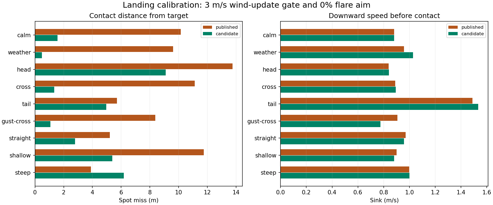

# Browser landing calibration — 24 October 2026

The non-MPC candidate sets `LAND_FLARE_AIM=0` and uses the tested 3 m/s sideslip
wind-update gate. It retains the existing 3 m power-off height, 1.3 m brake gate,
brake feedback, LQI gains, observer and aircraft physics. The aim setting removes
the fixed-wing sink-reduction assumption from the landing path estimate; it does
not disable flare or set flare distance to zero.

## Matched comparison

Eighteen fresh runs compare the published firmware/defaults with the candidate
across nine conditions. Four additional runs repeat the tailwind case with lidar
noise seeds 173 and 273, giving eleven runs per version. The native browser
runtime, packaged ArduPlane WASM, EKF, lidar and Rust 9-DOF physics execute under
Node. There is no browser-generated landing RC guidance and no truth feedback
to the controller. Mean wind is fixed in earth NED axes for both versions.

The primary conditions include the built-in spiral/200 m final in calm air,
default synthetic weather, 1.5 m/s headwind, crosswind and tailwind, plus gusty
crosswind with 0.4 m/s turbulence. Separate straight approaches use nominal
0.55, 0.8 and 1.0 m/s sink geometry. Fresh controller trajectories can sample
different gust realizations despite matching seeds; this is not an isolation of
gust history. Contact metrics use the last sample before the existing ground
clearance boundary, not impact or rollout.

| Primary metric | Published | Candidate |
|---|---:|---:|
| Median spot miss | 9.61 m | 2.79 m |
| RMS spot miss | 9.38 m | 4.57 m |
| Worst spot miss | 13.75 m | 9.09 m |
| Median downward speed at contact | 0.91 m/s | 0.89 m/s |
| Confirmed landing endpoint, including repeats | 9/11 | 11/11 |



| Condition | Published miss (m) | Candidate miss (m) |
|---|---:|---:|
| Calm | 10.15 | 1.57 |
| Default weather | 9.61 | 0.48 |
| Headwind | 13.75 | 9.09 |
| Crosswind | 11.11 | 1.34 |
| Tailwind | 5.72 | 4.97 |
| Gusty crosswind | 8.38 | 1.08 |
| Straight, nominal | 5.21 | 2.79 |
| Straight, shallow | 11.75 | 5.39 |
| Straight, steep | 3.89 | 6.19 |

Eight of nine primary spot errors improve. The steep approach regresses and the
headwind case remains substantially short. Thus the configuration improves the
default simulator and this comparison set, but is not a general precision-landing
solution over arbitrary approach slopes and wind.

## Contact-speed review and promotion decision

The initial [plan](plan.json) asked for reduced median and worst miss, completion
of all candidate checks, and no increase in peak contact speeds. The strict
sample-maximum speed checks were **not** met: across all eleven runs per version,
maximum sink is 1.533 versus 1.505 m/s, and maximum ground speed is 5.957 versus
5.945 m/s. These are retained as failed raw checks in [summary.json](summary.json).

The fixed tailwind confirmations show substantial trajectory/sensor sensitivity:
published sink ranges from 0.969 to 1.505 m/s and candidate sink from 0.940 to
1.533 m/s across three seeds. Tailwind median sink improves from 1.490 to
0.942 m/s. The 0.028 m/s peak sink and 0.012 m/s peak ground-speed increases are
small relative to that observed spread. This is an engineering review of a
simulation change, not a statistical equivalence claim or a newly invented
flight-acceptance tolerance.

The [recorded decision](decision.json) promotes the candidate as a practical
accuracy improvement for the experimental web simulator while explicitly retaining
these limitations. Published endpoint failures were not omitted: two tailwind
runs did not reach the estimator-based stop condition within eight seconds of
contact. All candidate runs reached that condition. The rigid-canopy ground
behavior is unvalidated, so endpoint completion is software evidence rather than
physical landing acceptance. The fastest primary tailwind runs have negligible
common brake at first contact in both versions; this calibration does not resolve
that flare/height-estimation limitation.

## Inputs and evidence

[Cases](cases.json), [fixed tailwind confirmations](confirmation-cases.json),
[captured original configuration](configuration.json), [summary](summary.json),
[provenance](provenance.json), and the local ignored `runs/` contain the evidence.
Hashes bind the raw results, scripts, firmware and unchanged physics/gain inputs.
`case-tested.mts` preserves the executed campaign driver. The replay driver uses
the captured configuration after production defaults change; release smoke cases
select the promoted configuration explicitly.

The firmware source change is one line on top of revision
`97c479ab36f08b826723125691cde6994768e680`, committed as
[`3b72ab243e`](https://github.com/DavidIngraham/ardupilot/commit/3b72ab243e).
The complete reconstructable patch and exact generated artifact hashes accompany
the staged browser runtime. This work was implemented and tested with AI assistance.

From the repository root, use the existing Node 24 runtime and Python/Matplotlib:

```sh
LANDING_WORKERS=6 python3 research/active/landing-release-2026-10-24/run.py
LANDING_CASES=confirmation-cases.json LANDING_WORKERS=4 \
  python3 research/active/landing-release-2026-10-24/run.py
python3 research/active/landing-release-2026-10-24/assess.py
```

Missing or mismatched case data and wrong parameter readback fail assessment.
The initial executed driver read the original production configuration; the
stable replay driver reads its byte-identical captured copy. Post-build smoke,
browser checks and publication receipts are recorded separately in this study.

## Packaged release checks

The rebuilt committed firmware and promoted configuration passed all 55 viewer
unit tests, frozen native/WASM physics parity, native SITL launch/mode/mission
checks, LQI handover checks, and the browser's complete repeating-circuit/RTL
landing test. Five fresh runs using the actual release bytes also confirmed
landing: calm miss 0.38 m, default weather 2.38 m, headwind 8.95 m, tailwind
5.92 m and steep approach 6.63 m. These are smoke cases, not replacements for
the matched comparison above. [release-checks.json](release-checks.json) records
their exact hashes and the completed checks. The release integrity checker
confirmed that physics and gain inputs remained unchanged.
