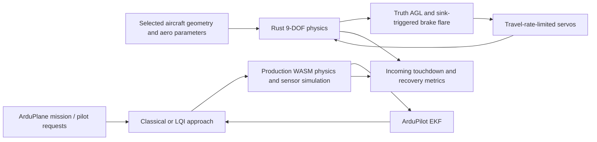
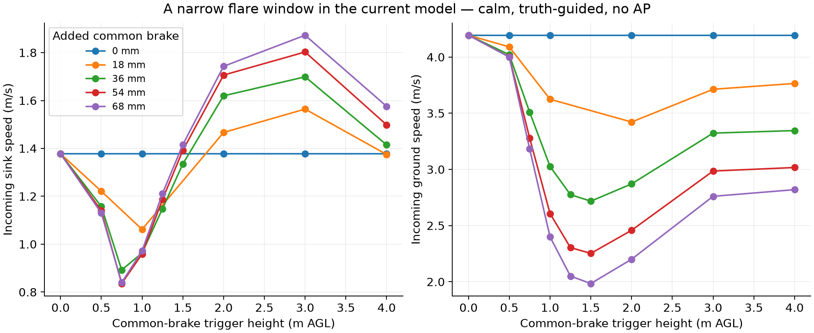
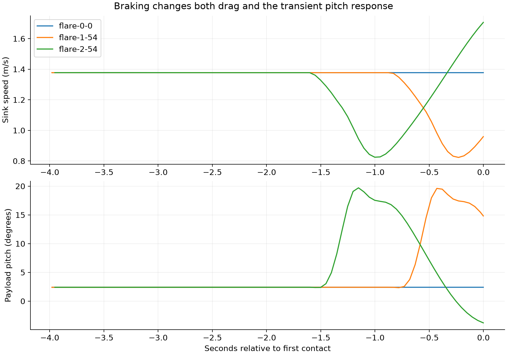
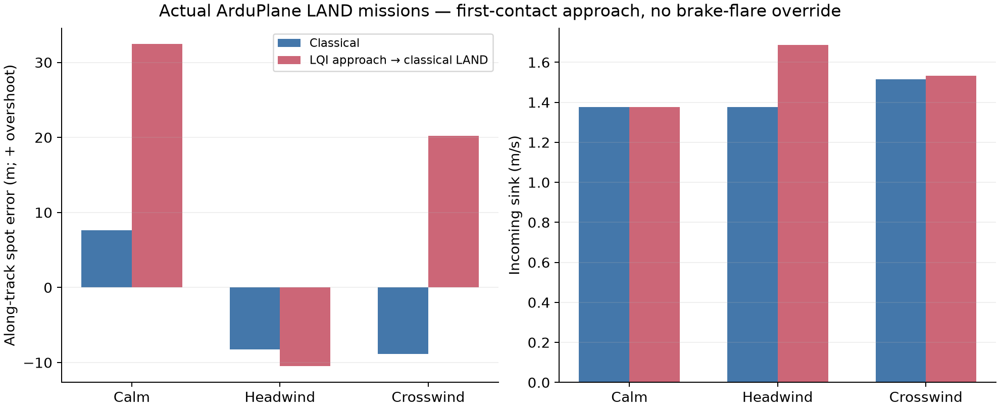
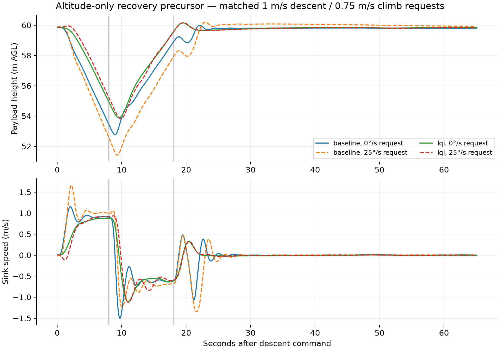

# Spot landing and swoop feasibility

**Disposition: research only; no deployment, firmware, gain or physics changes.**
Started October 19 and completed October 20, 2026. Uses the selected as-built
Trout Lake configuration with 132 mm riser spacing.

The current model predicts useful transient flare authority, but a narrow timing
window. Existing ArduPlane landing guidance does not produce a soft spot landing
by itself. LQI is useful for altitude recovery experiments, but the production
controller hands back to classical control during LAND. These runs do not qualify
an aggressive swoop or a flight landing envelope.

## What was built

There are two complementary harnesses:



- `native.py`: power-off glide, common-brake flare and braked-glide/release/recovery
  maneuvers through the installed Rust kernel. Uses the exact selected browser
  parameter vector and initial state, motor rundown and servo travel limit.
  This loop uses **truth**, not an observer or ArduPilot. There is no lateral
  guidance here; the powered trim's asymmetric brake offset is retained, and the
  unpowered vehicle changes heading. Its landing positions are not spot accuracy.
- `case.mts`: production ArduPlane/WASM, production physics, selected gain file and
  sensor/EKF loop. Common classical launch/climb to 60 m, controller selection and
  settling, then actual AUTO missions ending with MAV_CMD_NAV_LAND, or CRUISE
  descending-turn/recovery requests. No truth is injected into the controller.
- `assess.py`: separate position, severity, attitude, recovery and ownership
  metrics. Completing a mission does not constitute a successful soft landing.
- `test_harness.py`, `parity.mts`, `validate.py`: contact convergence, wind-frame
  invariance, sustained recovery detection, native/WASM kernel parity, trace
  checksums, controller ownership and artifact integrity.

## Protocol

**72 native cases:** 30 coarse flare cases (trigger heights 0, 0.5, 1, 2, 3, 4 m;
common brake 0, 18, 36, 54, 68 mm), 12 release/recovery cases, six wind/gust and
height-versus-sink-trigger cases, nine finer timing cases, and 15 height-bias /
sink-disturbance cases. Flare candidates start at 30 m in powered trim, cut power,
and glide at least ten seconds before flare eligibility. The finer sweep tests
0.75, 1.25 and 1.5 m with 36, 54 and 68 mm common brake. Bias cases use the
coarse-grid 1 m / 54 mm candidate, height error up to ±0.5 m, and a simultaneous
±0.3 m/s vertical velocity perturbation to both bodies at 3 m AGL.

Wind perturbations use 1.5 m/s fixed NED wind and a deterministic sinusoidal gust
of 0.2 m/s scale. They are not Dryden runs and are not repeated statistical samples.
The sink-trigger heuristic raises trigger height by 0.4 times positive sink rate;
this uncalibrated early-trigger rule did not consistently improve touchdown.

**18 ArduPlane cases:** six LAND missions (classical or LQI-selected approach,
calm / 1.5 m/s headwind / 1.5 m/s crosswind); four recovery cases with existing
full-stick requests; four exploratory TECS-cap changes; and four comparisons
with matched pilot altitude ramps and original TECS tuning.
Wind in LAND cases is defined along/across the frozen approach line, with
production Dryden turbulence 0.2 in the two windy cases and no thermals. The
heading is chosen from the calm flight before introducing wind; after 15 seconds
of weather settling, the mission is placed relative to the current position.
The mission uses waypoints 20 m ahead at 60 m, 100 m ahead at 30 m, and LAND
200 m ahead at 0 m. These are matched relative geometries, not identical
instantaneous state or bitwise-identical turbulence histories. One run per
condition is a feasibility screen, not a statistical controller ranking.

Recovery requests are eight seconds of descent with 0 or 25°/s steering request,
ten seconds of climb with neutral steering, then return to 60 m. The equal-input
comparison requests 1 m/s down and 0.75 m/s up using the pilot lever, without
changing TECS feedforward parameters. The earlier `matched-*` cases changed
TECS_SINK_MIN/MAX and CLMB_MAX and therefore also changed controller dynamics;
they remain in the evidence but are **not** the matched-input comparison.
`matched-input-*` identifies the comparison used in the recovery plot.

AP recovery has a 25 m floor and a 60° attitude guard. Native release tests start
at 100 m, establish a 36 mm braked glide for ten seconds, release brakes for
0.5–3 s, then apply 18, 36 or 54 mm. This is a modest brake-release precursor,
not a validated high-speed diving turn or near-ground swoop.

## Measurement definitions and a contact trap

The surface solver reports the **last internal substep's** contact flag. An
impact followed by a small separation within the same outer step can be missed.
Waiting for a later contact flag produced misleadingly low sink rates and
post-impact pitch excursions in the initial diagnostic runs.

The native harness therefore calls the solver at 1.25 ms (one internal substep)
and records the state immediately **before** first contact. A 0.625 ms check
verifies convergence. The AP harness uses a 20 mm-above-contact proximity boundary
and the preceding physics frame; reported AP “touchdown” values are incoming
near-ground values, not a reconstruction of the exact impulse. The existing
production contact solver was not changed. Rejected outer-step/contact and
misaligned-wind diagnostic runs are excluded from reported results and retained
locally in ignored `rejected-contact-*` directories.

AP recovery requires five continuous seconds within 1 m of initial altitude and
within 0.2 m/s vertical speed, after the recovery sequence. Native recovery uses
two seconds with vertical speed magnitude below 1.5 m/s and world angular-rate
magnitude below 0.15 rad/s. Native recovery altitude includes ordinary glide sink
during the wait; it is **not a minimum safe recovery altitude**.
Specific-force load is payload translational acceleration minus gravity, normalized
by gravity; it excludes impact impulses and is not riser tension or a structural
load qualification.

## Findings

In calm native glide, no flare reaches first contact at approximately 1.38 m/s
sink and 4.19 m/s ground speed. A 1 m / 54 mm flare gives about 0.96 m/s and
2.61 m/s. A 0.75 m / 54 mm flare reduces sink further to about 0.84 m/s, but
retains more forward speed, about 3.28 m/s. That is a tradeoff, not one uniquely
optimal setting. Applying the same 54 mm at 2 m produces roughly 1.71 m/s sink:
the favorable transient has passed before touchdown.





The altitude-only native release runs peak around 4.46–5.00 m/s airspeed.
For 18 and 36 mm recovery brake, the specified settling criterion takes roughly
8–14 m of height loss. All four 54 mm recovery cases fail that criterion within
the observation window: their sustained sink remains too high. This is not
evidence of divergent instability. A stronger brake command is not automatically
a better recovery command.

All AP landing runs use classical control during the last five seconds.
The LQI-selected cases assess an LQI approach followed by classical LAND,
not an LQI flare. The existing lateral guidance is generally much closer to the
approach line than to the requested longitudinal touchdown point. Approach
energy management and flare authority are the next targets.





Detailed per-case measurements are in [results.md](results.md),
[native-summary.json](native-summary.json), [refine-summary.json](refine-summary.json)
and [ap-summary.json](ap-summary.json).

## What this supports next

1. Build a landing-specific energy/flare reference generator, first using truth
   AGL as an explicit experimental input. Optimize sink, forward speed and
   attitude together before targeting smaller spot error. Do not simply enable
   the cruise LQI unchanged in LAND.
2. Compare a calibrated time-to-contact / sink-aware flare against fixed-height
   timing, including AGL bias, measurement delay, servo speed and gust variation.
   The tested “trigger earlier when sinking faster” rule is insufficient.
3. Decide how the firmware will obtain trustworthy near-ground height. A
   sub-metre timing window cannot be assumed available from current navigation
   altitude. Rangefinder or terrain-relative sensing needs its own test.
4. Keep swoop work at altitude. Establish entry airspeed, turn radius, descent,
   relative attitude, load and recovery maps before joining it to a landing.
   Add modeled/identified uncertainty rather than optimizing one nominal dive.

The five-panel aero model has a smooth algebraic lift roll-off, but not dynamic
stall, canopy collapse/reinflation under aggressive flight, flexible canopy shape,
ground effect or slack suspension. The point constraint can transmit loads that
real slack lines cannot. Ground contact is a constrained plastic impulse model,
not landing gear or fabric dynamics. These omissions make low-pass clearance,
deep-brake stall and impact severity predictions particularly weak.
This campaign adds no flight calibration evidence for those regimes.

## Reproduce

From the repository root, with the existing installed Python packages and built
viewer artifacts:

```sh
control/.venv/bin/python research/active/landing-swoop-2026-10-19/native.py
control/.venv/bin/python research/active/landing-swoop-2026-10-19/refine.py
control/.venv/bin/python research/active/landing-swoop-2026-10-19/campaign.py
control/.venv/bin/python research/active/landing-swoop-2026-10-19/matched.py
control/.venv/bin/python research/active/landing-swoop-2026-10-19/test_harness.py
```

The four supplemental TECS-cap cases are specified in `matched-protocol.json`;
run each JSON through `case.mts` to reproduce those cases. `campaign.py` and
`matched.py` contain the Node PATH and runner invocation. `parity.mts` records one
selected-configuration WASM step for comparison to the installed native kernel.
Then run `assess.py`, `plot.py` (research Python with matplotlib), `pack.py` and
`validate.py`. `evidence.tar.gz` retains all 90 final traces and AP logs;
`evidence-manifest.json` contains checksums. Firmware, physics and gain hashes are
in `ap-protocol.json`; native extension and configuration hashes are in
`native-provenance.json`.

AI-assisted implementation and analysis. No flight-use recommendation or
deployment is implied by a completed simulation run.
