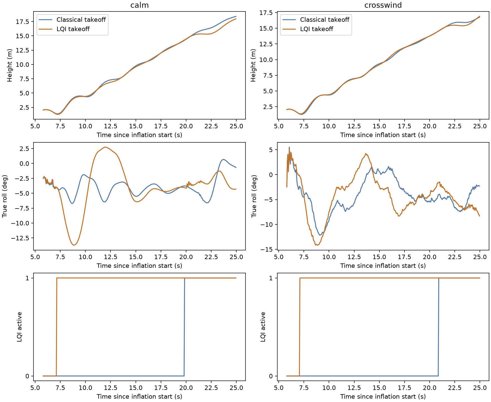

# LQI during TAKEOFF: isolated trial

**LQI can perform the simulated powered takeoff with the existing gains.** This trial does not establish better launch control: climb time is similar, pitch is slightly lower, and roll excursions are larger in several cases. Production firmware, gains, physics and deployment are unchanged.

## Change and test coverage

The research-only ArduPlane patch allows MIMO eligibility during the TAKEOFF flight stage **only while explicitly in TAKEOFF mode**, in addition to the existing NORMAL-stage eligibility. AUTO mission takeoff stages are not newly enabled. Launch detection, throttle suppression, heading guidance, estimator validity, arming and failsafe checks remain intact. No low-speed validity checks are bypassed.

The inverted inflation/release sequence remains the existing simulated/operator-assisted sequence. LQI takes over the powered climb after launch detection; it does not control canopy inflation. Takeoff throttle minimum/maximum and slew limits still constrain the LQI throttle request. This is not unconstrained longitudinal control from rest.

The deployed firmware and candidate use the same selected gain file, as-built Trout Lake physics and EKF, without a pitot sensor or canopy-angle truth. Thirteen primary runs cover paired calm air, three default-Dryden seeds, a $1.5$ m/s headwind, a $1.5$ m/s crosswind, and a candidate controller-switch exercise. A fourteenth diagnostic repeat identifies the headwind eligibility gate.

All fourteen reach the AUTO handoff and complete another $30$ simulated seconds without ground recontact after release. Six candidate runs actually exercise LQI during TAKEOFF: calm, three turbulence seeds, crosswind and the switch test. The two candidate headwind runs use classical takeoff and must not be counted as LQI takeoff successes.

## Results

Times are measured from the start of inflation, not motor start. Attitude peaks cover free flight while in TAKEOFF mode below $13$ m; they include the launch transient and are not steady oscillation amplitudes.

| Case | Classical time to true $15$ m | Candidate time | Peak roll, classical / candidate | Peak pitch, classical / candidate |
|---|---:|---:|---:|---:|
| Calm | $20.51$ s | $20.61$ s | $6.7/13.7^\circ$ | $31.3/29.9^\circ$ |
| Dryden seed 17 | $21.11$ s | $21.70$ s | $7.9/12.6^\circ$ | $32.1/29.5^\circ$ |
| Dryden seed 73 | $22.00$ s | $21.85$ s | $8.0/14.2^\circ$ | $32.4/29.5^\circ$ |
| Dryden seed 2026 | $20.21$ s | $20.16$ s | $7.8/12.0^\circ$ | $31.3/29.7^\circ$ |
| Crosswind | $21.36$ s | $21.36$ s | $12.2/14.2^\circ$ | $30.8/29.2^\circ$ |

In calm air, candidate LQI first becomes active at $1.29$ m altitude, approximately $1.35$ s after the scripted free-flight release. The deployed firmware first engages LQI near $14.24$ m, after the takeoff flight stage ends. Candidate minimum free-flight height is $1.27$ m versus deployed $1.36$ m. No tested run activates LQI before the launch model permits power.

The switch test disables LQI around inflation time $10$ s and re-enables it around $14$ s, during the climb. It completes takeoff and AUTO continuation. Both deployed and candidate runs can briefly suspend/re-engage LQI during the AUTO handoff; the logs show the same transition in the baseline. Final ten-second controller-active fractions are $100\%$.

## Headwind limitation

Both candidate headwind runs complete on classical control because the existing LQI requirement for a valid EKF wind estimate is not satisfied during takeoff. Diagnostic telemetry reports flags $77$ during the climb: airspeed validity, AHRS health, heading-rate validity and frontend eligibility are true, but wind validity is false. The flags become $79$ when wind becomes valid, and LQI engages around $23.5$ m in AUTO.

This explains the fallback directly; it is not a failure of the newly permitted flight stage. We did not relax wind validity or assume that an unavailable estimate was zero wind.

## Evidence and reproducibility

- [takeoff.patch](takeoff.patch): final patch including diagnostic-only stage/eligibility telemetry. [initial-takeoff.patch](initial-takeoff.patch) is the version used for the thirteen primary runs; only the final headwind probe uses the extra eligibility telemetry.
- [Initial build manifest](initial-build-manifest.json) and [diagnostic build manifest](build-manifest.json) pin source base, patch and firmware hashes.
- [metrics.json](metrics.json): per-run timing, attitude, controller ownership and initialization evidence.
- [evidence.tar.gz](evidence.tar.gz): complete traces and logs; [evidence-manifest.json](evidence-manifest.json) includes hashes and per-run firmware provenance.
- build.py applies the patch to a clean local AP checkout, builds WASM, copies it into this isolated directory and restores the original source in a finally block. It does not copy firmware into the viewer or publish it. Required MAVLink submodule checkout was initialized at its recorded commit.
- Run run.py, weather.py, switch.py and probe.py with the control Python environment; run assess.py there and plot.py with the research environment. All use the existing viewer runtime and actual WASM AP.
- During harness development, the initial wind vector was accidentally passed to a speed/direction API. The rejected headwind calls and mislabeled zero-mean crosswind calls are recorded in weather-execution.json and superseded by the corrected wind.py runs in wind-execution.json. Those preliminary calls are excluded from the fourteen retained results.
- validate.py checks run evidence, stage engagement, switch behavior, gain/EKF initialization and selected-release integrity. The experiment is AI-assisted.

## Recommendation

Keep this as an opt-in research candidate. Before making it the default, investigate the larger roll transient and decide explicitly how takeoff should behave while EKF wind is unavailable. These tests support feasibility in the existing launch model, not real-aircraft takeoff validation or an expanded flight envelope.
