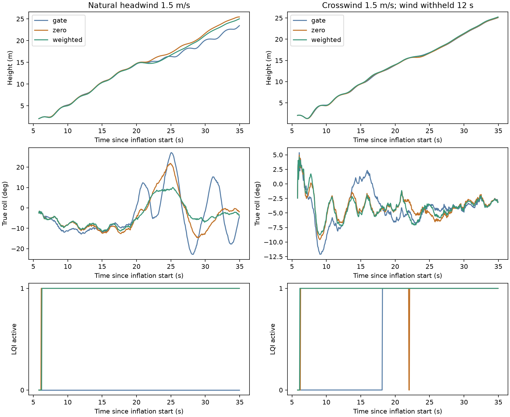
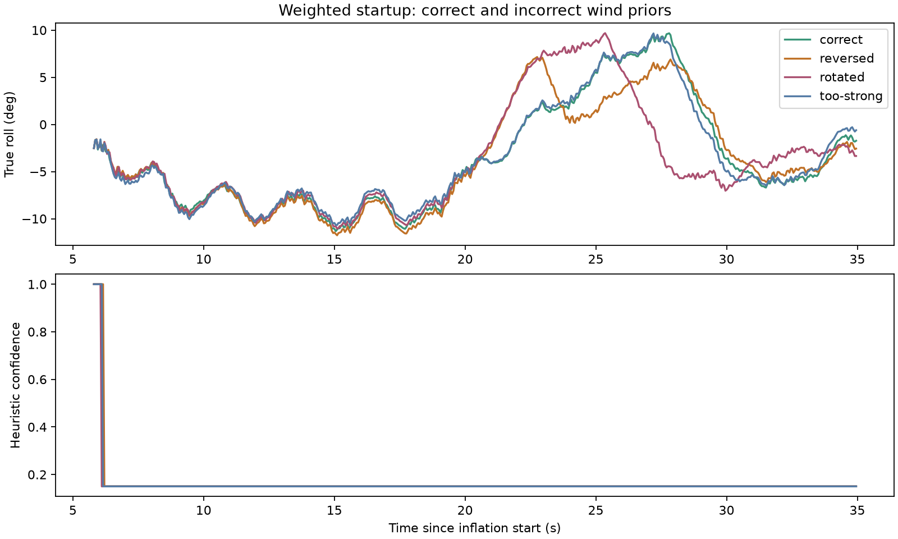
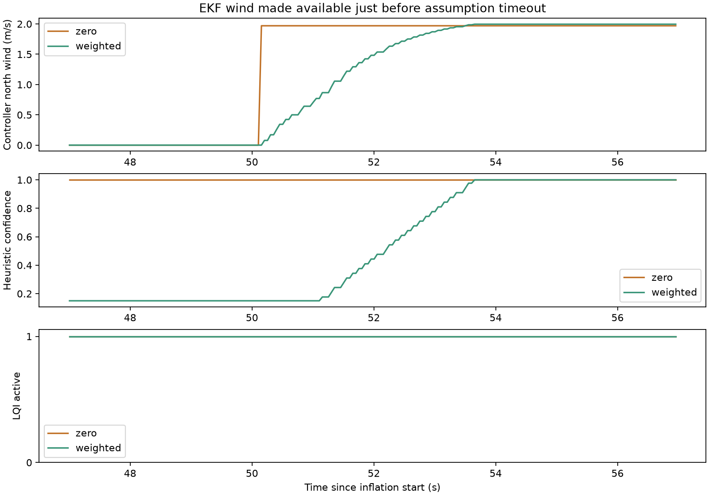

# Wind assumptions for LQI takeoff initialization

**A bounded zero-wind fallback is promising in this simulator. The more complicated weighted observer has not earned adoption.** Both strategies remove the headwind engagement gap, but this campaign does not establish a safe general launch envelope. A marginal tailwind launch has almost no ground clearance, and both the wind-gated and weighted controllers touched the ground in some repetitions.

The deployed firmware, gains, physics and web simulator are unchanged. This is an isolated, AI-assisted research patch.

## What was compared

All three policies share the previous experimental permission to use LQI in explicit TAKEOFF mode, while retaining launch detection, throttle suppression, estimator/arming/failsafe gates and takeoff output limits. The baseline here is **wind-gated LQI with classical fallback while wind is unavailable**. It is not the published simulator's always-classical takeoff stage.

| Policy | While EKF wind is unavailable | When wind becomes available |
|---|---|---|
| Gate | Classical controller | Existing LQI |
| Zero | Existing LQI gains; assume zero wind and derive consistent airspeed from ground velocity | Existing EKF measurements; no added wind blending |
| Weighted | Low-confidence wind prior; reduce selected velocity corrections and feedback | Blend wind and restore normal feedback |

The zero-wind case is a testable hypothesis, not an assertion that wind is physically zero. EKF state and wind estimation are never overwritten. The controller contract separately records whether wind is assumed. Existing attitude, navigation and airspeed validity checks remain required.

The weighted case starts with confidence $c=0.15$. This is a chosen scheduling weight, **not estimated covariance or a Kalman probability**. It applies the transformation

$$
D(c)=R^T\operatorname{diag}(c,c,1)R
$$

to physical velocity residuals before normalization, so horizontal NED components receive reduced weight while the vertical component remains available. The same transformation applies to initial velocity errors and velocity feedback errors. Attitude, gyro and height corrections remain active. Speed-error integration is weighted by $c$; observer trim-speed scheduling moves toward the reference speed while uncertain. Turn demand is limited to $\min(r_{\max},10+25c)$ deg/s.

This changes the observer/controller dynamics. It is not a formally redesigned optimal LQI or a proven robust gain schedule. Existing feedback gains and matrix coefficients are unchanged.

The prior is supplied as north/east wind at startup, defaulting to zero. There is no new anemometer ingestion or timestamp validation in this experiment.

## Limits and handover

An assumption can be used for at most $45$ seconds after takeoff eligibility. If wind is still unavailable, LQI releases ownership and classical control resumes. Startup support can continue into AUTO within that time limit; unrelated flight modes do not initiate the assumption.

Weighted startup low-pass filters newly available wind with a $2$ s time constant, waits $1$ s of valid wind, then raises confidence at $1/3$ per second. The final revision additionally blends the filtered prior toward the EKF value so the end of that transition matches the normal input exactly. A valid-wind blend may finish beyond the assumption deadline; an **unavailable** wind assumption cannot.

The initial implementation could cut this blend short if validity arrived immediately before the deadline. That edge case was corrected and explicitly tested with availability withheld for $44$ s. The final weighted controller stays engaged and reaches full confidence smoothly after the deadline. The initial results and patch are retained separately.

The zero-wind policy intentionally retains an abrupt input change when wind becomes available, to test the simplest substitution. Existing controller/actuator limits remain active. Its successful tests do not prove that every possible wind-estimate jump is benign.

## Campaign and results

There are **72 runs** across two patch revisions:

- 3 initial headwind smoke cases.
- 43 primary cases: 24 natural-availability cases, 12 delayed-availability cases, four wind-prior cases, three timeout cases.
- 6 repetitions of the marginal tailwind case.
- 20 follow-ups: all 17 weighted primary cases with corrected blending, plus three late-validity boundary cases.

Natural tests use zero mean wind, $1.5$ m/s headwind, tailwind or crosswind, each with default Dryden turbulence ($0.2$ m/s horizontal intensity) and seeds 17 and 73. The default thermal remains configured away from the launch area. Delayed cases withhold wind **from the controller only** for $12$ s while the real EKF continues running. Timeout tests withhold it for $60$ s.

The selected as-built Trout Lake model, deployed gain file, EKF and actuator model remain in the loop. There is no pitot or canopy-angle truth feedback. Each launch is followed by $60$ simulated seconds in AUTO if no failure was recorded.

### Matched natural-availability matrix

The weighted column below uses the final smooth revision; gate and zero use the initial revision, whose behavior is unchanged by the weighted-only correction.

| Measure | Gate | Zero | Weighted |
|---|---:|---:|---:|
| LQI engaged during TAKEOFF | 6/8 | 8/8 | 8/8 |
| Runs without ground recontact / screening failure | 8/8 | 8/8 | 7/8 |
| Median time to true $15$ m, from inflation start | $21.53$ s | $21.13$ s | $21.51$ s |

The wind-gated policy misses both headwind takeoffs. The two fallback policies engage around $6.1$–$6.3$ s after inflation starts, approximately $0.3$–$0.5$ s after the scripted free-flight release. Neither engages before the launch model permits power.

Representative peak roll angles during TAKEOFF below $13$ m:

| Case, seed 73 | Gate | Zero | Final weighted |
|---|---:|---:|---:|
| Zero mean wind | $13.6^\circ$ | $10.9^\circ$ | $10.4^\circ$ |
| Headwind | $12.9^\circ$ | $12.6^\circ$ | $11.6^\circ$ |
| Crosswind | $13.2^\circ$ | $8.1^\circ$ | $10.3^\circ$ |
| Tailwind | $15.1^\circ$ | $13.7^\circ$ | $13.9^\circ$ |

These modest differences are not a statistically established ranking. Identical seeds do not make browser scheduling, initialization and launch-command timing bitwise identical.

### Tailwind is the limiting case

Across the initial campaign, repeats and final follow-up, four runs record ground recontact: three weighted cases and one gate case. All are the same $1.5$ m/s tailwind/seed-17 launch condition. The first weighted failure also exceeds the $45^\circ$ pitch screening bound after contact. A failed launch can subsequently climb in the ground-contact model; reaching $15$ m later does not erase the failure.

Zero-wind startup completes all 17 of its tested runs. However, in the initial marginal tailwind case its minimum payload-center height is $0.1005$ m against a modeled contact floor of $0.1$ m—about half a millimetre clearance. The gate case also passes with only millimetres of clearance in one run. Do not interpret those passes as adequate margin or a reliable probability of success.

This implicates the scripted release/launch condition as well as control. The study does not establish a controller-only instability, nor does it validate launching this aircraft downwind.

### Wrong priors and timeout behavior

The weighted policy completes tests with the correct headwind prior, reversed sign, a spurious $3$ m/s crosswind prior and an exaggerated $4$ m/s headwind prior. In the final revision, peak roll remains about $10.7$–$11.8^\circ$; time to $15$ m ranges from $21.95$ to $23.20$ s. This suggests the low-confidence weighting limits sensitivity in these cases, but it does not deliver a clear advantage over the simpler zero assumption.

Both assumption policies relinquish control after the $45$ s window when availability is withheld for $60$ s, then re-engage after it is restored. Classical control maintains the simulated flight during that interval. Late-validity testing confirms that the corrected weighted blend is not truncated by the deadline.

In total, 68/72 runs complete without a recorded screening failure. Counts include unequal numbers of cases per strategy and follow-up revisions; they are **not failure probabilities**. This is a structured scenario campaign, not Monte Carlo certification.

## Evidence and verification

- The preregistered scenario screen checks completion/no ground recontact and true attitude bounds of $45^\circ$ roll/pitch after free-flight release. Results also retain ownership, initialization, altitude, body rates, brake travel, common brake and throttle metrics.
- Full traces and logs are in evidence.tar.gz, with per-run checksums and firmware provenance in evidence-manifest.json.
- metrics.json and summary.json retain all results, including failures and both revisions. No failed runs were replaced.
- initial-startup.patch / initial-build-manifest.json identify the first 52 runs. startup.patch / build-manifest.json identify the final 20.
- validate.py checks evidence, all recomputed metrics, actual takeoff ownership, absence of premature activation, the 45-second cap, timeout return/re-engagement, and the late-validity blend.
- The source checkout is restored after each isolated WASM build. Selected deployment integrity is checked separately. No hardware firmware or PR was published.

## Reproduce

Use the existing control/research Python environments and viewer dependencies. Local tool paths are declared in build.py and run.py.

1. Extract evidence.tar.gz into this directory and run validate.py with control Python to inspect retained results.
2. Build the first revision with build.py initial-startup.patch; run run.py, campaign.py and confirm.py.
3. Build the final revision with build.py; run handover.py.
4. Run assess.py with control Python and plot.py with research Python.
5. make_patch.py regenerates the final patch from the pinned, clean AP base and startup-methods.cpp. The build manifest records that base.

Experimental parameters are CP3_STMODE (0 gate, 1 zero, 2 weighted), CP3_WPRN/WPRE (prior, m/s north/east) and CP3_WDLY (diagnostic withholding, seconds). These exist only in the isolated patch.

## Decision

The evidence supports **trying a bounded zero-wind startup before adding observer gain scheduling**. It resolves the observed engagement gap and has not failed in the tested cases. The weighted policy provides no consistent performance benefit and is not ready to replace it.

Keep deployment unchanged. Before promoting a startup policy, establish a launch condition with meaningful ground-clearance margin, test a broader wind-estimate transition range, and repeat with representative initial airspeed/heading errors. Valid EKF wind means estimation is active, not that the estimate is accurate; none of these results justify silently treating unknown wind as a precise measurement.
