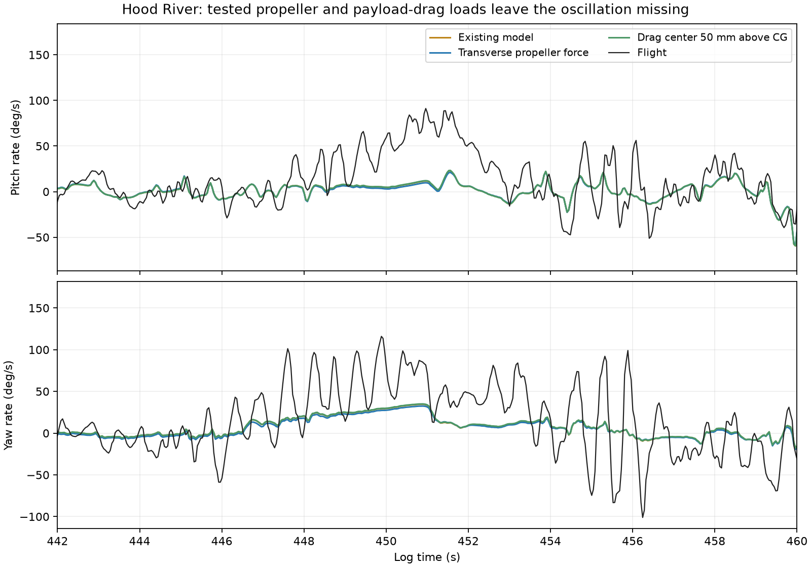
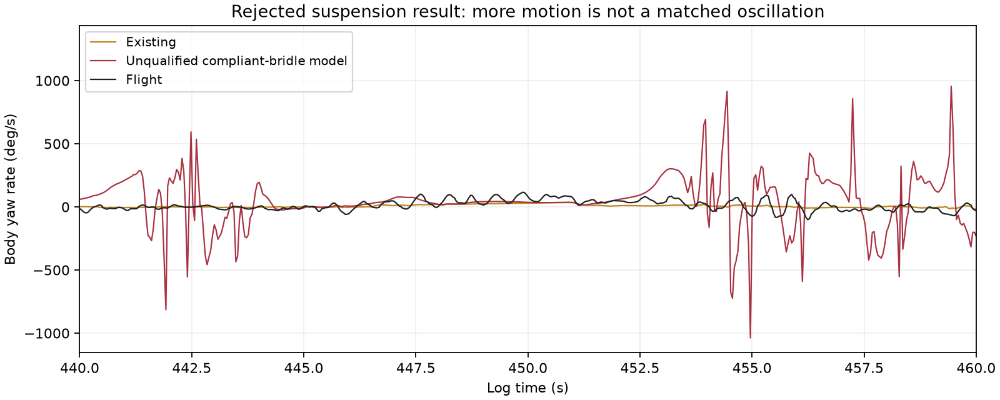
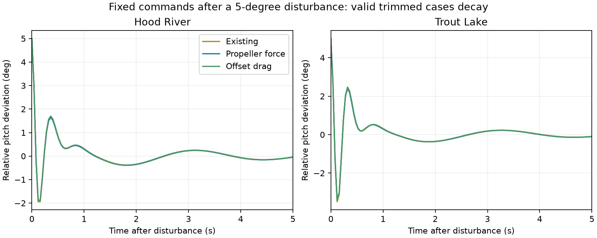

# Additional rigid-body physics hypotheses

**None of the tested additions qualifies as an explanation of the missing oscillation.** Transverse propeller force and displaced payload drag produce small changes and remain stable. The compliant-suspension prototype produces excessive motion, fails equilibrium checks, and is not qualified for physical inference. The latter is an unresolved model-construction problem, not evidence that real riser mechanics are irrelevant.

AI-assisted research, 2026-10-18. No deployed physics, observer, gain file or browser artifact changed.

## Frozen diagnostic scope

The final suite contains 130 replays: thirteen variants across the same four Hood River and six Trout Lake windows used in the brake-tension study. Each flight keeps its own prior as-built mass, inertia, CG and 132 mm riser geometry. There is no coefficient optimizer, and these previously examined windows are not independent validation.

Hypotheses and bounds are in protocol.json. Numerical summaries and errors are retained. Earlier suspension construction/initialization failures are under rejected-two-link/ and rejected-length-initialization/; they are not selected alternatives.

## Implemented mechanisms

### Transverse propeller force

An in-plane aerodynamic force opposes transverse airflow at the propeller disk. Its magnitude scales with positive mapped thrust and a velocity scale containing axial and induced flow:

$$
\mathbf F_{\perp}
=-a\,T\frac{\mathbf v_{\perp}}{\sqrt{v_x^2+v_i^2+\epsilon}},
\qquad
v_i=\sqrt{\frac{T}{2\rho A}}.
$$

The force is applied at the existing propeller location, creating the corresponding payload moment. The disk diameter is 9 inches; $a$ is swept over 0.1, 0.3 and 0.6. These are sensitivity coefficients, not a blade-element fit. The load is dissipative in transverse motion. Existing thrust, shaft torque and gyroscopic loads remain.

Propellers in oblique inflow do produce additional forces and moments; see [experimental non-axial propeller loads](https://www.mdpi.com/2226-4310/11/4/274). This experiment tests the transverse-force path only. It does not model intrinsic disk pitching/yawing moments, dynamic inflow or a deforming motor mount, and cannot exclude those mechanisms.

### Payload drag application point

The original isotropic payload drag is replaced by the same law evaluated at a body-fixed point displaced 50 mm forward, aft, above or below the CG. Local velocity includes angular motion. The resulting force and moment are applied together; original CG drag is subtracted to avoid double counting. The combined drag force/moment extracts mechanical energy from motion relative to the air.

The bounds are exploratory, not CAD-derived centers of pressure. Direction-dependent projected area and wake interference remain unmodeled.

### Compliant riser/bridle support

The final prototype uses two payload attachment locations and four tension-only canopy branches, with fore/aft canopy attachments at +/-150 mm and lateral locations from the existing support geometry. It replaces the ideal point constraint and effective rotational springs. Existing rotational damping is retained as an explicit uncertainty.

Each branch has axial spring stiffness of 500 or 2000 N/m and damping of 0.5 or 2 N s/m. Forces act along branch directions at actual body attachment locations, giving equal-and-opposite forces and consistent moments. Slack branches carry no force. This adds relative translation and load redistribution while keeping the canopy rigid.

Rest lengths come from each flight's fixed reference rigging pose with an approximate static weight preload. Neither those branch locations nor their elastic properties are measured. The unobserved canopy starts in that reference relative pose, rotated with the observed payload; a separate baseline-reference-init variant checks that initialization alone. Observed payload state is preserved.

A first two-link version lacked fore/aft canopy support and was rejected. A second initialization attempted to prescribe four independent tensions, which was often geometrically incompatible. The final reference-pose initialization is compatible, but does not solve the more important equilibrium/model-adequacy failures described below.

## Results

| Hood River powered turn | Mean body yaw rate, 447–456 s | Fast yaw RMS over replay |
|---|---:|---:|
| Flight | 40.17 deg/s | 29.97 deg/s |
| Existing model | 16.23 deg/s | 1.96 deg/s |
| Strongest transverse propeller force | 14.93 deg/s | 1.85 deg/s |
| Drag center 50 mm above CG | 16.52 deg/s | 1.95 deg/s |

Fast RMS uses the established 1.2–1.9 Hz Welch metric after removing the first two seconds and last 0.4 seconds. It is not evaluated over the same interval as the turn mean.

Across windows, the strongest propeller-force model changes mean yaw-rate RMSE by +0.55% at Hood River and -1.38% at Trout Lake. The above-CG drag-center case changes it by less than 0.1% in either flight. Neither resolves the large spectral amplitude or phase mismatch.

The compliant-bridle cases produce large, poorly matched rotations. For example, the 500 N/m, 2 N s/m case gives mean roll/pitch/yaw RMSE ratios of 18.4/8.3/7.2 at Hood River and 36.8/16.8/15.1 at Trout Lake. These are unacceptable regressions, not a successful reproduction of an oscillatory mode. An occasional similar mean turn rate is incidental amid much larger instantaneous errors.

## Equilibrium and disturbance checks

All variants were attempted at a common-command fraction of 0.1, independently solving straight-level trim for each flight. The compliant model uses additional relative-position and relative-velocity unknowns and checks both bodies' accelerations and relative velocity; it does not reuse the fixed-point equilibrium as if it were valid.

- Eighteen baseline/propeller/drag/reference-initialization trims pass the 1e-6 residual threshold.
- Each valid trim was tested with 0, 1, 5 and 15 degree canopy-relative-pitch disturbances and fixed commands for 40 seconds.
- All 54 nonzero disturbances decay. The maximum late/early relative-angle RMS ratio is approximately 0.0000509.
- All eight compliant-suspension trim attempts fail, with maximum residuals approximately 0.044–1.07. Their subsequent fixed-command stability tests are not counted as passed or failed; no valid equilibrium was established.

These failures do not establish that the actual aircraft cannot trim with compliant suspension. They show that the assumed branch geometry/rest lengths and this prototype have not produced a credible alternative to the effective point-support model.

## Numerical and mechanical checks

- Zero-addition replay parity with the installed Rust/Python baseline is within 1.3e-12 in state components over all ten windows.
- Four research Rust tests check suspension force/global-moment balance, slack behavior, dissipative propeller force and dissipative displaced drag.
- The existing three brake-tension tests and fifteen reusable core tests pass after the generic load-interface change.
- Doubling substeps from 32 to 64 leaves the propeller and drag replay metrics essentially unchanged.
- The compliant-suspension trajectories diverge substantially over 30 seconds when the timestep is halved. Fast-yaw RMS differs by approximately 6–18% in the checked cases. Early-time state agreement is much closer, but long-horizon convergence is not established. Those outputs are explicitly unqualified; their numbers must not be treated as accurate physical predictions.

The reusable core now accepts optional body wrenches before its point-constraint solve, and can omit that solve when a research backend supplies suspension forces. The ordinary production entry point supplies zero extra loads and retains the point constraint. No new aircraft parameter schema or browser binding is introduced.

## Decision and next evidence

Do not deploy any variant or retune LQI against it. The tested transverse propeller force and isotropic drag-center changes are too small to explain the observed mode. Broader propeller or payload aerodynamic models remain possible but are not supported by this sweep.

The suspension result is inconclusive. Before extending it, measure or reconstruct actual fore/aft line groups, convergence points and loaded lengths, then require static load balance and converged small-disturbance dynamics before replay fitting. Video of riser motion and canopy shape is valuable here. Large oscillations from an unqualified suspension model are not evidence in favor of the mechanism.

## Reproduction

From the repository root, build the research executable with cargo build --release --manifest-path research/active/missing-physics-2026-10-18/Cargo.toml. Run run.py, constant.py and checks.py using the control environment; run report.py using the research environment for Matplotlib.

Raw flight inputs remain external and are hashed in input-hashes.json. Generated input requests and trajectories are local, reproducible outputs excluded from Git. The maintained Rust core supplies aerodynamics, propulsion and rigid-body dynamics; only the experimental load laws and orchestration live in this study.
