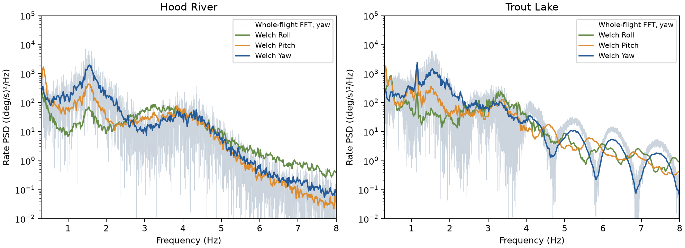
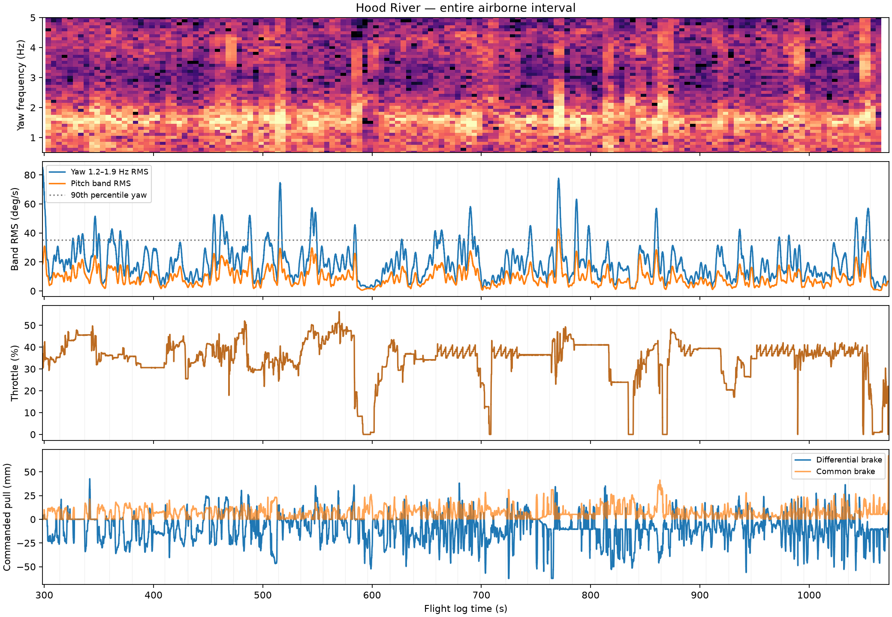
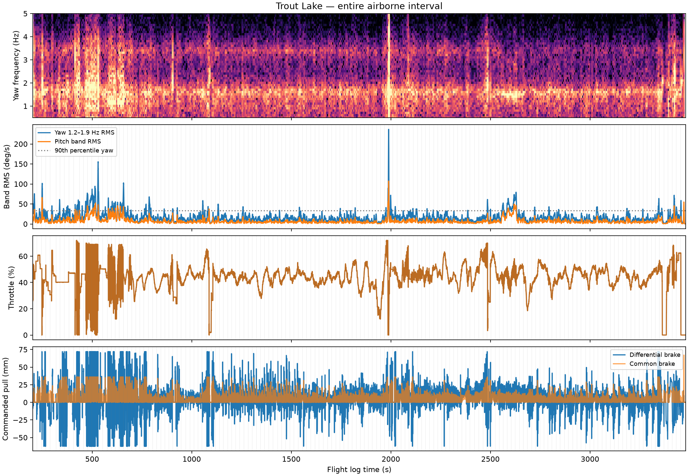

# Whole-flight spectra and oscillation timing

AI-assisted analysis, 2026-10-18. Existing flight logs; no model, controller or deployment changes.

## Finding

The 1.2–1.9 Hz yaw oscillation is widespread through both flights, with strongly varying amplitude. It is not confined to a few post-maneuver ring-downs. A distinct, strong ~1.16 Hz component in Trout Lake is largely contributed by a short CRUISE episode, illustrating why a whole-flight FFT alone is insufficient. Persistent motion does not prove a self-excited limit cycle: ongoing inputs or disturbances could continually excite a damped mode.

## Whole-flight analysis intervals

The contiguous analysis interval runs from the first to last POS.RelHomeAlt above 3 m: Hood River 298.52–1073.20 s (12.91 min), Trout Lake 202.49–3481.05 s (54.64 min). This excludes most ground/launch/landing data but is an operational flight-interval definition, not an independently verified airborne detector. All intervening data are retained without stitching separate segments together. Maximum gyro log gaps are about 21.3 ms.

Logged IMU0 body rates are interpolated onto a 50 Hz grid. A Hann-windowed whole-interval periodogram provides the requested FFT spectrum. A 64-second, 50%-overlap Welch spectrum gives a more readable averaged PSD. Frequency values below are Welch-bin maxima, not precisely identified invariant natural frequencies.

| Flight | Prominent yaw peaks | Additional feature |
|---|---|---|
| Hood River | ~1.56 Hz, with a broad surrounding band | Roll energy around 3.2–3.8 Hz |
| Trout Lake | ~1.16 Hz and ~1.55 Hz | Roll peak around 3.33 Hz |

## How continuously is the usual band present?

Ten-second nonoverlapping windows, excluding flight-boundary margins, provide independently calculated 1.2–1.9 Hz yaw-band RMS. The 5 deg/s threshold is a descriptive amplitude threshold, not a statistical detection threshold.

| Flight | Windows | Above 5 deg/s RMS | Median RMS | 10th–90th percentile RMS |
|---|---:|---:|---:|---:|
| hood_river | 76 | 97.4% | 19.7 deg/s | 10.0–37.3 deg/s |
| trout_lake | 326 | 97.5% | 15.2 deg/s | 7.7–34.2 deg/s |

The strongest yaw peak over 0.8–5 Hz lies in 1.2–1.9 Hz in approximately 89% of Hood River and 92% of Trout Lake ten-second windows. Entirely MANUAL windows also contain the component: median band RMS is about 20 deg/s in both flights. It is therefore not exclusive to automatic flight. This is a statement at ten-second resolution, not proof of uninterrupted oscillation at every instant.

The timeline uses a zero-phase third-order 1.2–1.9 Hz bandpass and a centered 2-second RMS envelope. Filter/envelope smoothing smears timing around rapid events; it must not be used to claim subsecond cause/effect or infer free-decay damping from a spike. Spectrogram windows are 10 seconds with 5-second overlap, color scale -10 to 35 dB relative to (deg/s)²/Hz.

## The lower-frequency Trout Lake episode

The large 1.16 Hz whole-flight peak is not representative of the typical spectral window. The median spectrum across nonoverlapping 20-second windows peaks at 1.60 Hz in Trout Lake (1.55 Hz in Hood River).

In Trout Lake, roughly 64% of the summed 1.05–1.25 Hz spectral power comes from four 20-second windows spanning 582.49–662.49 s. The most energetic 10% of windows account for 84.6% of that band power. These fractions refer to summed windowed spectral estimates, not exact time-domain energy.

The 580–660 s interval is entirely CRUISE (mode 7), after the switch at 578.95 s. Its yaw peak is 1.15 Hz at 0.05 Hz spectral resolution. Magnitude-squared coherence at that peak is 0.988 with throttle output and 0.974 with differential-brake output; common-brake coherence is 0.401. These estimates use 20-second Welch windows and seven overlapping averages. They show strong association, not independent statistical samples or direction of causality.

This suggests a separate control-coupled episode to investigate. The controller may excite, amplify, or respond to the motion; pilot reference changes, operating-point changes and nonlinear effects are not excluded. It should not be conflated with the more pervasive 1.5–1.7 Hz component or used as proof that all flight oscillation is a limit cycle.

## Does it follow identifiable excitation?

We screened actual output changes over one second: throttle >8 percentage points, differential brake >10 mm, or common brake >5 mm. Events are spaced at least 20 seconds apart. Compare median yaw-band envelope 10–3 seconds before versus 3–10 seconds after; the exclusion around the trigger reduces, but does not eliminate, filter-smearing and overlapping-input confounding.

Of 36 Hood River and 155 Trout Lake selected events, only 28% and 20%, respectively, increase band RMS by more than 50%. Median after/before ratios are 0.75 and 0.95. These do not establish that inputs reduce oscillation: event selection, phase, ongoing feedback, unrecorded wind and concurrent commands confound attribution.

All identified high-amplitude burst onsets have a large output change somewhere in the preceding ten seconds. That is not informative evidence of causation: the same condition holds at essentially all times (100% Hood River, 99.9% Trout Lake). There are no ten-second windows plus preceding ten seconds free of these threshold crossings. The logs therefore do not supply clean unforced baselines under this definition.

## Interpretation and next step

Separate the persistent ~1.6 Hz motion from the episodic ~1.16 Hz CRUISE behavior in subsequent model validation. Analyze 580–660 s with mode/reference history, throttle limits and lateral/longitudinal controller outputs before assigning its strong whole-flight peak to missing canopy physics. For the persistent component, a controlled small excitation followed by genuinely quiet commands would be more informative about damping than these continuously driven flights.

## Reproduction and checks

Run research/.venv/bin/python research/active/oscillation-timing-2026-10-18/analyze.py. Input hashes, full event/window metrics, and compressed whole-flight FFT/Welch ordinates are retained. No logs are committed. The whole-flight and segment spectra are descriptive reused-data analysis, not a frozen validation dataset.
