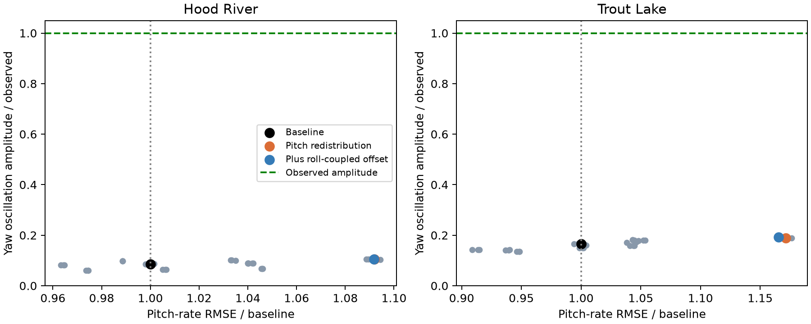

# Pitch inertia and damping distribution study

AI-assisted diagnostic study, 2026-10-18. No selected physics, controller gains, firmware or browser deployment changed.

## Result

Redistributing pitch inertia and damping within the tested bounds does not explain the missing coupled oscillation. Lower damping modestly increases oscillation amplitude but worsens pitch-rate error. The lowest composite score is not a satisfactory physical model.

## Protocol

450 logged-input replays: 45 variants across four Hood River and six Trout Lake windows, all 30 seconds. These are reused historical data, not independent validation flights. Logged actuator commands are replayed open loop with causal motor dynamics, fixed per-window wind and inferred initial canopy attitude. The session role labels are inherited; this sweep uses every window diagnostically and makes no held-out claim.

Main factorial: added pitch inertia multipliers 0.25, 1, 4; aerodynamic pitch damping multipliers 0.25, 1, 4; joint pitch damping multipliers 0.1, 1, 3. Payload geometry/inertia and yaw damping are fixed in this factorial. Multipliers are broad sensitivity choices, not measured confidence limits.

Added pitch inertia is multiplied before the existing 0.52624 global added-inertia scale. Structural canopy pitch inertia remains 0.008 kg m². The direct total pitch inertia therefore spans approximately 0.00866–0.01852 kg m², versus 0.01063 nominal. This does not sweep structural inertia independently or below its fixed contribution.

Separate location checks vary added_z1 over -0.5, 0.25, 0.5 m and added_z2 over 0, 0.25, 0.75 m, alone and with the low-damping combination. In the actual mass matrix, added_z1 shifts the fore-aft added mass and directly changes pitch coupling. added_z2 primarily changes roll coupling; it is included as a cross-axis control, not mislabeled as pitch inertia. Translation–rotation coupling is recomputed by Rust.

Payload pitch inertia uncertainty is tested separately at 0.7 and 1.3 times nominal with a congruence transformation of the inertia tensor, preserving positive definiteness. These are sensitivity bounds, not measured uncertainty.

## Logged-input results

Values below are means over windows within each flight. Band amplitude is yaw-rate RMS over 1.2–1.9 Hz. RMSE is uncentered, excluding the initial two seconds and final 0.4 seconds.

| Flight / variant | Observed band RMS | Model band RMS | Pitch-rate RMSE | Yaw-rate RMSE |
|---|---:|---:|---:|---:|
| hood_river / baseline | 26.80 | 2.28 | 26.79 | 37.99 |
| hood_river / J4.0-C0.25-D0.1 | 26.80 | 2.79 | 29.25 | 37.81 |
| hood_river / coupled-offset0.0-D0.1 | 26.80 | 2.80 | 29.25 | 37.91 |
| trout_lake / baseline | 16.66 | 2.75 | 17.75 | 25.13 |
| trout_lake / J4.0-C0.25-D0.1 | 16.66 | 3.16 | 20.79 | 25.48 |
| trout_lake / coupled-offset0.0-D0.1 | 16.66 | 3.21 | 20.69 | 25.50 |

All rates are deg/s. J4.0-C0.25-D0.1 means four times added pitch inertia, one quarter aerodynamic pitch damping, and one tenth joint pitch damping. The third variant additionally removes the roll-coupled added-mass offset.

## Equilibrium, modes, and decay

26 equilibria were solved across both configurations at 12 mm common effective brake; all residuals were below 1e-4. This deliberately keeps both brakes engaged. It is not a sustained-turn equilibrium or a low-brake slack test.

Modes use a 15-state finite-difference map with RPM perturbations excluded. The nominal motor is equilibrated; RPM can evolve during the nonlinear decay runs. The 12 mm trim differs from earlier 6 mm mode studies. Neutral heading eigenvalues near zero are not diagnosed as instability.

| Flight / variant | Nearby mode Hz | Damping ratio | Pitch/yaw amplitude ratio | Pitch relative to yaw phase |
|---|---:|---:|---:|---:|
| hood_river / baseline | 1.773 | 0.441 | 1.32 | -5.0° |
| hood_river / J4.0-C0.25-D0.1 | 1.655 | 0.417 | 1.35 | -7.7° |
| hood_river / coupled-offset0.0-D0.1 | 1.655 | 0.417 | 1.35 | -7.6° |
| trout_lake / baseline | 1.781 | 0.444 | 1.10 | -12.0° |
| trout_lake / J4.0-C0.25-D0.1 | 1.726 | 0.393 | 1.19 | -14.4° |
| trout_lake / coupled-offset0.0-D0.1 | 1.726 | 0.393 | 1.19 | -14.3° |

The pitch-only redistribution mainly reduces damping of a faster mode near 3 Hz. It leaves the near-1.6 Hz mode strongly damped and with a substantially different shape from the observed Trout Lake pitch/yaw ratio around 0.37–0.47 and phase around -76 to -96 degrees. A free-mode shape is not itself a prediction of forced flight response; the script also retains differential-brake forced response at 1.5625 Hz.

All 78 nonzero 1°, 5°, and 15° canopy-pitch perturbations decayed in 40-second fixed-command runs. Maximum late/early relative-angle RMS ratio: 0.000124903. Early RMS uses 1–10 s and late RMS uses the last 10 s. The zero-perturbation controls remain at equilibrium. This does not rule out sustained forcing or a limit cycle elsewhere in the flight envelope.

## Numerical and initialization checks

Baseline reproduces the maintained replay and the identity factorial reproduces baseline exactly. For baseline and the two illustrated redistribution cases, 32-to-64-substep replay checks have a maximum body-rate difference of 0.003879 deg/s across ten windows.

Initial canopy angle was also varied from 0.35 rad to 0.25 and 0.45 rad in all ten windows for those three cases. The mean predicted yaw-band RMS stays near 3.01–3.05 deg/s for the redistribution cases versus 20.72 deg/s observed across all windows; changing initialization does not close the gap. Full metrics are retained in checks.json. Baseline and pitch-redistributed modal calculations were repeated at 2 ms versus 4 ms; both retain the same qualitative mode and stability result.

## Interpretation and next step

This rejects these parameter changes as a sufficient explanation, not the possibility that physical inertias or damping are wrong. Joint yaw damping, aerodynamic yaw derivatives, forcing, motor/servo load effects and unobserved canopy motion remain confounders. The small benefit from a roll-coupled offset reinforces that fitting pitch in isolation is insufficient.

Do not promote the lowest-score case or retune the controller against it. Next, use the measured pitch/yaw mode shape to constrain a joint yaw-damping/gyro/canopy-inertia study, and compare plausible excitation mechanisms. Video evidence of relative motion would help discriminate the alternatives; no new data are required to reproduce this study.

## Reproduce

From the repository root, run control/.venv/bin/python with run.py, modal.py and checks.py in this directory; use research/.venv/bin/python for report.py (Matplotlib). Raw replay traces are local ignored artifacts; protocol, input hashes, numerical results and this report are retained. No ArduPilot campaign is warranted because no physics candidate passes the dynamics comparison.
