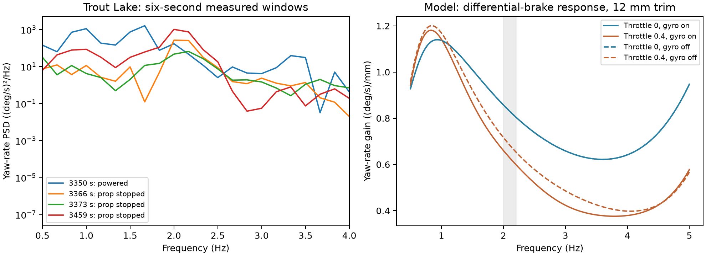

# Powered versus stopped-prop modes

The as-built rigid articulated model qualitatively loses pitch/yaw coupling when the prop stops, but does not reproduce the observed stopped-prop Trout Lake yaw feature. No model, controller, or deployment changes are warranted by this diagnostic.

## Protocol

Use the installed Rust simulator through its Python API, both as-built flight configurations, fixed voltage 22.2 V, zero wind, 12 and 18 mm common effective brake trim, and throttle 0, 0.1, 0.2, 0.3, 0.4. Solve a steady translating equilibrium at each throttle, allowing vertical velocity to settle rather than imposing level flight. Differential brake trims straight flight. Repeat with rotor spin inertia set to zero while leaving propulsion active. This isolates gyroscopic coupling from thrust within this model. These are reference as-built profiles, not a retune or exact reconstruction of each flight window.

Linearize the 15-coordinate attitude/relative attitude/velocity/rate state using central differences of size 1e-5 and step durations 0.004 and 0.002 s. RPM is held at its equilibrium value for the mechanical mode calculation; motor transient poles are not included. Compute discrete-time differential-brake frequency response as well as eigenmodes. All 40 equilibria converge below 1e-4 residual; maximum frequency disagreement between the two numerical resolutions is below 1e-7 Hz at 12 mm and 2e-8 Hz at 18 mm. This checks numerical consistency, not physical accuracy.

Six-second log windows use IMU instance zero, native 50 Hz resampling with gap checks, Hann periodograms (Welch with one segment), latest actual servo output and RawRPM telemetry, and logged relative-home altitude. No cross-window concatenation. Frequency spacing is approximately 0.167 Hz; these short records do not establish pole damping or causality. Input hashes are retained. Landing-adjacent large pitch transients are excluded from the selected comparison windows.

## Results

| Trout Lake feature | Flight evidence | Model at 12 mm trim |
|---|---|---|
| Prop-stopped yaw | 2.0–2.2 Hz in two descent episodes | No oscillatory yaw mode there; differential-brake yaw response peaks at 0.93 Hz |
| Prop-stopped pitch | Smaller intermittent 2.5–2.8 Hz component | Pitch-dominated modes at 2.93 and 1.74 Hz |
| Powered mixed motion | Approximately 1.6 Hz, pitch/yaw amplitude roughly 0.37–0.47 and pitch lag roughly 76–96 degrees in previously analyzed manual windows | 1.74 Hz mode, pitch/yaw amplitude 1.25 and phase about -14 degrees |

The powered 1.74 Hz mode has decay rate about 5.38 per second: amplitude e-folding time about 0.19 s. Removing rotor gyro at the same powered trim leaves a nearly pitch-only mode at 1.75 Hz. Thus gyro substantially changes participation, but does not produce the proposed large frequency migration from a 2.1 Hz yaw mode into a 1.6 Hz coupled mode. At zero RPM, gyro-on and gyro-off results coincide as expected.

At 18 mm trim the same conclusions hold: unpowered yaw response peak 1.0 Hz, pitch modes 2.93 and 1.74 Hz, powered mixed mode 1.76 Hz. The initial attempt at 6 mm trim encountered the logged actuator command bound because the Hood River offset places a servo at its limit; no result from that attempt is used.

Hood River likewise loses most pitch/yaw mixing at zero RPM, retaining pitch-dominated modes around 2.67 and 1.61 Hz. Its short observed descents do not establish a clean surviving yaw resonance, so the strongest frequency comparison comes from Trout Lake.

The measured 1.2–1.9 Hz pitch/yaw rate RMS falls from 9.11/20.76 deg/s at 3350–3356 s to 0.39/1.64 deg/s at 3366–3372 s with zero measured RPM. A separate approximately 2.1 Hz yaw feature remains. Recorded differential-brake spectra in these selected stopped-prop windows peak near 0.5 Hz, not 2.1 Hz; this does not exclude broadband control forcing, gusts, or other excitation.

## Interpretation and next step

A flight spectral peak is not automatically a free eigenmode. The current model fails this frequency/participation diagnostic, but this test is not an amplitude prediction under the actual disturbances and commands. Nor does a stopped motor exclude aerodynamic or sensor effects. Power removal changes thrust, wake, airspeed and vibration as well as angular momentum.

Use the stopped-prop windows to constrain yaw restoring moment, yaw damping, effective inertia and suspension/aerodynamic coupling before fitting the powered response. Replay their actual brake histories and evaluate the 2.1 Hz feature across available windows, with wind and initial relative attitude uncertainty. Then require a candidate to explain powered pitch/yaw phase, relative amplitudes and persistence without independently retuning each regime. Do not infer a specific aeroelastic mechanism from this result alone.

## Reproduce

From repository root, using the installed simulator environment:

```sh
control/.venv/bin/python research/active/power-off-modes-2026-10-18/flight.py
control/.venv/bin/python research/active/power-off-modes-2026-10-18/run.py
COMMON=18 control/.venv/bin/python research/active/power-off-modes-2026-10-18/run.py
research/.venv/bin/python research/active/power-off-modes-2026-10-18/plot.py
```


