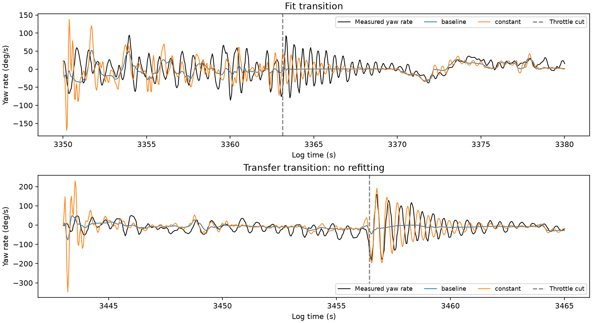

# Continuous power-transition identification

## Decision

No promotion. A single rigid-model parameter set can move the Trout Lake mechanical modes toward the observed powered/stopped frequencies, and increase spectral amplitudes across transitions. It does not reproduce waveform timing well enough: instantaneous yaw-rate error worsens substantially in the second Trout Lake descent. The tested positive RPM-dependent yaw damping term collapses to zero. This supports further calibration/identifiability work, not a claim that aeroelasticity is established or excluded.

## Data and model

Fit only Trout Lake 3350–3380 s, cutting throttle near 3363.13 s. Check Trout Lake 3443–3465 s (cut 3456.45 s) without parameter or nuisance-state refitting. Check Hood River 580–601 s and 1040–1067 s using its own as-built mass/geometry. These episodes were inspected in prior studies; the second transition is reserved from this numerical fit, not a newly unseen dataset.

Replay once continuously through each transition. The canopy state is initialized before power-off and never reset at the cut. The original 25 Hz actual actuator histories are retained. Recorded ESC RawRPM is linearly interpolated onto that clock and within integration steps, driving the existing thrust and shaft-torque maps, gyroscopic angular momentum, and spin-acceleration reaction. ESC gaps are checked below 0.5 s. Linear interpolation uses future samples: this is offline reconstruction, not an online estimator. Sparse/quantized RPM and its derivative remain uncertain; +/-0.12 s alignment sensitivity is included. This does not validate the propeller aerodynamic maps.

A research-only Rust executable wraps the existing sim-core RHS. Production core, bindings, firmware, browser, and controller gains are unchanged. Wind is a constant mean per transition with bounded corrections in the fitting transition; no unmeasured gust sequence is invented.

## Fitting and checks

Fit positive multipliers on rotor spin inertia (0.5–1.5), yaw stiffness (0.25–4), yaw damping (0.02–2), and pitch damping (0.1–3). Geometry and body inertia are fixed during fitting. Canopy initial pitch/yaw corrections are bounded to +/-10 degrees; horizontal wind corrections to +/-2 m/s, with weak normalized regularization. Validation resets these corrections to zero rather than importing a flight-specific fitted wind/initial attitude or fitting validation data.

Compare a constant-damping model with the restricted hypothesis

$$
c_{yaw}(n)=c_0[1+g(n/8000)^2],\qquad 0\leq g\leq20.
$$

This tests damping increasing with RPM. It does not test decreasing/nonmonotonic damping, airspeed dependence, or delayed aerodynamic moments.

Each model uses two starting points. The least-squares residual combines normalized instantaneous rates, log pitch/yaw spectral amplitudes in 1.2–1.9, 1.8–2.4 and 2.4–3 Hz bands, complex normalized pitch/yaw cross-spectra, and three-block rate envelopes. Powered and unpowered portions are scored separately, excluding startup and a two-second post-cut settling interval. The objective is exploratory and places substantial weight on spectral shape. Its decrease is not a deployment acceptance criterion.

All four fits terminate by the cost-change criterion; 422 residual evaluations are recorded. Both starts converge to similar solutions. The constant fit multipliers are approximately: rotor inertia 1.494, yaw stiffness 0.828, yaw damping 0.020, pitch damping 0.229. Rotor inertia is close to the upper bound and yaw damping hits the lower bound. These are effective parameters, not independent physical measurements or a uniquely identified optimum.

The RPM coefficient fits to approximately 0.0000005, yielding essentially the constant model. There is no meaningful improvement from this additional term within this model family and objective.

Backend checks reproduce production constant-RPM integrations at zero and powered RPM to about 2e-14 state units. Eight actual-transition 32/64-substep checks and 96 sensitivity cases cover +/-15% payload yaw inertia (SPD-preserving congruence transform), +/-5-degree initial canopy pitch/yaw, +/-1 m/s horizontal wind, and +/-0.12 s RPM alignment. The maximum 32/64-substep rate difference is 0.0047 deg/s. These are one-at-a-time sensitivity checks, not refitted confidence intervals. The second descent candidate yaw RMSE ranges from 21.36 to 46.48 deg/s across these checks, so its timing mismatch is sensitive to uncertain inputs/parameters and the nominal 46.43 value is not a robust lower bound on achievable error. No sensitivity case is selected using this validation result. Input and executable hashes are retained.

## Results

| Trout Lake quantity | Observed | Baseline | Constant fit |
|---|---:|---:|---:|
| First powered 1.2–1.9 Hz yaw RMS | 26.70 | 3.62 | 18.11 deg/s |
| First descent 1.8–2.4 Hz yaw RMS | 7.51 | 0.54 | 5.27 deg/s |
| Second powered 1.2–1.9 Hz yaw RMS | 17.26 | 4.39 | 12.82 deg/s |
| Second descent 1.8–2.4 Hz yaw RMS | 20.10 | 0.30 | 12.57 deg/s |

These windows differ from the prior shorter descent-only study, so their observed RMS numbers should not be compared as if computed over identical intervals.

Spectral improvement comes at a cost. First-transition powered yaw RMSE increases from 32.76 to 42.10 deg/s, and descent RMSE from 15.18 to 16.93. In the second transition, powered yaw RMSE increases from 23.44 to 25.86, and descent RMSE from 29.22 to 46.43. Thus the substantial reductions in composite fitting score (13.70 to 3.81 training; 25.72 to 7.94 second transition) do not establish better instantaneous dynamics. Replay plots show timing/phase disagreement.

Hood River transfer is mixed: powered yaw RMSE improves from 40.52 to 37.38 deg/s in the first window but worsens from 49.00 to 54.01 in the second; both descent errors worsen. Oscillation energy increases, but some bands overshoot substantially. No cross-configuration validation pass is claimed.

## Stability diagnostic

Four straight-flight equilibria at fixed 12 mm effective common brake and throttle zero/0.4 converge. All non-neutral local modes decay; maximum real parts near 1e-9 per second are heading-neutral numerical noise. The fitted Trout Lake model has a stopped-prop mode at 2.208 Hz with decay 0.507 per second, and a powered mode at 1.565 Hz with decay 1.755 per second. These are equilibrium eigenmodes, not direct spectral fits or proof of persistent oscillation. Hood River's corresponding frequencies are about 2.056 and 1.277 Hz, showing that matching Trout Lake does not solve cross-configuration behavior.

## Interpretation

The previous suspicion that a power-dependent yaw damping term was necessarily missing is not supported by this test. Existing gyroscopic coupling plus much lower constant damping can produce the qualitative frequency change. However, bound-hitting, phase/timing error and mixed transfer show that the physical parameters and excitation are still not adequately identified. The result does not justify applying a 98% damping reduction.

A useful next analysis is profile fitting around independently plausible rotor/body inertias, together with examination of phase/input timing and initial relative-rate uncertainty. Any promoted candidate must improve dynamic shape and rate errors across both transitions, rather than merely achieve their spectral amplitudes. No LQI retune is justified by this result.

## Reproduce

Build with `cargo build --release` in this directory. Run `study.py`, `test_backend.py`, `validate.py`, and `stability.py` using `control/.venv/bin/python` from repository root. `stability.py` imports the existing power-off study trim helper. Run `plot.py` with `research/.venv/bin/python`. Flight paths are in `study.py`; raw inputs and compiled targets remain outside version control.

