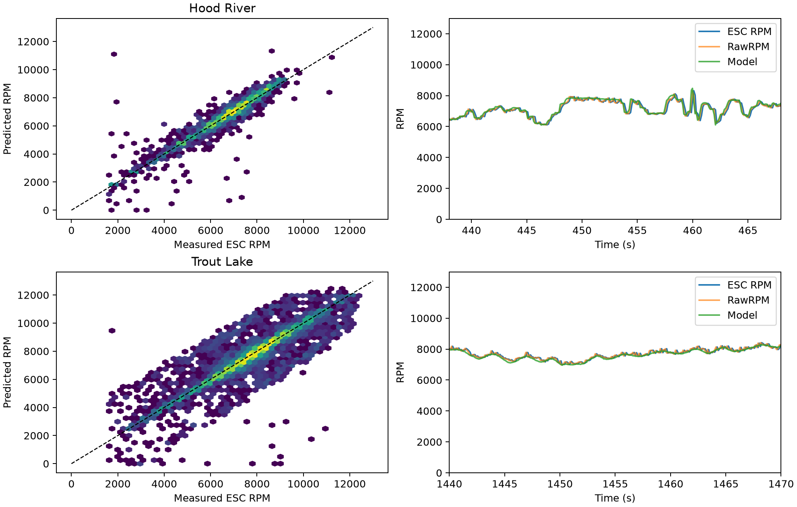

# Measured ESC RPM versus propulsion model

AI-assisted audit, 2026-10-18. Descriptive consistency check on reused flight data, not an independent validation of the original fit. No parameters or deployment changed.

## Result

The present throttle/voltage-to-RPM model agrees closely with measured motor speed. Most large apparent transient error against ESC.RPM is reduced when using unslewed ESC.RawRPM, consistent with telemetry processing rather than a large steady propulsion error.

| Flight | RawRPM RMSE | RawRPM median absolute relative error | RawRPM 90th percentile error | Slewed RPM RMSE | Stable-condition RPM RMSE |
|---|---:|---:|---:|---:|---:|
| hood_river | 136 RPM | 0.82% | 2.38% | 324 RPM | 96 RPM |
| trout_lake | 178 RPM | 0.95% | 2.77% | 466 RPM | 135 RPM |

RawRPM mean prediction bias is +37 RPM at Hood River and -55 RPM at Trout Lake. Exact paired comparisons using a common positive-RPM mask are also retained in results.json. Stable-condition median absolute relative error is 0.79% and 0.90%, respectively.

## What was evaluated

The current Rust model uses $n_*=743.5778 V\max(u-0.0005141,0)^{0.9086807}$, with first-order relaxation $\dot n=(n_*-n)/\tau$ and $\tau=0.0175613$ s. Here $u$ is normalized throttle, $V$ is voltage, and $n$ is mechanical RPM.

The audit starts once from logged RPM, then runs forward from actual RCOU.C1 output and ESC voltage without feeding subsequent measured RPM back into the prediction. It integrates exactly between timestamped command and voltage events, holding the latest available inputs. Servo1 function/min/max/reversal in the logs confirm throttle normalization (C1-1000)/1000.

Comparisons use the existing valid-flight mask, measured RPM above 1500, voltage above 10 V, recent throttle output (<0.1 s), and exclude one second after ESC gaps above 0.3 s. Stable condition means the static target varies by less than 3% of measured RPM within a centered 0.6 s interval; this future-looking classification is only a diagnostic label.

ESC.RPM is slewed between telemetry updates; RawRPM is the stored unslewed speed, as checked in AP_ESC_Telem and the historical BLHeli backend. Both are subject to telemetry timing/quantization. A diagnostic -0.12 s shift of the model reduces slewed-RPM RMSE to 142/178 RPM. This is not a newly fitted physical delay; it is consistent with the ~0.12 s ESC reporting interval and the strong agreement with RawRPM.

The 17.6 ms motor time constant is shorter than the approximately 40 ms actuator logging interval and 120 ms ESC interval. These records do not independently resolve that time constant well. Transient error against RawRPM is retained separately rather than claiming the slew correction removes all dynamics uncertainty.

## Check against the actual physics replays

The ten existing 30 s diagnostic windows were rerun through the maintained native simulator with its usual fixed per-window voltage, original initial RPM, and logged throttle commands. After excluding the first two seconds, mean window RMSE against RawRPM is 137 RPM for Hood River and 135 RPM for Trout Lake. Mean window median absolute percentage errors are 1.48% and 1.23%. These are averages of window metrics, not pooled whole-flight errors. Results are in replay-check.json.

## Implication

RPM mismatch is unlikely to account for the order-of-magnitude underprediction of the low-frequency yaw oscillation by itself. It does not validate thrust, shaft torque, propeller normal force, aerodynamic inflow or gyroscopic moment: RPM is only one input to those calculations. The model maps RPM and axial inflow through propeller tables, while its RPM target is an empirical throttle/voltage relationship rather than a motor torque-balance model. Correct speed can coexist with an incorrect applied force or moment.

Do not retune motor lag from slewed RPM alone. If investigating excitation next, prescribe RawRPM as a diagnostic input and compare to the causal model, while keeping the distinction between measured speed and independently validated propeller loads.

## Reproduce

Run analyze.py with research/.venv/bin/python (NumPy/Matplotlib), replay_check.py with control/.venv/bin/python, and checks.py with research/.venv/bin/python. checks.py compares the audit formula with native Rust RPM propagation. Raw logs and generated NPZ traces are not committed. Input hashes are in results.json.
