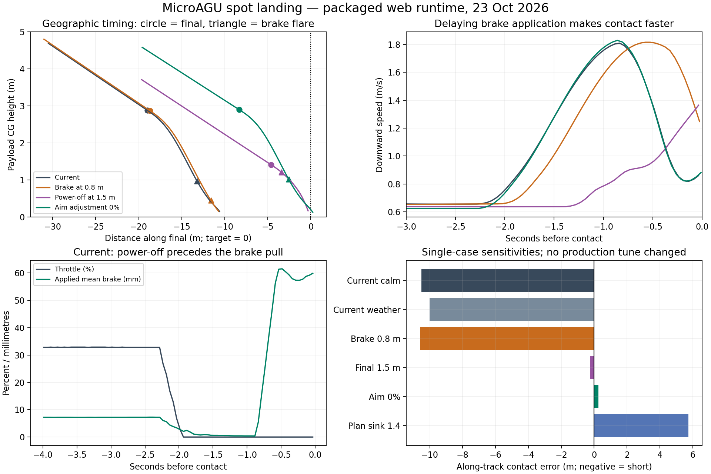

# Spot-landing assessment — 23 October 2026

The poor accuracy is reproducible. The current built-in landing mission contacted
the ground approximately **10 m short**, with less than 0.4 m cross-track error.
The main defect is the approach/flare distance assumption: the path brings the
aircraft to its power-off height too far upstream for its actual unpowered
descent. The evidence does **not** support lowering the brake trigger as the
primary correction.

## Reproduction and configuration

I flew the published simulator through its normal launch, selected 8× simulation
speed and **RTL · land**, and left its default weather enabled. It completed the
native landing sequence and paused after landing. Its event log reported:

> Flare 3.0m sink=0.82 speed=4.4 dist=20.8

Here ArduPlane's “Flare” event means entry into power-off FINAL, not the later
common-brake pull. No numerical spot error was extracted from the live UI.

Ten instrumented flights used the same browser `Simulator` runtime, packaged
ArduPlane WASM, Rust physics WASM, configuration and LQI gain file. SHA-256 checks
matched all four inputs to the published manifest; the entire local and live
build manifests were identical. These flights ran the web runtime under Node,
without the renderer. They use the existing native-landing driver, extended only
for parameter and weather overrides and passive parameter recording. They climb
and settle before uploading the landing mission, rather than reproducing the
live UI's entire initial circuit. Thus they reproduce the landing mechanism,
not an identical live-browser trajectory.

The read-only [parameter probe](probe.mts) confirmed these values directly from
the packaged firmware; see [parameters.json](parameters.json):

| Parameter | Actual value | Role |
|---|---:|---|
| `LAND_FLARE_ALT` | 3 m | Native FINAL, power-off and LQI handback |
| `LAND_FLARE_SEC` | 0 s | Time trigger disabled |
| `LAND_FLARE_AIM` | 50% | Planner's flare-distance adjustment |
| `TECS_LAND_SINK` | 0.25 m/s | Planner's assumed final sink |
| `PG_FLARE_HGT` | 1.3 m | Separate latched common-brake trigger |
| `PG_FLARE_PCT` | 80% | Nominal common-brake request |
| `PG_FLARE_RATE` | 300 percentage points/s | Command slew limit |
| `PG_FLARE_RES` | 10% | Reserved differential travel |
| `PG_FLARE_SINK` | 0.65 m/s | Brake feedback sink target |
| `PG_FLARE_GAIN` | 27 | Brake feedback gain |

The older landing article's 1.4 m/s planning sink is not the current runtime
setting. The current browser defaults omit `TECS_LAND_SINK`, leaving the
firmware default of 0.25 m/s. The planner and brake feedback use different sink
parameters; neither makes the unpowered vehicle instantly achieve that rate.

## What the fresh traces show

In the calm built-in mission, native FINAL was first observed at 2.88 m actual
payload-CG height, 19.00 m before the target. Contact followed 2.23 s later,
after only 8.49 m of forward travel. The aircraft therefore arrived 10.50 m short.
The weather case showed the same mechanism: FINAL at 18.57 m short, contact at
10.00 m short. The descending orbit reached approximately 30 m before the
straight final; a failure to complete the spiral descent did not explain these
runs.

Throttle slews down and LQI disengages at FINAL. The ordinary common trim also
releases, and sink increases from approximately 0.66 m/s toward 1.8 m/s before
the brake pull reduces it. Brake-flare telemetry first appears near 0.97–1.01 m
actual CG height in the current mission runs, with about 0.7–0.8 s remaining
before contact. These are sampled telemetry transitions, including estimator and
reporting delay, not exact measurements of the internal gate's firing instant.
They provide no evidence that the brakes are being applied several metres high.



## Isolating the cause

All rows below are fresh runs, in AUTO throughout. The first six vary one setting
at a time relative to the calm built-in mission, except the explicitly identified
weather row. Negative along-track error means landing short. Contact is the last
sample before the driver's ground-clearance boundary, not the end of rollout.

| Case | Along-track error (m) | Downward speed (m/s) | Ground speed (m/s) |
|---|---:|---:|---:|
| Current, calm | −10.50 | 0.88 | 2.79 |
| Current, default weather settings | −10.00 | 0.92 | 2.56 |
| Power-off height 1.5 m | −0.23 | 1.40 | 2.23 |
| Brake height 0.8 m | −10.61 | 1.19 | 4.26 |
| Planning sink 1.4 m/s | +5.75 | 0.88 | 2.80 |
| Flare aim adjustment 0% | +0.26 | 0.89 | 2.77 |
| Aim 0%, second calm run | −1.84 | 0.88 | 2.82 |
| Aim 0%, default weather settings | −2.22 | 0.97 | 3.20 |
| Separate straight approach, current | −5.44 | 0.96 | 2.61 |
| Separate straight approach, aim 0% | +3.34 | 0.95 | 2.64 |

Lowering the brake height changes the spot error by only 0.11 m, while increasing
both contact sink and forward speed. Lowering power-off height corrects the spot
in this case but produces a different flare transient and substantially faster
downward contact. It also changes the planner's aim height, so that experiment
cannot isolate power-off timing from approach geometry.

Changing only the planner's aim adjustment retains the 3 m power-off trigger,
1.3 m brake trigger and original brake response, yet shifts the power-off point
downstream by about 11 m in the first calm comparison. Similar contact sink with
much smaller miss is strong evidence that approach geometry is the main issue.
Simply restoring the older 1.4 m/s planning sink overshoots by 5.75 m; copying that
historical value is not a qualified correction.

## Firmware explanation

The pinned firmware's [slope planner](https://github.com/DavidIngraham/ardupilot/blob/97c479ab36f08b826723125691cde6994768e680/libraries/AP_Landing/AP_Landing_Slope.cpp)
estimates flare travel using

$$
w=\frac{\mathrm{LAND\_FLARE\_AIM}}{100},\qquad
\bar v_{z,f}=\max\!\left(wv_{z,\mathrm{land}}+(1-w)v_{z,\mathrm{approach}},0.1\right),
$$

$$
t_f=\frac{h_{\mathrm{aim}}}{\bar v_{z,f}},\qquad d_f=V_g t_f.
$$

It shifts the descending path upstream to allow that travel. A 0.25 m/s final
sink assumption predicts a long float. This aircraft instead accelerates downward
when power and LQI trim brake release, then applies strong brake below the
separate low-height gate. Its measured remaining flight time is much shorter
than that assumption represents. Forward speed also changes during braking.

The [brake mixer](https://github.com/DavidIngraham/ardupilot/blob/97c479ab36f08b826723125691cde6994768e680/ArduPlane/servos.cpp)
implements the separate gate and bounded sink feedback. The native final trigger
and mixer consume estimated height; truth is used only for this assessment.

## Recommendation and limits

Correct the landing-path/flare-distance calibration first, while retaining the
existing brake height for the initial comparison. Zero aim adjustment is a useful
candidate for the built-in mission, reducing its observed miss to 0.29–2.25 m
across two calm runs and one weather run. It is not a universal tune: the separate
straight approach lands 3.38 m long in total distance. A general correction should
represent the power-off descent and subsequent brake pull as distinct parts of
the predicted remaining travel, and be checked across approach slopes, wind,
estimator error and actuator variation.

The older native landing assessment allowed spot error below 25 m, and browser
tests verified sequence completion and pause without asserting spot accuracy.
Those tests can pass the reproduced failure. A future fix should add an explicitly
agreed accuracy criterion alongside contact sink and ground-speed checks; merely
reaching “Landed” is insufficient.

These ten runs diagnose the packaged simulator, not physical aircraft landing
performance. They are a sensitivity study, not an independent validation campaign
or a calibrated distribution of errors. Fresh-process timing changes produce
some trajectory variation even in calm air. The synthetic weather cases use the
UI's default settings and seed 73, not a claim of identical gust history to the
live UI run. The rigid canopy/contact model does not validate impact, canopy
collapse or rollout. No production parameters, firmware, physics, controller gains
or published site were changed.

## Evidence and reproduction

Run from the repository root with the existing Node 24 runtime and Python with
Matplotlib:

```sh
python3 research/active/spot-landing-assessment-2026-10-23/run.py
PATH=/home/david/emsdk/node/24.19.0_64bit/bin:/usr/bin:/bin \
  viewer/node_modules/.bin/tsx research/active/spot-landing-assessment-2026-10-23/probe.mts
python3 research/active/spot-landing-assessment-2026-10-23/assess.py
```

[Case definitions](cases.json), [summary with transition coordinates](summary.json),
[source/runtime and evidence hashes](provenance.json), and
[captured published manifest](live-build.json) accompany this report.
Full local traces remain in ignored `runs/`; hashes in the summary identify their
bytes. `case-v1.mts` preserves the first six runs' driver; `case.mts` adds passive
parameter telemetry collection for the last four. The failed initial attempt to
request parameters through the browser's restricted message dictionary produced
no flight data; the separate probe extends only its in-memory encoder dictionary
with metadata checked against installed pymavlink. The corrected flights and
probe completed successfully.
