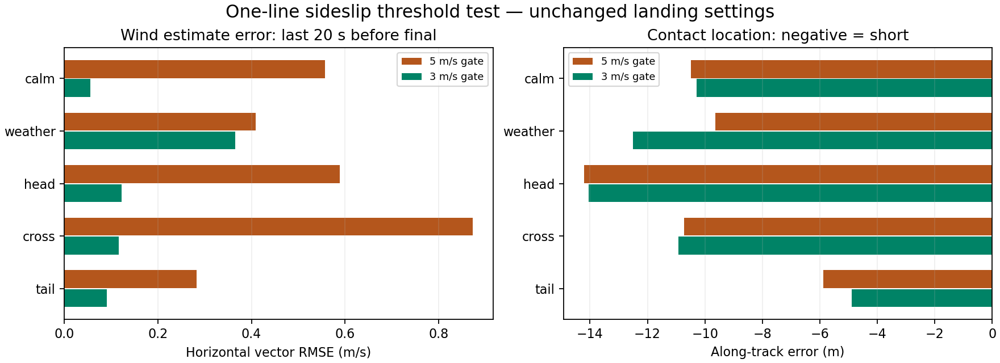

# Single-threshold wind-estimation test

This experiment lowers only the forward air-relative velocity gate in
`NavEKF3_core::FuseSideslip()` from **5 m/s to 3 m/s**. It is a simulation test,
not a general low-speed estimator redesign.

The clean `ardupilot-lqi-pipeline` checkout was at firmware revision
`97c479ab36f08b826723125691cde6994768e680`. Its pre-existing JS and WASM hashes
exactly matched the published browser runtime before the edit. The only source
change is preserved in [threshold-only.patch](threshold-only.patch). The separate
dirty research checkout and its broader low-speed EKF experiments were not used.

The candidate compiled successfully with the existing Emscripten 6.0.8 WASM
configuration. The original wind-state initialization condition remains at
5 m/s ground speed. Observation covariance, sensor configuration, LQI gains,
physics, landing geometry and flare settings are unchanged. Both versions fly
the existing native AUTO landing mission; neither receives wind truth as a
controller input.

## Test method

Ten fresh runs compare the original and candidate firmware in calm air, default
synthetic weather, and nominal 1.5 m/s headwind, crosswind and tailwind setups.
The calm and weather pairs ran with two processes at a time. The six corrected
steady-wind cases ran concurrently on the 16-core host.
The research harness uses the normal browser `Simulator` runtime under Node,
with the original sensor and MAVLink paths. Truth is used to evaluate wind and
contact location. Existing attitude and landing-completion guards are retained.

The numerical comparison uses the last 20 s before power-off FINAL. Contact is
the last sample before the existing ground-clearance boundary, not a validated
impact or rollout result. The wind-error measure is horizontal vector RMSE.
The steady winds are fixed in earth axes: north flow −1.5 m/s for headwind,
east flow +1.5 m/s for crosswind, and north flow +1.5 m/s for tailwind. These are
identical between firmware versions, with a northbound final approach.
Case inputs and seeds match between versions, but fresh-process
timing and changed closed-loop trajectories do not give bit-identical gust
encounters. Each condition has one run per version.

An initial steady-wind batch inherited the older harness's course-relative wind
setup. Changing the controller's wind inputs changed the initial cruise heading
in one case, making a nominal headwind into an oblique tailwind on final. Those
steady-wind comparisons were replaced by the fixed-earth-axis cases above;
the first calm and default-weather comparisons remain valid. Preliminary traces,
two headwind-labelled repeats, driver and summary are preserved under the
`threshold-initial-*` files and their original `runs/threshold-*` case IDs. They
are excluded from the primary comparison. This corrects the preliminary
headwind-specific interpretation given while the experiment was running.
Two preliminary candidate runs failed to confirm a settled landing after
contact. These remain recorded as failures in the preliminary evidence; they
are not relabelled as passes. They occurred outside the corrected fixed-vector
comparison and remain a reason to avoid treating this small experiment as
general qualification.

Detailed results and evidence fingerprints are in
[threshold-summary.json](threshold-summary.json) and
[threshold-provenance.json](threshold-provenance.json).



## Results

| Condition | Wind RMSE, 5 → 3 m/s gate (m/s) | Along-track error, 5 → 3 m/s gate (m) | Contact sink, 5 → 3 m/s gate (m/s) |
|---|---:|---:|---:|
| Calm | 0.557 → 0.056 | −10.49 → −10.30 | 0.90 → 0.88 |
| Default weather | 0.409 → 0.365 | −9.64 → −12.51 | 0.94 → 0.80 |
| Headwind | 0.589 → 0.123 | −14.21 → −14.06 | 0.84 → 0.84 |
| Crosswind | 0.873 → 0.117 | −10.72 → −10.92 | 0.89 → 0.89 |
| Tailwind | 0.282 → 0.091 | −5.88 → −4.88 | 1.50 → 0.94 |

All ten primary runs completed the native landing and presentation stop. They
remained in AUTO; LQI was active for 100% of each evaluated approach window and
handed back for final. No primary run hit the existing attitude guard. The
candidate's contact sink ranged from 0.80 to 0.94 m/s. Ground-speed RMSE remained
approximately 0.008–0.018 m/s across the primary set.

The lower gate materially improves steady/calm wind estimation. The default
gust case improves less, and its landing moves farther short. Better wind
estimation therefore does not automatically improve spot accuracy under the
unchanged flare-distance assumptions. Calm, headwind and crosswind contact
locations remain very close between gates, with the systematic short bias
retained. The tailwind candidate also has a slower contact than its baseline,
but one run per condition does not establish a general touchdown benefit.

This is a useful positive test of the wind-update hypothesis. It supports
continuing the 3 m/s gate experiment while correcting the landing-path/flare
distance calibration separately. It does not establish an estimator threshold
for physical flight or justify changing the public simulator by itself. No
observation-noise adjustment, gain retune, additional wind-state initialization
change, or public deployment was made.

## Reproduction

The one-line source edit is left reviewable in
`ardupilot-lqi-pipeline/libraries/AP_NavEKF3/AP_NavEKF3_AirDataFusion.cpp`.
The candidate artifacts are retained locally in
`threshold-firmware/3m/arduplane.js` and `arduplane.wasm`; the unchanged baseline
is in `threshold-firmware/5m/`. These binary copies are ignored by Git and their
hashes are recorded in the provenance file.

To recreate the candidate from the pinned source, apply `threshold-only.patch`
in a clean matching firmware checkout, then build with the existing WASM setup:

```sh
source /home/david/emsdk/emsdk_env.sh
export EMCC_CFLAGS='-sEXPORTED_RUNTIME_METHODS=cwrap,HEAPU8,FS,SOCKFS,PThread'
./waf plane -j4
```

Copy the resulting JS and WASM into `threshold-firmware/3m/`, the packaged
originals into `threshold-firmware/5m/`, and put `{"type":"module"}` in
`threshold-firmware/package.json`. Then run from the MicroAGU repository root:

```sh
python3 research/active/spot-landing-assessment-2026-10-23/run-threshold.py
python3 research/active/spot-landing-assessment-2026-10-23/assess-threshold.py
```

The runner also accepts selected case IDs. Full local traces are in ignored
`runs/`. Assessment fails on missing/mismatched case inputs and verifies the
original firmware, candidate firmware, single source edit, and unchanged
physics/configuration/gain hashes. The public simulator assets were not replaced.
