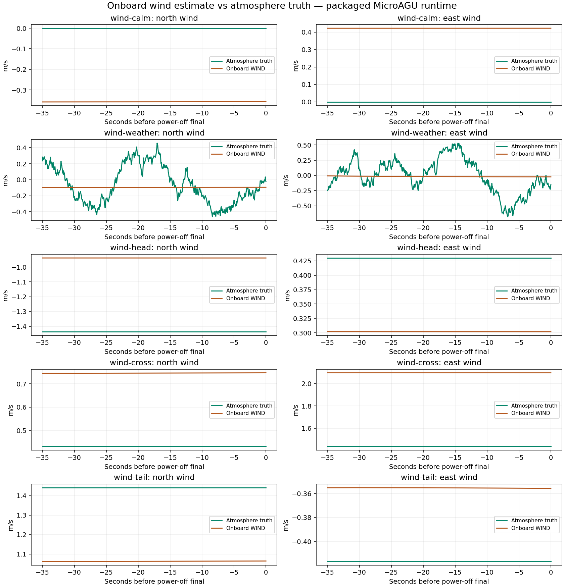

# Wind estimation and the short-landing error

The onboard wind estimate has meaningful errors. It is not an accurate copy of
the imposed atmosphere. However, the evidence does not identify it as the main
cause of the systematic roughly 10 m short landing described in [RESULTS.md](RESULTS.md).
The landing planner uses measured ground speed directly, and that quantity is
much more accurate than the wind estimate in these tests.

## What is actually measured

The web UI's **WIND TRUTH** indicator displays the synthetic atmosphere. It does
not display ArduPilot's wind estimate. The earlier landing recordings did not
contain estimated wind, so they could not establish estimation accuracy.

Five additional flights use the same packaged firmware, physics, gains and
built-in landing mission, with observational instrumentation added to the
research driver. MAVLink `WIND` is requested at 10 Hz and compared with the
simultaneous `wind_ned_m_s` truth stream. Direction is converted from the message's
meteorological from-bearing into NED flow components. The standard message
metadata was checked against the installed pymavlink dialect. No controller
input is replaced by truth.

The reported window is the final 20 s before native power-off FINAL. Horizontal
wind RMSE is the root mean square of the two-component vector error, not an error
in direction angle. Ground-speed RMSE compares fused telemetry with physics CG
ground speed at the same sampled times; it includes telemetry latency and any
small CG/IMU velocity difference.

The full numerical results are in [wind-summary.json](wind-summary.json), with
source/runtime/driver hashes in [wind-provenance.json](wind-provenance.json).

| Case | Horizontal wind RMSE (m/s) | Ground-speed RMSE (m/s) | Along-track contact error (m) |
|---|---:|---:|---:|
| Calm | 0.55 | 0.015 | −10.22 |
| Default weather | 0.40 | 0.017 | −9.73 |
| Nominal 1.5 m/s headwind | 0.52 | 0.015 | −13.54 |
| Nominal 1.5 m/s crosswind | 0.73 | 0.007 | −9.89 |
| Nominal 1.5 m/s tailwind | 0.38 | 0.018 | −5.79 |

Negative contact error is short of the target. The steady wind directions were
set relative to the initial cruise course; the final approach is northbound.
The complete NED wind vectors are recorded in the summary. LQI was active for
100% of each evaluated 20 s window.



## Why the wind estimate is imperfect

Parameter readback confirms `AHRS_EKF_TYPE=3`, `ARSPD_TYPE=0`, and `ARSPD_USE=0`.
The vehicle uses EKF3 and has no enabled airspeed sensor. Although the JSON
physics interface supplies airspeed and wind to the SITL sensor environment,
that does not mean those values are directly supplied to the EKF wind estimate.
The disabled airspeed sensor supplies no independent pitot measurement.

The pinned [EKF3 wind estimator](https://github.com/DavidIngraham/ardupilot/blob/97c479ab36f08b826723125691cde6994768e680/libraries/AP_NavEKF3/AP_NavEKF3_Control.cpp)
uses fixed-wing motion assumptions, including zero sideslip, to make wind states
observable. A valid estimate is not a guarantee of small error. The research
controller's [input and measurement path](https://github.com/DavidIngraham/ardupilot/blob/97c479ab36f08b826723125691cde6994768e680/libraries/AP_CustomControl/AP_CustomControl_LQI.cpp)
subtracts estimated wind from ground velocity to obtain air-relative velocity,
so these errors can bias its airspeed/observer inputs.

There is a specific low-speed incompatibility in this packaged revision:
[`FuseSideslip()`](https://github.com/DavidIngraham/ardupilot/blob/97c479ab36f08b826723125691cde6994768e680/libraries/AP_NavEKF3/AP_NavEKF3_AirDataFusion.cpp)
performs its synthetic zero-sideslip update only when body-forward estimated
air-relative velocity exceeds **5 m/s**. These approaches are below that gate.
Reconstructing that component from recorded fused navigation, attitude and wind
gives **3.71–4.62 m/s** across all five evaluation windows. This reconstruction
uses sampled telemetry, not the filter's exact delayed internal state, but is
well below the threshold. The observed wind estimate is essentially flat over
the straight final, including the gust case. With no enabled pitot measurement,
it retains an earlier estimate instead of tracking the changing atmosphere.

This is more specific than merely a slow filter: the normal sideslip correction
is gated out at the aircraft's usual approach speed. Wind states can remain
marked valid while their useful measurement updates have stopped. Lowering that
gate alone is not a verified fix; the sideslip observation's conditioning and
validity for the articulated payload/canopy still need checking at low speed.

The [EKF3 output](https://github.com/DavidIngraham/ardupilot/blob/97c479ab36f08b826723125691cde6994768e680/libraries/AP_NavEKF3/AP_NavEKF3_Outputs.cpp)
explicitly sets vertical wind to zero. Vertical gusts and thermal lift are not
estimated as atmospheric vertical velocity by this wind output. Fused vertical
vehicle speed is still available to height and brake control.

MAVLink `WIND` has no validity flag, and the sender transmits the numeric estimate
even when the AHRS return value is invalid. LQI activity provides a separate
check during approach because its eligibility requires valid wind; the activity
fraction is included in the numerical results. This should not be generalized
into a validity claim for every post-contact sample.

## Implication for landing accuracy

The pinned [landing slope planner](https://github.com/DavidIngraham/ardupilot/blob/97c479ab36f08b826723125691cde6994768e680/libraries/AP_Landing/AP_Landing_Slope.cpp)
calculates remaining flare travel from AHRS ground speed and the assumed flare
time. It does not calculate that speed by subtracting an estimated headwind from
assumed airspeed. Thus wind-estimation error is not a direct error in the speed
used by this calculation.

There are two different questions:

1. **Is the onboard air-relative estimate accurate?** Only approximately in
   these cases. Persistent errors of several tenths of a metre per second are
   material for an aircraft flying around 4 m/s. Vertical wind is unestimated.
2. **Does that explain the early-looking final and roughly 10 m short landing?**
   The stronger evidence remains the mismatch between planned and actual
   power-off/flare travel. The short landing persists in calm air, the directly
   used ground speed is accurate, and changing only the landing aim adjustment
   substantially changes spot error while retaining the existing wind estimator.

This is evidence about relative importance, not an isolated causal measurement
of wind-estimator contribution. No paired perfect-wind input substitution was
performed. The steady-wind cases combine physical wind effects with estimation
error; changes in their landing misses cannot be attributed entirely to the
estimator. Each condition has one fresh run, so these results are not a wind
qualification or an uncertainty distribution.

Correcting flare-distance calibration remains the first landing change to test.
Wind estimate, wind truth, fused ground velocity, and air-relative observer
inputs should remain recorded in that follow-up. Broader precision claims need
wind/airspeed estimation sensitivity checks and resolution of the low-speed
update gate, especially for changing wind and vertical air close to the ground.
Production sensing, controller and landing
settings were not changed for this assessment.

## Reproduction

```sh
python3 research/active/spot-landing-assessment-2026-10-23/run-wind.py
python3 research/active/spot-landing-assessment-2026-10-23/assess-wind.py
```

Run from the repository root with the existing Node 24 runtime and Python with
Matplotlib, as in the original assessment. The runner can also take case IDs.
Full traces stay in ignored `runs/`; their SHA-256 hashes are recorded in the
summary. Missing results or mismatched case inputs cause assessment failure.
