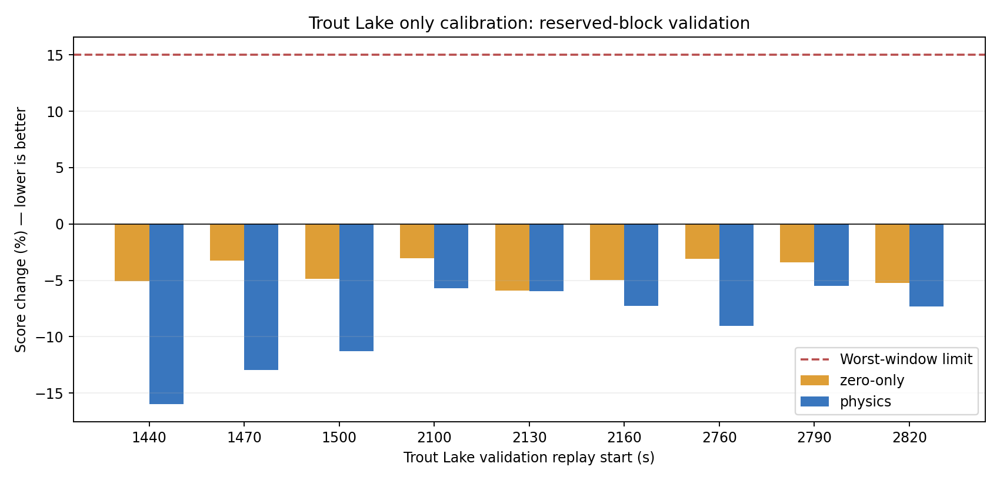
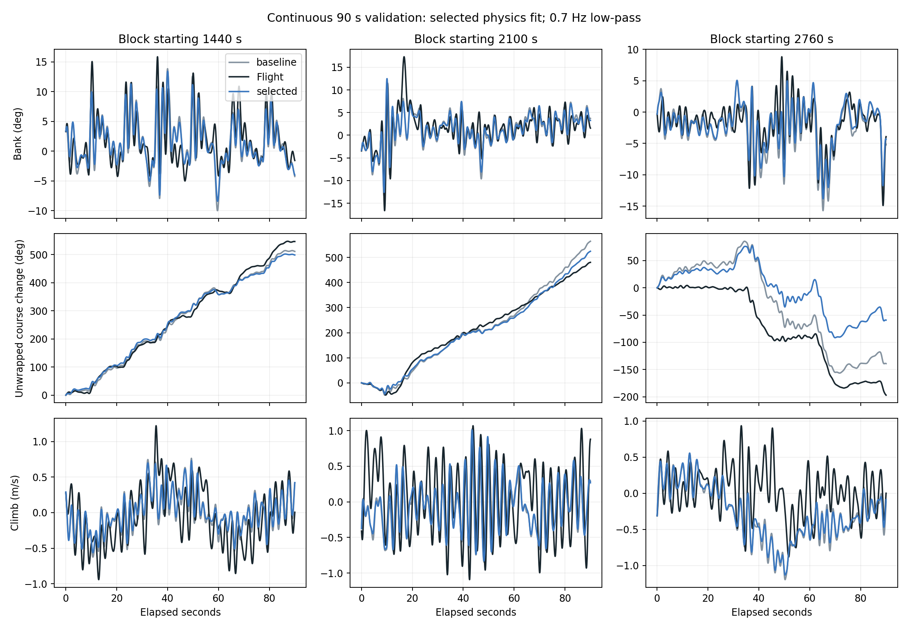

# Trout Lake primary fidelity study, 2026-10-18

The primary candidate selected using training data alone is **physics**. Its frozen 30-second Trout Lake validation gates **pass**. **It remains provisional because continuous 90-second replays expose a regression.** No production preset, browser runtime, or controller gain was changed by this study.

## Scope and split

Trout Lake is the primary target because it offers more data and is closer to the intended aircraft. The historical configuration remains **1.758 kg total mass and 132 mm riser spacing**, with its own payload inertia, CG-relative attachment/thrust locations, and mass-scaled yaw stiffness. This is not a fit for the planned 185 mm spreader. Full source configurations are in `configurations.json`.

Training blocks: 660–750, 1140–1230, 1740–1830, 2520–2610 s. Reserved validation blocks: 1440–1530, 2100–2190, 2760–2850 s. Each block is divided into three independently initialized 30-second replays for fitting and primary validation. Separate 90-second continuous replays test sensitivity to that reset interval. No training replay overlaps a validation block; there are substantial time gaps between blocks.

All data come from the same February flight and were potentially examined during prior project research. These are reserved blocks for this fit, **not independent flight validation**. Training includes bank angles up to 32.5 degrees; reserved blocks reach only 17.9 degrees. A good result cannot qualify aggressive turns or the whole LQI envelope. Input-groundspeed minima exceed 1.8 m/s, so observed course is not being inferred near zero ground speed.

## Candidate families and fixed protocol

The zero-only family fits two Trout Lake brake-zero offsets, bounded to ±3 mm. The physics family additionally fits aft aerodynamic application-point shift, residual brake yaw coefficient, roll stiffness, pitch/yaw damping, and brake lift/drag coefficients. Outboard redistribution stays disabled following the previous study. Mass, inertia, geometry, propulsion, initial wind, and baseline aerodynamic terms remain fixed.

Two prescribed starts use bounded Powell search, with budgets of 120 evaluations per start for zero-only and 240 for physics. `optimizer-status.json` records convergence and budget exhaustion; a budget-limited fit is not proof of optimality or identifiable physical parameters. The lowest regularized training score across both families is selected **before validation runs**. Validation does not choose the winning family or retune it.

The 0.7 Hz low-pass loss separates slower lateral and longitudinal motion from faster body-rate residuals. Lateral/longitudinal/fast groups carry 40/40/20% weights. Nine RMSE channels and their physical scales match the previous coupled-brake experiment, but the objective averages each training window's score relative to its own baseline, avoiding domination by the highest-error windows. Small regularization penalizes brake offsets and coefficient scale departures. Two seconds at each replay edge are excluded from the loss. Predicted velocity is transformed to the IMU point. Course is unwrapped.

Frozen gates require at least 5% mean score improvement, no window more than 15% worse, no mean group more than 5% worse, improvement in at least six of nine windows, and at least 5% mean improvement at each initial canopy angle (0.25, 0.35, 0.45 rad). Hood River is diagnostic only and is not an acceptance gate. These metrics assess recorded-input prediction, not controller stability or flightworthiness.

## Primary results

| Candidate | Mean score change | Worst window | Improved windows | Lateral ratio | Longitudinal ratio | Fast-rate ratio | Gates |
|---|---:|---:|---:|---:|---:|---:|---|
| zero-only | -4.3% | -3.1% | 9/9 | 0.861 | 0.989 | 0.998 | FAIL |
| physics | -9.0% | -5.5% | 9/9 | 0.741 | 0.963 | 0.976 | PASS |


Ratios are relative to each window's baseline. They quantify this weighted score, not percentages of physical error. Nominal initial-angle mean RMSEs, averaged over nine validation windows:

| RMSE channel | Baseline | Selected | Unit |
|---|---:|---:|---|
| slow_bank | 2.707 | 2.377 | deg |
| slow_yaw_rate | 9.191 | 7.819 | deg/s |
| course | 23.250 | 24.802 | deg |
| slow_pitch | 4.800 | 4.698 | deg |
| slow_climb | 0.417 | 0.409 | m/s |
| slow_speed | 0.592 | 0.603 | m/s |
| fast_roll_rate | 6.299 | 6.009 | deg/s |
| fast_pitch_rate | 10.177 | 9.591 | deg/s |
| fast_yaw_rate | 17.215 | 17.396 | deg/s |




## Duration and numerical checks

For the selected candidate, continuous 90-second replays have mean score ratio **1.015**, worst ratio **1.222**, over three blocks and three canopy initializations. These are post-selection robustness diagnostics; they do not select another candidate. All trajectories finite: **True**. Doubling integration substeps from 32 to 64 on the first validation window changes any reported RMSE by at most **2.34e-06** in its channel's units.



## Decision and remaining weakness

Retain this as a **provisional Trout Lake calibration candidate**, not a production replacement. The primary 30-second gates pass, and all four older Trout Lake check windows improve (about 9%, 13%, 13%, and 22% at 840, 1350, 2400, and 2910 s). However, the final continuous 90-second block is about 22% worse, leaving the three-block average about 1.5% worse. Passing the short-window gates does not remove that concern.

At 2760 s, continuous-replay course RMSE grows from 48.1 to 78.1 degrees and groundspeed RMSE from 0.809 to 1.393 m/s, even while bank/yaw-rate errors improve. This localizes the remaining weakness to accumulated trajectory and speed error, rather than a general loss of local turning fidelity. Wind and voltage are held fixed at each replay start; errors in those assumptions can matter more over 90 seconds. This does not establish the cause of the drift.

Both physics searches hit their evaluation budgets. Several selected parameters are at or near their bounds: left brake zero +3 mm, roll stiffness ×1.495, pitch/yaw damping approximately ×0.50, and brake lift ×0.705. The numerical improvement is real on these reserved blocks, but these values should not be treated as uniquely measured physical properties.

The next step is to separate slow drift due to input/environment assumptions from static model errors, then include multiple replay horizons in a new fit. Previously used validation blocks must be identified as reused evidence. No LQI retuning or browser-model promotion should be based solely on the present short-window pass.

## Selected parameters

| Parameter | Selected value |
|---|---:|
| `left_zero_mm` | 3 |
| `right_zero_mm` | 0.526502 |
| `brake_cp_shift` | 0.014246 |
| `Cndelta` | 0.00493537 |
| `roll_stiffness_scale` | 1.49477 |
| `pitch_damping_scale` | 0.502568 |
| `yaw_damping_scale` | 0.503568 |
| `CLbrake_scale` | 0.705283 |
| `CDbrake_scale` | 0.764993 |


Offsets are changes from the existing Trout Lake calibration, not measured line slack. Scale values multiply the current as-built profile. Damping, effective brake coefficients, and application-point shifts remain conditional model estimates; a good trajectory fit alone does not uniquely identify them.

## Hood River transfer

Trout Lake brake-zero corrections are **not** applied to Hood River; its existing calibration and its own 1.385 kg mass/inertia/CG remain. The fitted physics changes transfer as a diagnostic. Relative scores for starts 360, 600, 720, 1020, and the 438 s powered-turn replay are recorded in `summary.json` and `transfer.json`. Hood River regression does not veto a Trout Lake improvement, but limits claims of a generally calibrated mass-dependent model.

## Reproduction

From the repository root, using the installed Rust Python binding:

```sh
uv run --project research python research/active/trout-lake-fidelity-2026-10-18/run.py
uv run --project research python research/active/trout-lake-fidelity-2026-10-18/audit.py
python research/active/trout-lake-fidelity-2026-10-18/plot.py
python research/active/trout-lake-fidelity-2026-10-18/document.py
```

NumPy/SciPy are required for analysis; Matplotlib for plotting. Set `MICROAGU_REPLAY_DATA` to the historical replay inputs if necessary. Protocol, input/source hashes, optimizer trace, selections, and metrics are versioned. Large replay arrays are generated locally and ignored. The production controller and browser remain unchanged pending acceptance and any required downstream validation.
