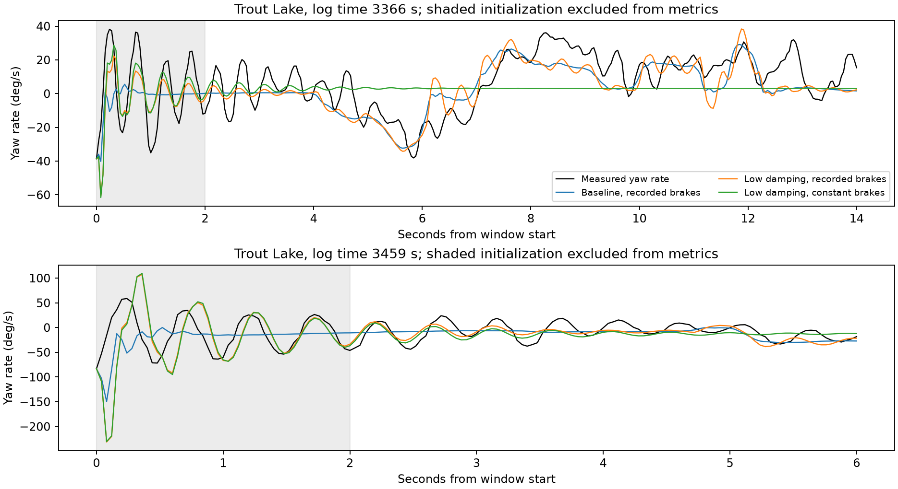

# Recorded-brake replay of unpowered yaw

## Conclusion

Reducing joint yaw damping can reveal a roughly 2 Hz yaw resonance already present in the rigid articulated equations. Recorded brake fluctuations sustain that resonance. This is a useful identification lead, but no parameter set tested here explains both descent episodes and powered flight well enough for promotion. No production physics, LQI gains or browser deployment were changed.

## Protocol

Use existing Hood River and Trout Lake prepared causal inputs, as-built flight-specific masses/inertias and geometry, native Rust replay, 25 Hz commands, and 32 integration substeps. Replay Trout Lake 3366–3380 s and 3459–3465 s, and Hood River 594–600 s and 1060–1066 s. The latter two are short low-power descents, not strictly zero-RPM throughout. Exclude the first two seconds from metrics. Metrics use instantaneous body-rate errors, not accumulated position error.

The short diagnostic records use a local input adapter because the maintained identification session contract requires at least 12.8 s; that production validation is unchanged. Initial payload attitude/rates/velocity and actual brake/throttle commands come from the logs. Canopy attitude is inferred with the existing force/airflow initializer; wind is the existing estimated constant mean. RPM evolves from the current propulsion model starting at logged RPM. No gust history is fitted.

Sweep 36 common multiplier sets across all four descents (144 replays): yaw stiffness 0.5/1/2/4, yaw damping 0.05/0.2/1, payload yaw inertia 0.7/1/1.3. Payload inertia is changed by a congruence transform preserving positive definiteness, including products of inertia. Canopy inertia and pitch parameters remain unchanged. These broad bounds diagnose sensitivity; they are not measured physical uncertainties.

Select three diagnostic candidates, including the lowest-error and spectral-amplitude candidates, then compare unchanged parameters across ten previously used powered windows (40 replays including baseline). All windows have been inspected previously: this is exploratory transfer checking, not a blind validation set. Add nine one-at-a-time initialization/wind cases for baseline and two spectral candidates across four descents (108 replays): canopy pitch/yaw +/-5 degrees and horizontal wind +/-1 m/s. These are sensitivity checks, not a complete nuisance optimization or uncertainty posterior.

## Most informative candidate

Keep yaw stiffness unchanged, multiply yaw damping by 0.05, and payload yaw inertia by 1.3. This is a 95% damping reduction, not a small tuning adjustment.

| Trout Lake descent | Observed 1.8–2.4 Hz yaw-rate RMS | Baseline | Candidate |
|---|---:|---:|---:|
| 3366–3380 s, after initialization exclusion | 3.93 deg/s | 0.65 deg/s | 4.05 deg/s |
| 3459–3465 s, after initialization exclusion | 12.14 deg/s | 0.41 deg/s | 3.61 deg/s |

The first descent still has a larger modeled low-frequency component: the overall yaw spectral maximum remains at 0.75 Hz rather than the measured 2 Hz. Matching the selected band does not mean matching the waveform. Its yaw RMSE increases from 11.29 to 11.90 deg/s. The second descent yaw RMSE improves from 16.45 to 13.89 deg/s, but the oscillation amplitude remains substantially too small.

With the candidate, Trout Lake's unpowered equilibrium has a yaw-dominated mode at 2.14 Hz, decay rate 0.81 per second (amplitude e-folding time about 1.23 s). The baseline has no oscillatory yaw mode in this band. Hood River's corresponding candidate mode is 2.00 Hz. All 12 checked baseline/candidate equilibria converge; no positive growth mode beyond numerical heading-neutral noise is found.

## Input-driven response versus initialization

In the longer Trout Lake descent, the candidate's late-window (last six seconds) band RMS is 3.88 deg/s with recorded brakes. Replacing brake fluctuations with their window means reduces it to 0.0048 deg/s. Full post-initialization band RMS falls from 4.05 to 0.16 deg/s. Throttle and all initial conditions remain the same. This supports continuing brake excitation of a lightly damped model resonance, rather than a persistent free initialization transient. It does not prove the real aircraft has exactly this mechanism.

Initialization/wind checks leave the first descent candidate band RMS between 4.02 and 4.29 deg/s, but the short second descent varies from 1.72 to 7.77 deg/s. The second episode is much less constraining because its brief usable duration remains sensitive to unobserved canopy attitude.

## Powered transfer

| Powered flight, mean across windows | Baseline yaw RMSE | Candidate yaw RMSE | Baseline / candidate / observed 1.2–1.9 Hz yaw RMS |
|---|---:|---:|---:|
| Hood River | 37.90 | 36.83 deg/s | 2.37 / 8.51 / 26.49 deg/s |
| Trout Lake | 25.19 | 27.82 deg/s | 2.86 / 6.73 / 15.73 deg/s |

The candidate increases oscillatory energy in the right direction, but remains far below measured powered amplitudes and worsens Trout Lake yaw RMSE by about 10.5%. Its powered Trout Lake modes around 1.74 and 2.01 Hz have pitch/yaw phases around -150 degrees, compared with roughly -80 to -90 degrees in the previously analyzed manual flight windows. Frequency agreement alone is insufficient. Powered equilibrium modes remain damped; autonomous sustained oscillation has not been established.

## Checks and limitations

Twenty-four additional replays compare 32 versus 64 substeps and constant versus recorded brakes; all numerical trace differences pass a 0.02 deg/s bound. No sweep or validation replay failed. The low-damping candidates hit the exploratory damping lower bound, so this is not evidence of an identified optimum. Stiffness, inertia, and damping remain confounded, especially with missing canopy angles. Short-window spectral estimates have coarse resolution, and prepared 25 Hz rates are used consistently for replay comparisons. No full EKF replay or independent optical truth is available.

## Next work

Treat lower effective unpowered yaw damping as a concrete hypothesis. Before changing the selected model, inspect the physical sources of the current yaw damping and how they depend on airspeed, rotor speed, and relative motion; then fit both power regimes jointly with explicit nuisance-state uncertainty. Do not simply publish the 0.05 multiplier. Existing records may not distinguish damping from unmodeled forcing well enough to identify a unique model.

## Reproduce

Run `run.py`, `validate.py`, and `checks.py` using `control/.venv/bin/python`; run `modes.py` with the same environment (imports the previous power-off study trim helper). Run `plot.py` using `research/.venv/bin/python`. All paths are relative to this study. Raw flight files remain outside Git at the paths in the scripts; hashes are recorded in the manifest.

