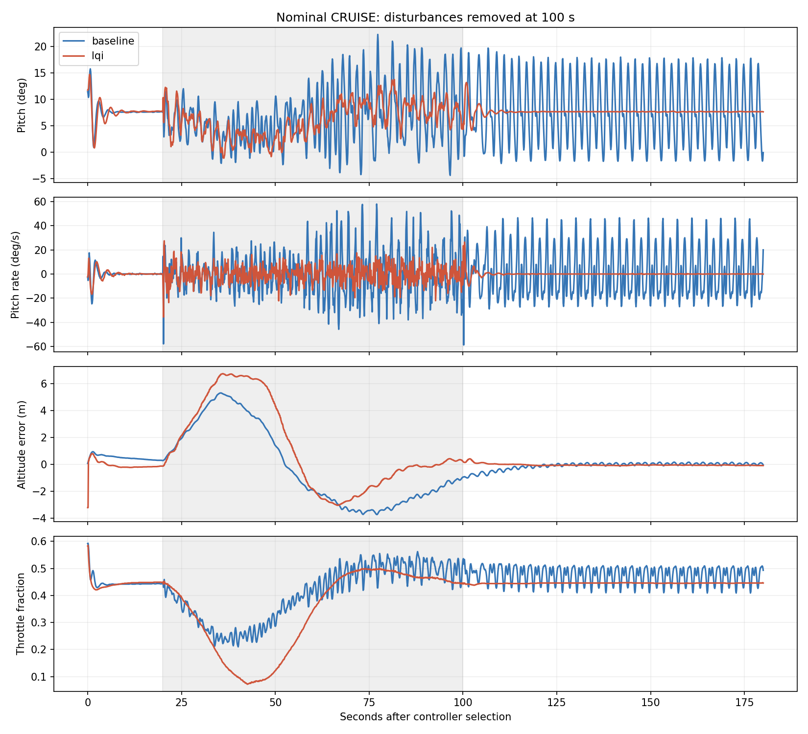
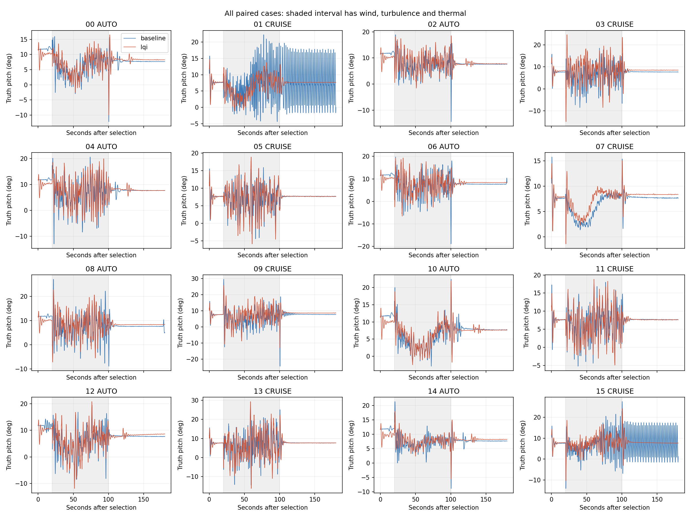

# Interpretation

The old PG + TECS controller's oscillation is reproduced with the deployed
firmware and EKF. In CRUISE cases 01 and 15, pitch motion persists long after
external weather is removed: late pitch AC RMS is 5.81 and 5.73 degrees,
with a spectral peak near 0.51 Hz. Early-to-late recovery RMS ratios are
0.95 and 0.98. These are sustained, limit-cycle-like responses within the
observation window, not a demonstration of an exact mathematical limit cycle.

LQI settles in both matched cases: late pitch AC RMS is 0.035 and 0.039 degrees.
The other six CRUISE pairs settle with both controllers. A separate normal-speed
replay of nominal case 01 reproduces the result: baseline 5.824 degrees versus
LQI 0.015 degrees. This rules out accelerated pacing as the sole explanation
for that observed oscillation. Throttle oscillates with pitch in the baseline
trace, but an ablation is needed before attributing the cause to a particular
TECS feedback term, actuator interaction or model feature.

All 32 study runs and both normal-speed checks completed without crossing
the screening envelope. That does **not** make the oscillating baseline cases
acceptable or prove robust stability of either controller.

Performance is mixed. Median disturbed-segment altitude error RMS in CRUISE is
3.02 m baseline versus 1.65 m LQI; AUTO is 1.86 m versus 3.82 m. Median AUTO
cross-track error is 4.24 m versus 5.79 m. Pitch-rate RMS is generally lower
with LQI, but detrended pitch amplitude is not uniformly lower across pairs.
See `RESULTS.md` for paired differences, exploratory bootstrap intervals,
individual recovery results, lateral motion and actuator effort. AP altitude
targets differ from LQI's internal governed reference, which matters when
interpreting the tracking comparison.

This is a small **sensitivity Monte Carlo**, not an estimate of real-world
failure probability: two nominal pairs and fourteen random pairs use assumed
parameter ranges; the geometry and nominal calibration remain grounded in the
existing flight logs. Two of eight CRUISE baseline cases oscillating should not
be interpreted as a 25% field failure probability. No delay, voltage, sensor-fault
or calibration-uncertainty distribution was sampled. Spectral analysis focuses
on 0.1–2 Hz pitch motion, with truth sampled at 10 Hz.

The next comparison should retain these two cases as regression scenarios,
isolate the baseline pitch/throttle interaction, and test recovery and actuator
effort alongside tracking. A larger campaign should first define operational
weather/voltage ranges and flight-data-supported model uncertainty. This study
supports investigating LQI's damping benefit; it does not justify automatically
promoting it over the baseline for all flight modes. No tune or deployment was
changed during this study.

