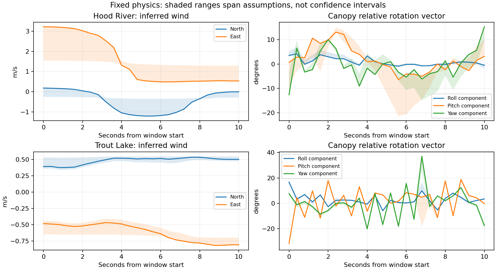
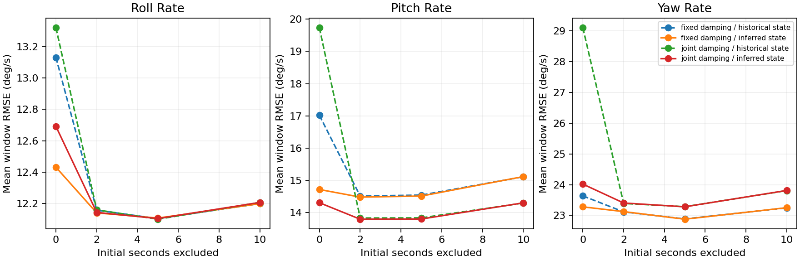

# Conditional canopy-state and wind MAP experiment

AI-assisted research, 16 October 2026. Existing Hood River and Trout Lake logs
only. No runtime model, controller gains, source flight logs or deployment are
modified. Inferred values are research annotations, not corrected measurements.

## Findings

The three-stage experiment is implemented. [Numerical results](RESULTS.md) and
[`summary.json`](summary.json) contain the full comparisons.

**Initialization predominantly affects the first few seconds of these model
replays.** At unchanged 3× damping, inferred initialization reduces mean full-window
pitch-rate RMSE from 17.02 to 14.72°/s. After excluding the first two seconds, the
comparison is 14.52 versus 14.48°/s. With wind held fixed, ±0.1 rad initial relative
pitch perturbations produce a mean rate disturbance of 10.92°/s over 0–2 seconds,
0.71 over 2–5 seconds, 0.17 over 5–10 seconds and 0.02 over 10–20 seconds. This
supports quick decay in the simulator; it is not a direct measurement of real
canopy settling time. Large later prediction errors remain.

**The fitted damping is strongly method-dependent.** The conditional graph
selects pitch/yaw multipliers near the 0.5× lower bound, with slow-wind assumptions
selecting 0.50×/0.61×. The earlier free-running objective favored the upper bound.
This comparison changes both state treatment and the objective, so the reversal
cannot be attributed solely to better canopy initialization. It exposes the
danger of interpreting either boundary result as a physical coefficient.
Starting the shared fit at 1×, 3× or 8× converges to essentially the same boundary
solution. Tightening the stopping tolerance by 100× changes the nominal objective
by less than 0.01%, so the reversal is not explained by those optimizer choices.

On held-out forecasts after discarding two seconds, nominal fitted damping with
inferred initialization changes pitch-rate error from 14.48 to 13.80°/s (4.7%
better), yaw-rate error from 23.12 to 23.40°/s (1.2% worse), and leaves roll-rate
error essentially unchanged. This is not a decisive replacement model.

**Hidden-state estimates remain conditional on the model.** In the Hood River
300-second window, changing assumptions moves inferred wind by up to 1.73 m/s and
relative orientation by 17.45°. That window's nominal wind differs from the
previous kinematic smoother by 3.07 m/s RMS horizontal-vector difference. Neither
estimate is independent wind truth. Optimizer convergence does not resolve this
ambiguity.

Matched synthetic tests recover wind at 0.005–0.026 m/s component RMSE and relative
orientation at about 0.6°. Fitting true damping of 2×/4× gives approximately
2.22–2.23×/3.98–4.00×. A 30% brake-lift mismatch or varying wind increases hidden
state errors to about 0.08 m/s and 1.1–1.2°. Those successes validate useful parts
of the implementation, not real-flight identifiability.

No fitted coefficient is promoted. The next physical identification effort
should distinguish persistent force/moment mismatch from early replay transients
and report sensitivity to its dynamics-defect assumptions; future independent
canopy attitude or airspeed measurements would constrain ambiguities the current
logs cannot settle.

## Implementation

The reusable estimator lives in
[`microagu_control.estimation`](../../../control/src/microagu_control/estimation.py).
It uses the existing Rust simulator through its Python binding and SciPy sparse
nonlinear least squares. There is no second dynamics implementation or new native
interface. This directory contains the experiment definitions and results.

This is a **conditional nonlinear MAP smoother**, not a complete navigation
re-estimation. Logged payload attitude, rates and IMU-point NED velocity are
conditioned on. Their underlying IMU and GNSS are not also counted as independent
observations. Payload position is a translation gauge for the airborne model and
is not optimized. Sensor bias, vertical wind, time alignment, brake calibration
and aerodynamic coefficients are not estimated in this experiment.

Each 0.4-second knot has eight unknowns:

- Canopy relative rotation vector (3), in radians. These are not Euler angles.
- Canopy-minus-payload world angular velocity, expressed in payload axes (3).
- Horizontal NED wind (2), in m/s; vertical wind is fixed to zero.

The exact hinge position and velocity constraints construct the rest of the
canopy state. An edge integrates the actual Rust model with all ten logged 40 ms
control intervals, using 32 RK substeps per interval. It compares predicted
payload attitude/rates/velocity with the next observation and imposes soft
canopy orientation/rate continuity. Logged RPM and voltage initialize each
shooting edge; they are not updated during that edge.

The scaled edge residuals are payload attitude / 0.08 rad, body rates / 0.20 rad/s,
velocity / 0.35 m/s, canopy orientation / (0.08 sqrt(dt)) and canopy angular
velocity / (0.30 sqrt(dt)). These effective discrepancy scales include model and
measurement error, and are assumptions rather than measured sensor covariances.
Wind increments have scale 0.10 sqrt(dt) m/s, varied to 0.03 sqrt(dt).
All residuals use soft-L1 loss, including priors; the wind-increment prior thus
has heavier tails than a Gaussian random walk and can admit sharp inferred gusts.

Initial relative orientation has scale 0.5 rad around the historical estimate;
relative rate has a zero-centered 1 rad/s scale. Absolute wind has a zero-centered
5 m/s scale. Original assumed wind is an initial numerical guess only, not a
wind observation. Neither the previous whole-flight smoother nor recorded EKF
wind enters the objective. The two shared log-damping parameters have weak
regularization centered at 3× with scale 1.5; allowed multipliers are 0.5–12×.
These priors and bounds are explicit modeling assumptions.

The 132 mm as-built riser spacing and historical measured mass/inertia/CG,
routing, 60 mm assumed ring height, propulsion, brake parameters and stiffness
are retained. Pitch and yaw damping multiply their separate baseline coefficients;
all other physics parameters remain fixed.

## Three stages

1. **Fixed physics:** reconstruct hidden states at 3×/3× damping for eight
   ten-second training windows. Repeat with ±0.1 rad initial pitch-component
   guesses, slower wind diffusion, and doubled model-discrepancy scales: 40 fits.
   Different starting guesses do not change the prior centers.
2. **Shared parameter fit:** release pitch and yaw damping separately, shared
   across all eight training windows. Repeat under nominal, slow-wind and looser
   model assumptions. `information-*.json` eliminates state perturbations from
   the local robust Jacobian to expose conditional parameter curvature. It
   excludes the explicit damping-prior rows but retains state/wind priors.
   These curvature estimates are not calibrated confidence intervals, especially
   at an active parameter bound. Additional starts at 1× and 8× and a 100× tighter
   termination tolerance are recorded under `diagnostic-*`.
3. **Validation:** recover known hidden states and separate damping from synthetic
   trajectories, including two noise seeds, varying wind, and an estimator with
   a deliberately wrong brake-lift coefficient. For eight held-out historical
   flight windows, estimate the starting state from the **preceding ten seconds**
   and predict thirty seconds with no future navigation, RPM, voltage or wind
   corrections. Recorded actuator commands remain prescribed inputs, so this is
   an open-loop model test, not a closed-loop controller trial.

Training starts: Hood River 300/480/690/930 s; Trout Lake 600/900/1920/2790 s.
Held-out starts: Hood River 360/600/720/1020 s; Trout Lake 840/1350/2400/2910 s.
No training window overlaps a prediction window or its preceding initialization
window. These remain segments from the same two historical flights, not new
independent validation flights.

Forecasts compare historical initialization and inferred initialization under
both fixed and fitted damping. Errors are also scored excluding the first 2, 5
and 10 seconds. Additional ±0.1 rad pitch-component perturbations hold estimated
wind fixed to measure initialization sensitivity separately from wind changes.

## Outputs and interpretation

- `summary.json`: fit sensitivity, synthetic recovery and predictive aggregates.
- `augmented-*-nominal.npz`: original payload observations at knot times, inferred
  relative rotation/rates, horizontal wind and scaled residuals.
- `augmented-*-sensitivity.npz`: componentwise min/max across the five assumptions.
  These are an empirical sensitivity envelope, not a probability interval.
- `joint-*.npz`: shared fitted damping and the concatenated hidden trajectories,
  in training-window order listed above.
- `forecast-*.npz`: 25 Hz predictions, original observations and inferred starting
  states. Full 26-state trajectories and motor RPM are retained.
- `fixed-*.json`, `joint-*.json`, `prefix-*.json`: optimizer status, objective,
  first-order optimality, evaluation count and bounds diagnostics. A successful
  relative-cost stopping criterion does not prove a global optimum.
- `audit.json`: source/native/input hashes, integration refinement and completeness.

Five structural tests cover hinge constraints, state/measurement transforms,
sparse-Jacobian dependencies, future-data exclusion, parameter preservation and
rejection of divergent optimizer trials. Integration refinement from 32 to 64
substeps changes tested scaled residuals by at most 1.93e-5. All forty fixed fits
and sixteen held-out forecasts are finite. One prefix optimizer initially tried
a divergent state; the solver now rejects that trial with infinite cost and
shrinks its trust region. The successful targeted retry is in `check-retry.log`;
the original diagnostic log is retained.





The graph can explain errors by changing hidden wind or articulation. Agreement
with observations therefore does not establish those hidden states as physical
truth. Residual correlations from fused navigation and repeated conditioning are
not modeled; short segments provide limited wind excitation; the same simulator
generates the matched synthetic truth. The mismatch and assumption tests are
necessary checks, but do not span every possible real-world modeling error.

## Reproduce

From the repository root, with the existing source flight data available (or
`MICROAGU_REPLAY_DATA` pointing to it):

```bash
simulation/.venv/bin/python -m pytest research/archive/hidden-state-map-2026-10-16/test_estimation.py -q
simulation/.venv/bin/python research/archive/hidden-state-map-2026-10-16/run.py fixed
simulation/.venv/bin/python research/archive/hidden-state-map-2026-10-16/run.py joint
simulation/.venv/bin/python research/archive/hidden-state-map-2026-10-16/run.py diagnostic
simulation/.venv/bin/python research/archive/hidden-state-map-2026-10-16/run.py synthetic
simulation/.venv/bin/python research/archive/hidden-state-map-2026-10-16/run.py varying
simulation/.venv/bin/python research/archive/hidden-state-map-2026-10-16/run.py check
simulation/.venv/bin/python research/archive/hidden-state-map-2026-10-16/audit.py
/home/david/envs/venv-ardupilot/bin/python research/archive/hidden-state-map-2026-10-16/report.py
```

Stages overwrite their named outputs; they do not silently reuse cached fits.
The source module is loaded directly by the experiment so rebuilding the native
extension is unnecessary. An ordinary package build includes the reusable module;
it requires the existing `analysis` extra. Plotting additionally needs Matplotlib.
