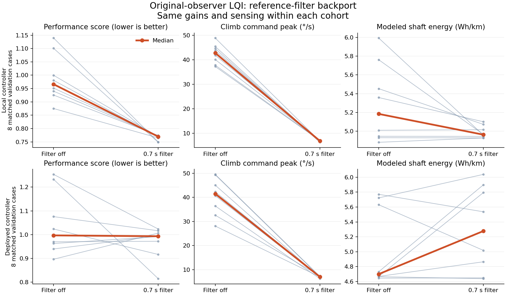

# Original-observer LQI reference-filter backport

AI-assisted. Existing gains, original observer, no pitot or canopy sensing. Rate limits remain ±0.5 m/s. Only the climb-reference filter changes from 0 to 0.7 s.

## local

Acceptance: PASS

| Variant | Complete / screens pass | Score | Climb relative pitch-rate peak °/s | Descent relative pitch-rate peak °/s | Climb settling s | Updraft recovery s | Shaft Wh/km |
|---|---:|---:|---:|---:|---:|---:|---:|
| off | 8/8 | 0.966 | 42.803 | 40.462 | 22.673 | 21.500 | 5.184 |
| on | 8/8 | 0.770 | 6.859 | 6.786 | 22.388 | 21.275 | 4.962 |

Median paired changes (%):

```json
{
  "training": {
    "score": -22.78695903282323,
    "energy": -13.24598671810473,
    "acquisition_time": -0.6211180124223947,
    "climb_peak": -80.14311346185784,
    "descent_peak": -80.4215663800666,
    "acquisition": 2.9996192564588853,
    "descent": 7.1107730991837315,
    "updraft": -2.25797949232297,
    "crosswind": -56.068847469454376
  },
  "validation": {
    "score": -20.16906782026723,
    "energy": -2.4295874035891676,
    "acquisition_time": -0.31055900621118626,
    "climb_peak": -83.82416226340283,
    "descent_peak": -83.2950909640258,
    "acquisition": 2.2784729740416787,
    "descent": 8.021011487914853,
    "updraft": -1.3811961309434906,
    "crosswind": -26.164458680100637
  }
}
```

Validation paired change distribution (negative is lower; eight cases):

| Metric | Minimum | Median | Maximum | Improved cases |
|---|---:|---:|---:|---:|
| Score | -34.21% | -20.17% | -12.60% | 8/8 |
| Shaft Wh/km | -17.27% | -2.43% | +0.94% | 6/8 |
| Climb rate peak | -86.18% | -83.82% | -81.30% | 8/8 |
| Descent rate peak | -84.89% | -83.30% | -80.04% | 8/8 |

Mission medians (four cases per mode and variant):

| Mode | Filter | Altitude RMS m | Cross-track RMS m | Relative rate RMS °/s | Shaft W | Screens passed |
|---|---|---:|---:|---:|---:|---:|
| AUTO | off | 2.883 | 3.665 | 14.553 | 73.993 | 4/4 |
| AUTO | on | 3.029 | 3.671 | 16.039 | 74.089 | 4/4 |
| CRUISE | off | 1.427 | 0.619 | 19.900 | 78.015 | 4/4 |
| CRUISE | on | 1.878 | 0.627 | 19.610 | 75.953 | 4/4 |

## deployed

Acceptance: FAIL: training crosswind regression >20%; validation score improves less than 5%; validation crosswind regression >20%; CRUISE shaft power regression >5%

| Variant | Complete / screens pass | Score | Climb relative pitch-rate peak °/s | Descent relative pitch-rate peak °/s | Climb settling s | Updraft recovery s | Shaft Wh/km |
|---|---:|---:|---:|---:|---:|---:|---:|
| off | 8/8 | 0.997 | 41.492 | 40.070 | 23.230 | 21.370 | 4.700 |
| on | 8/8 | 0.993 | 7.033 | 6.731 | 22.485 | 21.613 | 5.277 |

Median paired changes (%):

```json
{
  "training": {
    "score": -11.91142700521921,
    "energy": -0.6738258070835834,
    "acquisition_time": -0.6211180124223503,
    "climb_peak": -85.84640216479099,
    "descent_peak": -85.07321445760188,
    "acquisition": -15.526336328150748,
    "descent": -11.026971369196703,
    "updraft": 2.780022152959205,
    "crosswind": 136.1896219993778
  },
  "validation": {
    "score": -2.648670955966043,
    "energy": 2.1428784259925893,
    "acquisition_time": -0.619200981519813,
    "climb_peak": -83.20854651120938,
    "descent_peak": -83.16745736586921,
    "acquisition": 0.02215869070016363,
    "descent": 5.659230691854189,
    "updraft": 1.0166545865664012,
    "crosswind": 76.43523209008208
  }
}
```

Validation paired change distribution (negative is lower; eight cases):

| Metric | Minimum | Median | Maximum | Improved cases |
|---|---:|---:|---:|---:|
| Score | -33.93% | -2.65% | +12.28% | 4/8 |
| Shaft Wh/km | -10.88% | +2.14% | +24.65% | 3/8 |
| Climb rate peak | -85.69% | -83.21% | -75.07% | 8/8 |
| Descent rate peak | -85.95% | -83.17% | -75.14% | 8/8 |

Mission medians (four cases per mode and variant):

| Mode | Filter | Altitude RMS m | Cross-track RMS m | Relative rate RMS °/s | Shaft W | Screens passed |
|---|---|---:|---:|---:|---:|---:|
| AUTO | off | 3.653 | 3.842 | 14.770 | 74.703 | 4/4 |
| AUTO | on | 4.030 | 5.118 | 15.907 | 76.547 | 4/4 |
| CRUISE | off | 2.022 | 0.468 | 19.953 | 66.948 | 4/4 |
| CRUISE | on | 1.483 | 0.708 | 19.815 | 72.133 | 4/4 |

## Limits

Finite scenario screens are not formal stability margins. The two cohorts are separately controlled experiments: local includes pre-existing zero-trim and EKF work, deployed uses published AP base revision 010ada6 plus only this filter patch. No enhanced-state gains or extra sensing are transferred. Shaft power is a quasi-steady model, not measured electrical consumption.

Acceptance uses medians of paired ratios; these need not equal ratios of the tabulated medians. Mission tracking uses a 1 m denominator floor. Individual regressions remain visible in [gust details](GUSTS.md) and raw metrics. The score weights task error 65%, motion 20%, actuator use 10%, and modeled energy 5%; it is a comparison index, not a measured safety margin.


