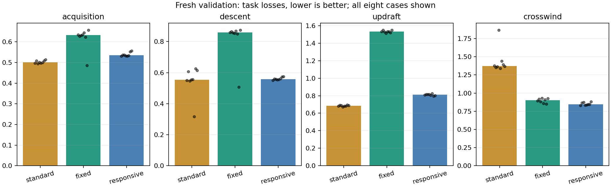
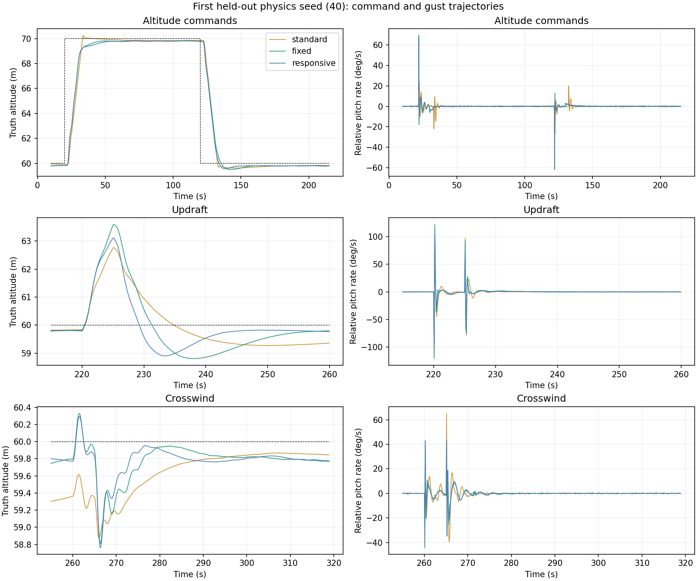

# Matched-governor tuning results

AI-assisted. Selection used only the three training physics cases. Eight fresh cases were used afterward for command/gust validation, and the same new physics seeds with new weather were used for four AUTO and four CRUISE mission checks per configuration.

Selected on training: **responsive**. Validation: **passes declared checks**.

The selected candidate improves the declared aggregate and mission altitude tracking, but it does not dominate standard control: updraft recovery remains slower and altitude-command relative pitch-rate peaks remain substantially larger. The lower crosswind task loss reflects integrated response as well as peaks; it must not be described as a reduction in peak payload pitch. Passing the finite-horizon screens is not a proof of stability or a deployment recommendation.

## Training

| Candidate | Robust score | Improvement vs fixed % | Rejections |
|---|---:|---:|---|
| balanced | 0.618 | +13.02 | none |
| damped | 0.750 | -5.41 | acquisition median regression >20%; descent median regression >20% |
| responsive | 0.543 | +23.69 | none |
| vertical | 0.546 | +23.28 | none |

## Fresh command/gust cases

Medians and worst cases are descriptive, not population confidence bounds.

| Configuration | Qualified runs | Median score | Worst-quarter score | Worst score | Shaft Wh/ground km |
|---|---:|---:|---:|---:|---:|
| standard | 8/8 | 0.607 | 0.652 | 0.693 | 4.689 |
| fixed | 8/8 | 0.738 | 0.742 | 0.744 | 4.755 |
| responsive | 8/8 | 0.530 | 0.549 | 0.553 | 4.759 |

| Selected versus | Acquisition loss % | Descent loss % | Updraft loss % | Crosswind loss % | Total loss % | Energy % |
|---|---:|---:|---:|---:|---:|---:|
| fixed | -15.25 | -35.07 | -47.29 | -5.17 | -27.18 | +0.08 |
| standard | +6.84 | -0.14 | +18.49 | -38.36 | -11.41 | +1.48 |

| Response (median) | standard | fixed | responsive |
|---|---:|---:|---:|
| Climb 10–90%, s | 8.40 | 8.80 | 8.50 |
| Climb settling, s | 16.76 | 21.49 | 17.47 |
| Climb peak relative pitch rate, deg/s | 21.66 | 62.51 | 53.00 |
| Descent settling, s | 16.13 | 23.86 | 13.21 |
| Descent peak relative pitch rate, deg/s | 24.46 | 57.46 | 49.02 |
| Descent overshoot, m | 0.39 | 0.51 | 0.45 |
| Updraft height peak, m | 2.95 | 3.78 | 3.32 |
| Updraft recovery, s | 7.83 | 21.17 | 12.84 |
| Crosswind pitch peak, deg | 17.51 | 20.85 | 20.77 |
| Crosswind recovery, s | 5.64 | 5.58 | 5.48 |

## Task preference sensitivity

Selection remains frozen; these alternative preferences are reported only for interpretation. Values are median paired percent changes; negative is better. The emphasized task receives 55% of the task subscore, each other task 15%.

| Preference | Selected vs fixed % | Selected vs standard % |
|---|---:|---:|
| equal_tasks | -27.18 | -11.41 |
| acquisition_first | -23.31 | -7.70 |
| descent_first | -28.74 | -9.02 |
| updraft_first | -35.14 | -2.46 |
| crosswind_first | -19.32 | -24.53 |

## Fresh mission checks

Truth altitude error and onboard cross-track during weather (20–100 s). These tests include acquisition; the new common caps apply from controller engagement.

| Mode | Configuration | Complete | Alt RMS m | Xtrack RMS m | Relative rate RMS deg/s | Shaft W |
|---|---|---:|---:|---:|---:|---:|
| AUTO | standard | 4/4 | 3.936 | 3.688 | 18.238 | 60.848 |
| AUTO | fixed | 4/4 | 3.155 | 3.481 | 17.490 | 60.711 |
| AUTO | responsive | 4/4 | 2.380 | 3.695 | 16.343 | 60.823 |
| CRUISE | standard | 4/4 | 1.938 | 0.053 | 9.979 | 66.634 |
| CRUISE | fixed | 4/4 | 1.342 | 0.196 | 10.485 | 68.497 |
| CRUISE | responsive | 4/4 | 0.871 | 0.190 | 9.525 | 68.489 |

## Limits

Matched altitude rate caps do not make the internal reference trajectories identical. The LQI heading-rate cap remains 10 deg/s versus the standard PG_TURN_RMAX=25 setting; mission path results include that lateral implementation difference. All candidates share one locally identified model and one observer; the physics perturbations cover a model family, not unknown real canopy mechanics. No hardware qualification, statistical stability margin, or globally optimal controller is claimed. The reference-governor patch preserves original defaults; the experiment and generated gains were not deployed.

