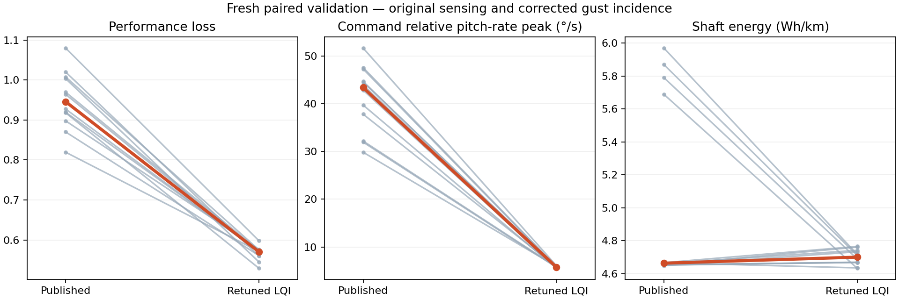

# Published LQI retuning with a fixed 0.7 s reference filter

AI-assisted. Original observer and sensing, existing trim and reference limits. All gain selection precedes fresh validation.

**Selected:** responsive_softspeed. **Release acceptance:** PASS

## Test correction

The earlier crosswind comparison used a fixed earth bearing against aircraft with different headings. In prior case 83, the horizontal wind in payload coordinates was about (−0.35, −1.93) m/s without filtering versus (+1.93, −0.50) m/s with filtering. The disturbance was therefore predominantly lateral in one run and axial in the other. Its 76% crosswind-loss regression was not a controlled estimate of filter effect. This study uses the same lateral incidence at gust onset and aligns CRUISE weather to the aircraft; AUTO weather stays tied to the mission route.

The same prior trace also showed common-brake buildup and reduced true airspeed, without throttle saturation. Gain/observer interactions may still matter; correcting incidence does not prove those effects absent. The observer and trim are held fixed here so the gain comparison remains interpretable.

## Training sweep

| Candidate | Qualified / runs | Median score | Worst score |
|---|---:|---:|---:|
| balanced | 6/6 | 0.631 | 0.656 |
| damped | 6/6 | 0.729 | 0.742 |
| efficient | 6/6 | 0.631 | 0.645 |
| efficient_brake10k | 6/6 | 0.625 | 0.639 |
| filtered | 6/6 | 0.715 | 0.746 |
| published | 6/6 | 0.945 | 1.045 |
| relative | 6/6 | 0.727 | 0.743 |
| responsive | 6/6 | 0.573 | 0.617 |
| responsive_brake10k | 6/6 | 0.571 | 0.581 |
| responsive_brake3k | 6/6 | 0.565 | 0.584 |
| responsive_softspeed | 6/6 | 0.561 | 0.569 |

Selection details, including rejected alternatives: [selection](selection-with-filtered.json).

## Fresh validation

| Controller | Qualified / runs | Score | Climb relative pitch-rate peak °/s | Descent peak °/s | Climb settling s | Updraft recovery s | Shaft Wh/km |
|---|---:|---:|---:|---:|---:|---:|---:|
| published | 12/12 | 0.946 | 43.376 | 41.778 | 23.605 | 21.353 | 4.664 |
| local | 12/12 | 0.713 | 6.872 | 6.610 | 22.290 | 21.343 | 4.971 |
| responsive_softspeed | 12/12 | 0.570 | 5.774 | 5.672 | 22.348 | 12.735 | 4.700 |
| efficient_brake10k | 12/12 | 0.620 | 5.773 | 5.866 | 22.303 | 16.665 | 4.735 |

Median paired changes are calculated per case, not as a ratio of table medians. Negative is lower loss/effort.

| Comparator | Metric | Min change % | Median % | Max % | Improved cases |
|---|---|---:|---:|---:|---:|
| published | score | -45.67 | -40.89 | -30.29 | 12/12 |
| published | energy | -20.97 | +0.31 | +2.34 | 5/12 |
| published | acquisition_time | -1.23 | +0.00 | +1.25 | 4/12 |
| published | acquisition | -16.45 | -4.05 | +19.29 | 8/12 |
| published | descent | -22.23 | -7.58 | +28.79 | 9/12 |
| published | updraft | -50.05 | -47.80 | -46.57 | 12/12 |
| published | crosswind | -85.68 | -80.28 | -5.04 | 12/12 |
| local | score | -26.12 | -19.66 | -15.88 | 12/12 |
| local | energy | -8.22 | -5.94 | -3.88 | 12/12 |
| local | acquisition_time | -0.00 | +1.25 | +1.89 | 1/12 |
| local | acquisition | -9.51 | +1.90 | +14.23 | 2/12 |
| local | descent | -16.61 | -4.36 | +13.70 | 8/12 |
| local | updraft | -48.87 | -47.91 | -46.35 | 12/12 |
| local | crosswind | -60.15 | -46.90 | -38.65 | 12/12 |

## Missions

| Mode | Controller | Altitude RMS m | Cross-track RMS m | Relative rate RMS °/s | Shaft W | Qualified / runs |
|---|---|---:|---:|---:|---:|---:|
| AUTO | published | 3.405 | 7.028 | 12.659 | 75.191 | 6/6 |
| AUTO | local | 3.147 | 3.238 | 12.802 | 75.199 | 6/6 |
| AUTO | responsive_softspeed | 3.822 | 6.018 | 11.825 | 71.926 | 6/6 |
| AUTO | efficient_brake10k | 3.782 | 10.648 | 12.242 | 72.274 | 6/6 |
| CRUISE | published | 1.175 | 0.466 | 21.825 | 75.289 | 6/6 |
| CRUISE | local | 1.104 | 0.453 | 22.097 | 79.508 | 6/6 |
| CRUISE | responsive_softspeed | 0.840 | 0.510 | 20.410 | 71.183 | 6/6 |
| CRUISE | efficient_brake10k | 1.001 | 0.495 | 20.907 | 74.095 | 6/6 |

## Ten-minute CRUISE checks

Final minute shown; three cases per controller.

| Controller | Shaft W | True airspeed m/s | Common brake fraction | Altitude RMS m | Qualified / runs |
|---|---:|---:|---:|---:|---:|
| published | 73.627 | 4.382 | 0.000 | 0.317 | 3/3 |
| responsive_softspeed | 74.701 | 4.313 | 0.038 | 0.214 | 3/3 |

## Limits

Finite scenario screening does not prove formal stability or flight readiness. Shaft power is modeled, not measured battery consumption. Physics remains the same as-built model. No enhanced sensors or observer changes are included. The local comparison includes its earlier zero-trim/EKF work and is a comparator, not a gain-only ablation.

The corrected training-only decision is in `selection-with-speed-task.json`, frozen before any held-out result. The preliminary symmetric speed-ratio gate also scheduled efficient_brake10k as an additional comparator; its hold-outs are retained but cannot alter the frozen winner.

