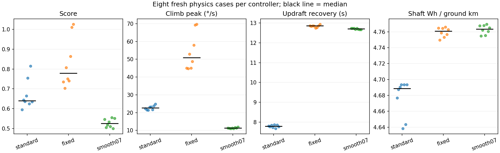
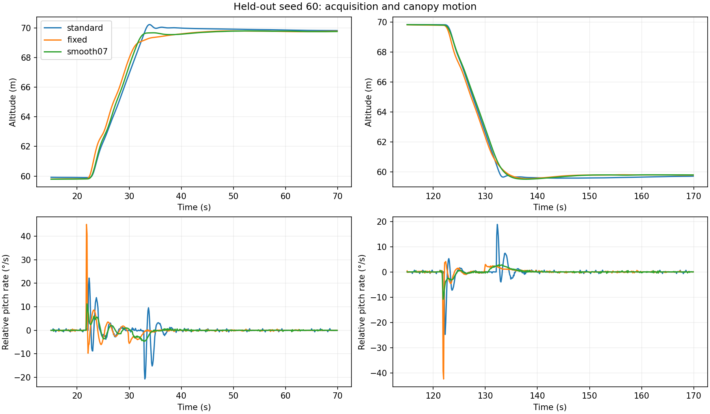

# Transition and sensing experiment results

Selected on training: **smooth07**. `fixed` is the previous responsive LQI, not the older fixed-gain baseline.

All results are simulation-only. The EKF remains active for navigation, reference generation, and speed/turn integrators. Full-state truth replaces the 16 inner feedback states as a diagnostic only.

## Held-out command and gust cases

| Variant | Runs / gates passed | Score median | Worst score | Climb rise s | Command to 90% s | Climb settling s | Climb peak °/s | Descent peak °/s | Updraft recovery s | Shaft Wh/km |
|---|---:|---:|---:|---:|---:|---:|---:|---:|---:|---:|
| standard | 8 / 8 | 0.640 | 0.815 | 8.450 | 12.208 | 16.740 | 22.647 | 25.288 | 7.795 | 4.689 |
| fixed | 8 / 8 | 0.779 | 1.027 | 8.600 | 11.803 | 17.503 | 50.861 | 49.583 | 12.853 | 4.761 |
| smooth07 | 8 / 8 | 0.525 | 0.555 | 8.000 | 11.683 | 15.183 | 11.309 | 11.006 | 12.695 | 4.764 |

## Training selection

| Candidate | Robust score | Change vs prior LQI | Rejection |
|---|---:|---:|---|
| smooth03 | 0.573 | -40.50% | none |
| smooth07 | 0.540 | -43.93% | none |
| smooth07_damped | 0.544 | -43.51% | descent median regression >20% |
| smooth07_fastobs | 0.591 | -38.67% | descent median regression >20% |
| smooth12 | 0.474 | -50.74% | descent median regression >20% |

Median paired changes (negative means less):

```json
{
  "fixed": {
    "score": -33.46590037084877,
    "energy": 0.07280816148251823,
    "climb_peak": -78.30493552579543,
    "descent_peak": -77.65355436861492,
    "acquisition_time": -6.976744186046563
  },
  "standard": {
    "score": -19.127548362690295,
    "energy": 1.6036377343090713,
    "climb_peak": -50.05130472837493,
    "descent_peak": -55.9772556303457,
    "acquisition_time": -5.882352941176472
  }
}
```

Validation rejection reasons: []

## Sensing ablations

These reuse training physics and are diagnostic, excluded from selection. `ideal`: noiseless zero-delay angle into the same observer; `nodelay`: 0.5° noise with zero delay; `stress`: 2° and 80 ms; `truth`: correctly mapped full feedback state, no observer.

| Variant | Complete / gate pass | Score median | Climb peak °/s | Descent peak °/s | Updraft recovery s |
|---|---:|---:|---:|---:|---:|
| fixed_ideal | 3 / 3 | 0.976 | 66.799 | 60.399 | 12.790 |
| fixed_nodelay | 3 / 3 | 0.972 | 66.274 | 60.498 | 12.760 |
| fixed_stress | 3 / 3 | 0.911 | 61.863 | 55.289 | 12.870 |
| fixed_truth | 3 / 3 | 0.767 | 58.416 | 57.294 | 11.455 |
| smooth07_ideal | 3 / 3 | 0.542 | 11.048 | 10.610 | 12.680 |
| smooth07_nodelay | 3 / 3 | 0.536 | 11.436 | 11.297 | 12.735 |
| smooth07_stress | 3 / 3 | 0.537 | 11.091 | 10.714 | 12.680 |
| smooth07_truth | 3 / 3 | 0.449 | 11.807 | 11.361 | 11.390 |

## Missions

| Mode | Variant | Complete | Alt RMS m | Xtrack RMS m | Relative rate RMS °/s | Shaft W |
|---|---|---:|---:|---:|---:|---:|
| AUTO | standard | 4/4 | 2.135 | 4.125 | 16.599 | 68.507 |
| AUTO | fixed | 4/4 | 1.263 | 3.940 | 14.409 | 69.113 |
| AUTO | smooth07 | 4/4 | 1.245 | 3.901 | 14.315 | 69.181 |
| CRUISE | standard | 4/4 | 1.627 | 0.000 | 8.731 | 66.803 |
| CRUISE | fixed | 4/4 | 0.558 | 0.206 | 7.973 | 69.898 |
| CRUISE | smooth07 | 4/4 | 0.567 | 0.206 | 8.105 | 69.888 |

## Preference sensitivity

Weights changed only after selection; no reselection. Task emphasis gives that task 55% of the task subscore, others 15%. Actuator/energy remain 10%/5%; task weight fills the remainder.

| Task emphasis / motion weight | Selected vs previous LQI % | Selected vs standard % |
|---|---:|---:|
| equal_motion_0.1 | -17.37 | -14.99 |
| equal_motion_0.2 | -33.47 | -19.13 |
| equal_motion_0.35 | -51.50 | -25.67 |
| acquisition_motion_0.1 | -21.26 | -13.83 |
| acquisition_motion_0.2 | -37.24 | -18.51 |
| acquisition_motion_0.35 | -54.57 | -24.96 |
| descent_motion_0.1 | -14.40 | -10.14 |
| descent_motion_0.2 | -32.01 | -15.00 |
| descent_motion_0.35 | -51.14 | -21.79 |
| updraft_motion_0.1 | -16.80 | -4.70 |
| updraft_motion_0.2 | -31.72 | -9.73 |
| updraft_motion_0.35 | -49.75 | -17.18 |
| crosswind_motion_0.1 | -17.14 | -27.34 |
| crosswind_motion_0.2 | -32.49 | -29.84 |
| crosswind_motion_0.35 | -50.43 | -34.31 |





Finite scenario screens are not stability margins. Shared local linearization, nonlinear unilateral allocation, model uncertainty, and unequal lateral reference caps remain limitations. Shaft energy is not measured battery energy.
