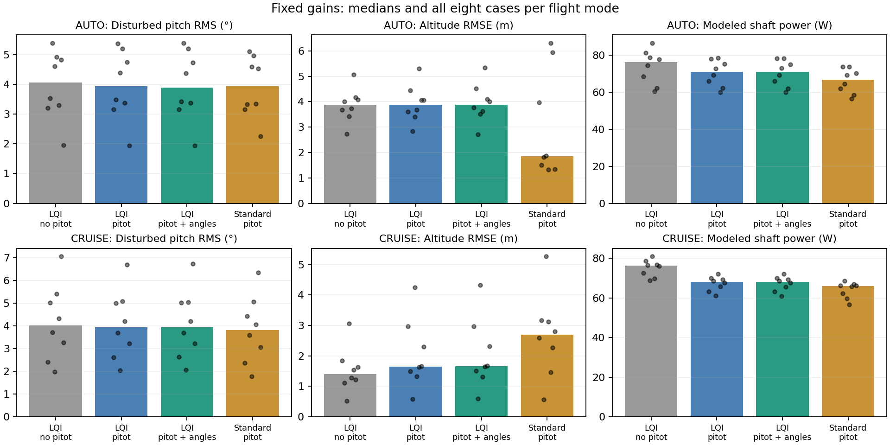

# Paired results

Percentages are median **paired** changes, not ratios of group medians. Ranges are observed P10–P90 across the fixed scenario suite, not confidence intervals.

| Comparison | Mode | Shaft power % | P10–P90 % | Energy/ground-distance % | Disturbed pitch RMS % | Altitude RMS % |
|---|---|---:|---|---:|---:|---:|
| airspeed_vs_sensorless | AUTO | -3.86 | -8.02 to -0.67 | -7.25 | -0.86 | -0.51 |
| airspeed_vs_sensorless | CRUISE | -11.05 | -11.68 to -8.50 | -15.59 | -1.02 | +35.89 |
| sensor_vs_airspeed | AUTO | -0.00 | -0.08 to +0.16 | +0.06 | -0.21 | +0.73 |
| sensor_vs_airspeed | CRUISE | -0.09 | -0.15 to +0.10 | -0.05 | +0.30 | +0.91 |
| sensor_vs_standard | AUTO | +6.20 | +5.71 to +6.92 | +7.65 | +1.71 | +68.29 |
| sensor_vs_standard | CRUISE | +2.21 | -1.53 to +16.81 | +3.11 | +5.78 | -17.70 |

## Retuning

Selection uses only cases 0, 1, 6 and 9; see `selection.json` for the rule and rejection reasons.
Selected configuration: **damping**.
- efficient: score 1.0064; passes screening guards.
- damping: score 0.9982; passes screening guards.
- Held-out AUTO, n=6: shaft +0.01%, pitch RMS -2.89%, altitude RMS +0.29%, cross-track -0.028 m versus the same sensors with fixed gains.
- Held-out CRUISE, n=6: shaft +0.02%, pitch RMS -1.92%, altitude RMS +0.84%, cross-track -0.002 m versus the same sensors with fixed gains.

## Interpretation limits

The realistic angle-sensor comparison includes an augmented observer. It is not merely replacing three values with truth. The raw angle/rate diagnostic is a different feedback architecture and cannot establish the attainable performance ceiling of a properly designed sensor-equipped controller.

Same missions do not guarantee identical achieved speeds, paths or final energy states. Per-run `analysis.json` retains achieved airspeed, ground path, energy per ground distance and height change. Shaft power is not battery power. All results are conditional on the simulator and assumed sensing.

