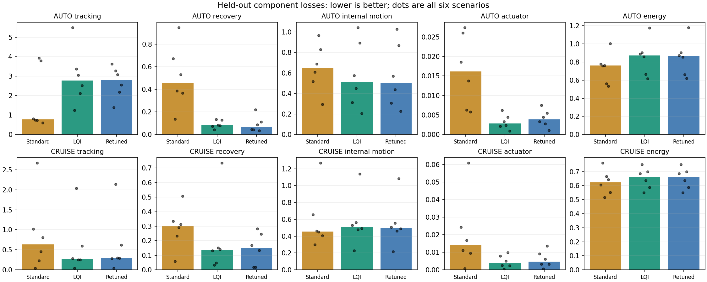
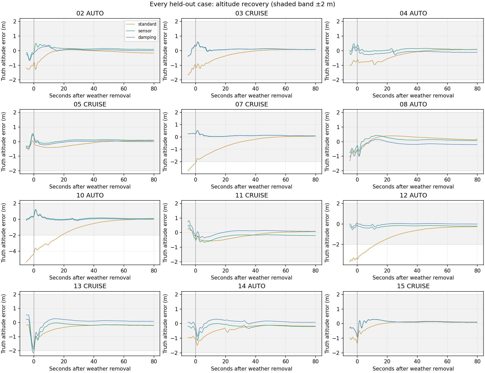

# Holistic sensor-equipped LQI assessment

AI-assisted retrospective analysis of the 92 retained runs. No new flight runs or gain selection.

**Answer:** the realistic sensor-equipped LQI has a useful CRUISE tradeoff: better altitude tracking/recovery and less relative angular-rate motion and brake activity. In AUTO, its quicker recovery does not compensate for substantially worse altitude capture and path tracking under the proposed index. Both controllers pass the finite-horizon stability screen; neither demonstrates a decisive stability advantage in these cases. Additional angle sensing contributes little beyond the pitot with these gains. The previous pitch-penalty retune improves some recovery/rate and tail metrics, but is not a consistent winner under this broader index. No controller is promoted.

Primary comparisons below use only the twelve cases excluded from the original tuning screen: six AUTO and six CRUISE. The new metrics themselves are retrospective, so this is not a preregistered validation.

## Stability screening

| Configuration | Runs | Harness failures | New screen failures | Max roll / pitch ° | Worst late relative-pitch band RMS ° | Longest full-brake episode s |
|---|---:|---:|---:|---:|---:|---:|
| standard | 16 | 0 | 0 | 14.52 / 28.48 | 0.031 | 0.0 |
| sensorless | 16 | 0 | 0 | 13.14 / 26.51 | 0.022 | 0.0 |
| airspeed | 16 | 0 | 0 | 13.20 / 26.37 | 0.022 | 0.0 |
| sensor | 16 | 0 | 0 | 12.39 / 26.60 | 0.023 | 0.0 |
| damping | 16 | 0 | 0 | 13.03 / 26.90 | 0.023 | 0.0 |
| efficient | 4 | 0 | 0 | 11.78 / 23.82 | 0.023 | 0.0 |
| angles | 4 | 0 | 0 | 11.17 / 22.99 | 0.019 | 0.0 |
| full | 4 | 0 | 4 | 48.92 / 28.18 | 3.087 | 76.8 |

## Held-out flight quality

Entries are scenario medians; parentheses give the worst of six cases. Altitude is truth height minus the recorded target; cross-track is onboard navigation telemetry.

| Mode | Configuration | Alt RMS m | Alt P95 m | Xtrack RMS m | Relative angle AC RMS ° | Relative rate RMS °/s | Recovery alt RMS m |
|---|---|---:|---:|---:|---:|---:|---:|
| AUTO | Standard + pitot | 1.68 (6.35) | 3.05 (10.55) | 4.16 (4.50) | 4.17 (6.63) | 12.29 (16.21) | 0.59 (2.28) |
| AUTO | LQI + both sensors | 4.07 (5.35) | 9.54 (11.72) | 4.57 (10.65) | 3.46 (6.99) | 11.60 (14.78) | 0.27 (0.31) |
| AUTO | Retuned LQI + both | 3.98 (5.35) | 9.48 (10.80) | 4.55 (7.93) | 3.51 (6.98) | 11.03 (14.36) | 0.21 (0.26) |
| AUTO | LQI + pitot only | 4.02 (5.30) | 9.53 (11.59) | 4.60 (10.41) | 3.47 (6.97) | 11.66 (14.79) | 0.27 (0.30) |
| CRUISE | Standard + pitot | 2.53 (5.28) | 4.66 (9.62) | 0.28 (0.44) | 3.77 (4.75) | 13.68 (26.12) | 0.49 (1.02) |
| CRUISE | LQI + both sensors | 1.61 (4.38) | 3.34 (9.14) | 0.41 (0.53) | 3.96 (5.26) | 12.26 (24.65) | 0.19 (0.46) |
| CRUISE | Retuned LQI + both | 1.71 (4.49) | 3.49 (9.37) | 0.41 (0.54) | 3.98 (5.23) | 11.79 (23.69) | 0.17 (0.37) |
| CRUISE | LQI + pitot only | 1.68 (4.30) | 3.33 (8.98) | 0.41 (0.53) | 3.91 (5.24) | 12.61 (24.56) | 0.19 (0.36) |

## Capture confound and later disturbed flight

AUTO was not settled when weather began at 20 s: LQI was still 10–14 m below target in the held-out cases, versus roughly 1–5 m for standard. The primary score intentionally includes this slower capture, but it must not be interpreted as pure gust rejection. The following 60–100 s window reduces that confound; mission phase and disturbance exposure are still not synchronized.

| Mode | Configuration | Altitude error at 20 s, median m | Later altitude RMS m | Later xtrack RMS m | Later relative-rate RMS °/s |
|---|---|---:|---:|---:|---:|
| AUTO | Standard + pitot | -2.70 | 1.23 | 4.90 | 12.66 |
| AUTO | LQI + both sensors | -12.61 | 0.66 | 5.69 | 11.74 |
| AUTO | Retuned LQI + both | -12.47 | 0.73 | 5.72 | 11.53 |
| AUTO | LQI + pitot only | -12.60 | 0.64 | 5.75 | 11.84 |
| CRUISE | Standard + pitot | 0.32 | 1.99 | 0.28 | 14.02 |
| CRUISE | LQI + both sensors | 0.06 | 0.94 | 0.41 | 12.49 |
| CRUISE | Retuned LQI + both | 0.03 | 0.93 | 0.41 | 12.06 |
| CRUISE | LQI + pitot only | 0.06 | 0.88 | 0.41 | 12.84 |

## Recovery, actuation, and aggregate index

Recovery time: first ten continuous seconds within 2 m altitude error and 2 °/s relative pitch-rate (2 s RMS) after weather removal. Unrecovered cases are censored, not assigned zero. The last evaluable onset is about 70 s. This is a combined weather-removal response, not a modal damping estimate.

| Mode | Configuration | Recovered / 6 | Median recovery s (recovered only) | Throttle ceiling % | Brake travel/s | Score median | Worst-quarter score | Worst score |
|---|---|---:|---:|---:|---:|---:|---:|---:|
| AUTO | Standard + pitot | 6 | 8.7 | 0.59 | 0.036 | 0.592 | 1.778 | 1.879 |
| AUTO | LQI + both sensors | 6 | 4.8 | 0.00 | 0.020 | 1.175 | 1.701 | 2.050 |
| AUTO | Retuned LQI + both | 6 | 3.8 | 0.00 | 0.020 | 1.185 | 1.365 | 1.387 |
| AUTO | LQI + pitot only | 6 | 4.8 | 0.00 | 0.020 | 1.174 | 1.680 | 1.967 |
| CRUISE | Standard + pitot | 6 | 4.1 | 0.00 | 0.035 | 0.545 | 0.872 | 1.123 |
| CRUISE | LQI + both sensors | 6 | 3.6 | 0.00 | 0.023 | 0.337 | 0.712 | 0.866 |
| CRUISE | Retuned LQI + both | 6 | 3.8 | 0.00 | 0.023 | 0.354 | 0.655 | 0.894 |
| CRUISE | LQI + pitot only | 6 | 3.7 | 0.00 | 0.023 | 0.388 | 0.673 | 0.843 |

## Paired changes and preference sensitivity

All percentages are median paired changes, not ratios of group medians. Negative is better. Weight sensitivity is a preference exploration, not a probability of superiority.

| Comparison | Mode | Alt RMS % | Xtrack RMS % | Relative angle % | Relative rate % | Recovery alt RMS % | Weights favor first % | Wins / 6 (proposed) |
|---|---|---:|---:|---:|---:|---:|---:|---:|
| sensor_vs_standard | AUTO | +106.67 | +15.00 | -8.95 | -8.28 | -65.24 | 0.0 | 2 |
| sensor_vs_standard | CRUISE | -17.10 | +34.75 | +3.21 | -8.55 | -45.44 | 100.0 | 5 |
| damping_vs_standard | AUTO | +102.86 | +14.33 | -8.42 | -10.24 | -65.63 | 0.0 | 2 |
| damping_vs_standard | CRUISE | -15.31 | +33.59 | +2.81 | -12.02 | -61.49 | 100.0 | 5 |
| sensor_vs_airspeed | AUTO | +0.68 | -0.51 | +0.17 | -0.55 | +0.10 | 98.0 | 3 |
| sensor_vs_airspeed | CRUISE | +1.19 | +0.27 | +0.90 | +0.75 | +0.53 | 99.9 | 4 |
| damping_vs_sensor | AUTO | +0.46 | -0.60 | +0.23 | -3.24 | -15.46 | 2.5 | 2 |
| damping_vs_sensor | CRUISE | +2.15 | -0.72 | -0.28 | -3.86 | -0.04 | 17.3 | 2 |

| Comparison | Mode | Paired score change % | Later-window score change % | Scale choices favor first % | No-energy wins / 6 |
|---|---|---:|---:|---:|---:|
| sensor_vs_standard | AUTO | +83.75 | -19.44 | 3.5 | 2 |
| sensor_vs_standard | CRUISE | -19.59 | -30.06 | 100.0 | 5 |
| damping_vs_standard | AUTO | +80.75 | -19.60 | 8.6 | 2 |
| damping_vs_standard | CRUISE | -23.45 | -44.10 | 100.0 | 5 |
| sensor_vs_airspeed | AUTO | -0.52 | -1.02 | 60.7 | 3 |
| sensor_vs_airspeed | CRUISE | -3.01 | -2.69 | 83.3 | 4 |
| damping_vs_sensor | AUTO | +0.31 | -1.68 | 17.1 | 2 |
| damping_vs_sensor | CRUISE | +1.17 | -6.63 | 44.2 | 2 |

## Index definition and limits

The five components use weights 35/30/20/10/5% for tracking/recovery/internal motion/actuation/energy. Each is an arithmetic mean of squared dimensional losses. These are provisional engineering scales, not user-approved requirements or safety limits:

- Tracking: disturbed altitude RMS / 2 m, altitude P95 / 5 m, cross-track RMS / 5 m, cross-track P95 / 10 m.
- Recovery: first 40 s after weather removal, altitude RMS / 2 m and relative pitch-rate RMS / 5 °/s.
- Internal motion: disturbed detrended relative rotation-vector RMS / 5° and relative angular-rate RMS / 20 °/s.
- Actuation: throttle travel / 0.2 fraction/s, mean brake travel / 0.2 fraction/s, upper-brake occupancy / 5%, throttle-ceiling occupancy / 10%. Released brakes are not penalized as saturation. The recorded throttle ceiling is 60%, not 100%.
- Energy: shaft Wh per actual ground km / 5 Wh/km; still not equal achieved missions or electrical energy.

Hard screens: recorded failures, truth roll >60°, pitch >45°, altitude <3 m, more than 5 s continuous applied upper-brake saturation, or late relative pitch band RMS >1° together with relative pitch-rate RMS >2 °/s. Failure disqualifies a score. These are finite-horizon operational screens, not proofs of asymptotic stability. Late windows can contain commanded AUTO turns.

Sensitivity uses named tracking/recovery/motion-first profiles and no-energy profile, plus seeded Dirichlet samples centered on the proposed weights (concentration 40, energy <=15%). A separate scale sensitivity varies each component reference scale by 0.5–2x (log-uniform). These coefficients are not guaranteed percentages of the resulting total loss. All profile results, every run, input hashes, P90/worst-quarter/worst values and paired changes are in metrics.json.

**Airspeed objective:** the standard controller uses the paraglider TECS branch, which controls height with throttle/pitch-rate damping and explicitly disables airspeed-based throttle control. It assumes nearly constant natural airspeed; ordinary TECS speed-error telemetry is not meaningful. The archived LQI clamps its true-speed target to 3.8–4.4 m/s. Thus achieved airspeed is retained, but an equal-reference airspeed tracking score cannot be reconstructed fairly and is deliberately excluded. Cross-track uses onboard estimates; AUTO path/mission phase is not synchronized across controllers. Altitude target telemetry is sampled/held. There are no isolated command-step tests, no identified closed-loop poles, no matched sensor-bias sweep, and no independently measured canopy physics uncertainty. Current results answer how these tunes flew this task suite, not the best possible sensor-equipped LQI.

