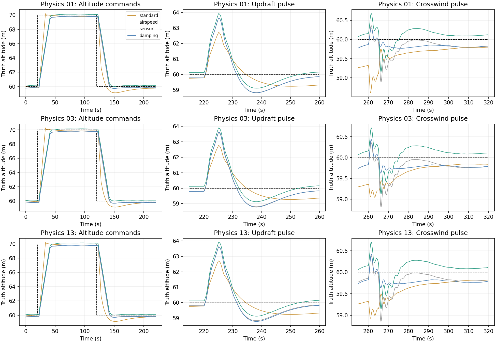

# Settled-flight supplemental tests

AI-assisted analysis. Twelve additional actual AP/EKF-in-loop runs; three physics configurations (nominal and two retained perturbations), four controller/sensing variants. No gain changes. All use CRUISE, start at 60 m after ten seconds within 0.5 m and 0.1 m/s vertical speed, then +10 m at 20 s, -10 m at 120 s, a 1 m/s updraft at 220–225 s, and 2 m/s westward wind at 260–265 s. Requests, ACKs and actual event times are retained. Finite sensor noise remains active.

**Reference limitation:** an initial attempt to set AIRSPEED_MIN=3.8 failed the firmware arming check (minimum 5). Those nine preflight failures are retained in ../transients and are not flight outcomes. The valid runs use AIRSPEED_CRUISE=5, AIRSPEED_MIN=5, AIRSPEED_MAX=7. LQI internally clamps TAS to 4.4 m/s. The standard controller runs TECS_PG_ENABLE=1: its paraglider branch controls height with throttle and pitch-rate damping, explicitly sets _using_airspeed_for_throttle=false, and assumes nearly constant natural airspeed. It returns before ordinary TECS speed regulation. Consequently NAV aspd_error is not a meaningful tracking error here (its reported target is zero). Raw telemetry is retained but excluded from scoring. These are actual operating responses, not equal-speed controller transfer-function tests; achieved speed is reported below.

| Controller | Completed | Initial altitude error m | Mean truth speed m/s | Mean pitot EAS m/s |
|---|---:|---:|---:|---:|
| standard | 3/3 | -0.053 | 4.380 | 4.236 |
| airspeed | 3/3 | -0.173 | 4.357 | 4.215 |
| sensor | 3/3 | 0.115 | 4.357 | 4.215 |
| damping | 3/3 | -0.213 | 4.376 | 4.232 |

## Altitude command response

Scenario medians (worst of three in parentheses). IAE is integral absolute truth error relative to requested altitude. Settling requires ±0.5 m and relative pitch-rate <=2 °/s for ten seconds; right-censored cases stay null.

| Step | Controller | 10–90% time s | Settling time s | IAE m·s | Overshoot m |
|---|---|---:|---:|---:|---:|
| climb | standard | 8.40 (8.50) | 16.98 (17.08) | 92.40 (92.69) | 0.23 (0.26) |
| climb | airspeed | 16.10 (16.20) | 21.67 (22.14) | 134.85 (139.15) | 0.00 (0.00) |
| climb | sensor | 16.00 (16.00) | 20.65 (20.80) | 123.35 (123.53) | 0.14 (0.14) |
| climb | damping | 16.10 (16.10) | 22.13 (22.17) | 142.48 (142.59) | 0.00 (0.00) |
| descent | standard | 8.70 (8.70) | 56.87 (57.06) | 107.82 (108.07) | 0.88 (0.88) |
| descent | airspeed | 16.10 (16.10) | 20.18 (20.44) | 126.59 (127.45) | 0.27 (0.30) |
| descent | sensor | 16.20 (16.20) | 21.90 (21.95) | 133.84 (133.88) | 0.00 (0.00) |
| descent | damping | 16.00 (16.00) | 20.93 (21.08) | 134.86 (135.81) | 0.30 (0.30) |

## Isolated gust response

Recovery is after gust removal, relative to pre-gust height, within ±0.5 m and relative pitch-rate <=2 °/s for five seconds. Gusts are abrupt imposed wind changes; they do not identify physical turbulence spectra.

| Gust | Controller | Peak height excursion m | IAE m·s | Peak pitch excursion ° | Recovery s |
|---|---|---:|---:|---:|---:|
| vertical | standard | 2.95 (2.96) | 31.18 (31.44) | 13.48 (13.53) | 7.90 (7.94) |
| vertical | airspeed | 3.81 (3.82) | 35.56 (35.73) | 14.05 (14.34) | 21.38 (21.38) |
| vertical | sensor | 3.80 (3.81) | 35.54 (35.79) | 13.69 (13.84) | 21.38 (21.47) |
| vertical | damping | 3.83 (3.84) | 36.04 (36.16) | 13.07 (13.17) | 21.47 (21.49) |
| crosswind | standard | 0.52 (0.69) | 22.04 (23.77) | 16.99 (25.07) | 5.76 (5.80) |
| crosswind | airspeed | 0.97 (0.98) | 8.34 (8.52) | 20.10 (20.32) | 5.57 (5.58) |
| crosswind | sensor | 0.97 (1.00) | 8.57 (8.79) | 20.69 (20.87) | 5.57 (6.87) |
| crosswind | damping | 0.63 (0.64) | 3.23 (3.32) | 9.77 (10.03) | 2.63 (3.37) |

## Integrity and scope

Actual LQI pitot-use and proprioception modes are asserted for each successful run. Firmware hashes and restoration verification are retained alongside results. ArduPilot sources are untouched; five viewer files were temporarily replaced from archived artifacts. These three chosen physics cases are diagnostic, not a new Monte Carlo or population stability claim.

