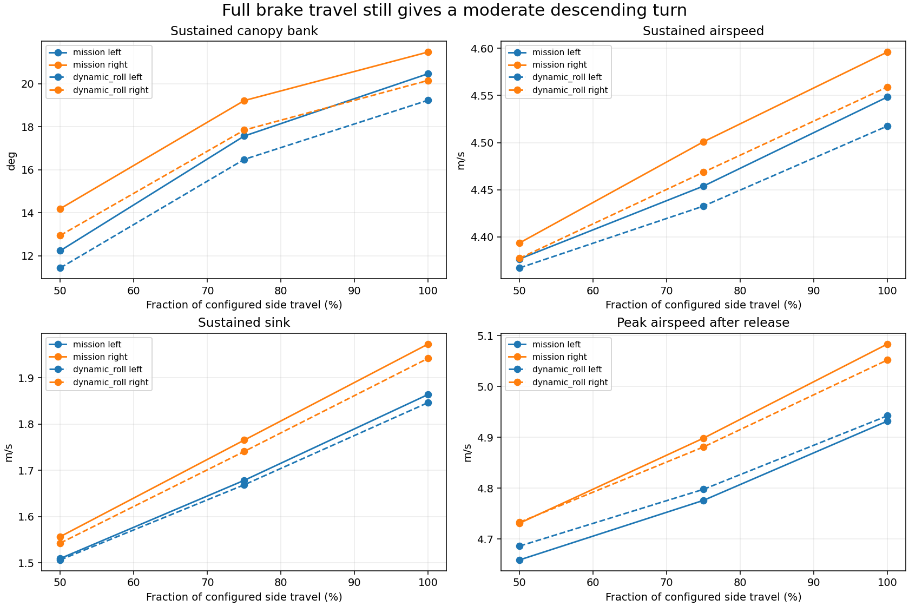
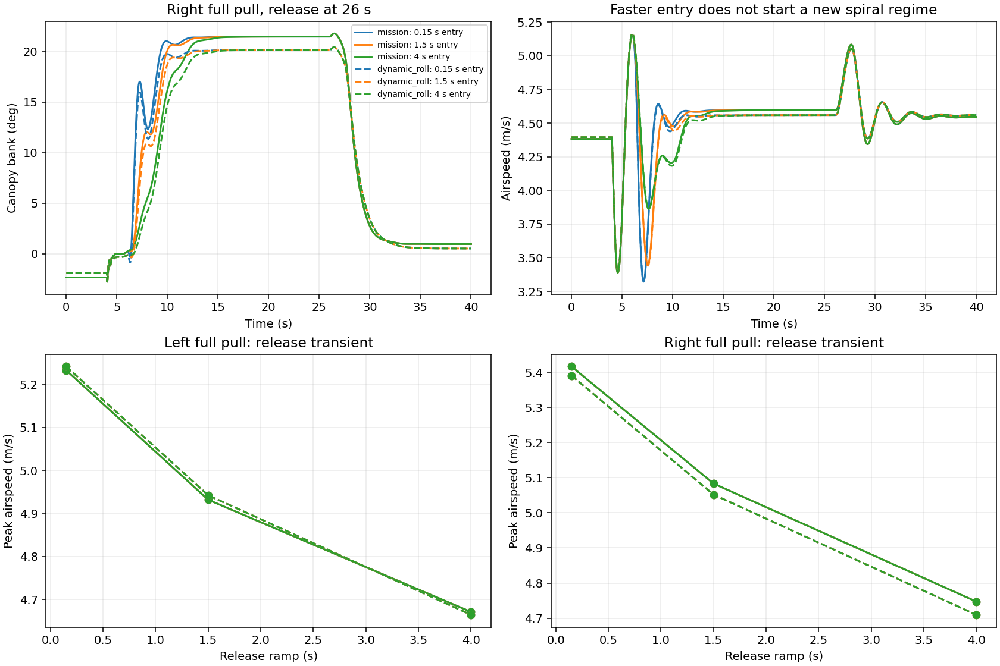
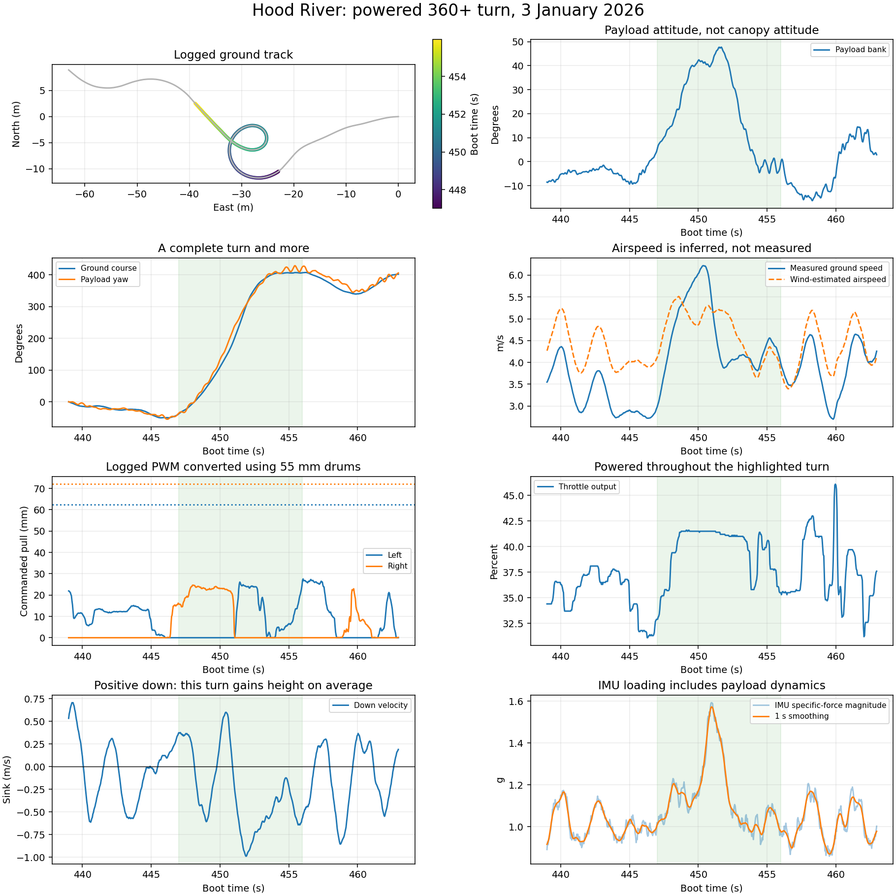
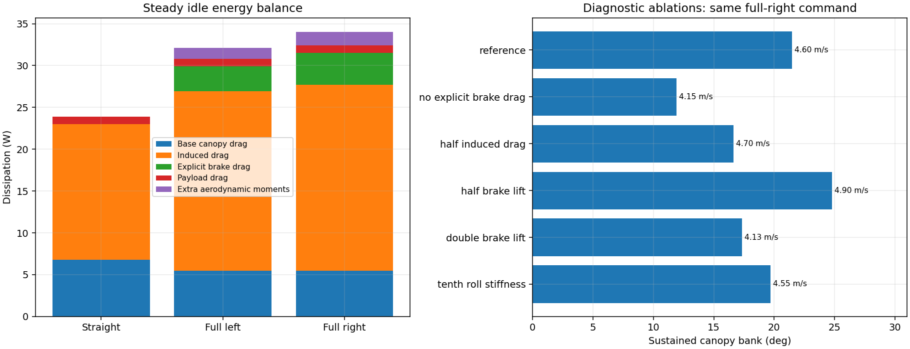

# Spiral authority investigation — 13 October 2026

## Finding

The retained simulator does not enter an accelerating deep spiral at its configured brake limits. More pull increases sink and produces a moderate bank, but the speed increase remains small. This holds in both turn directions, both retained model profiles, and all tested entry/release ramps. This is evidence about the current model, not a demonstrated limit of the real canopy.

No production aircraft parameters, controller gains, or firmware were changed. Diagnostic ablations below are deliberately large probes, not proposed calibrations.

## Brake authority and timing

46 open-loop cases use the Trout Lake 1.758 kg configuration, zero wind, and the existing actuator rate limit. Throttle becomes zero at 4 s; the brake maneuver starts at 6 s and releases at 26 s. Steady metrics cover 18–25 s; exit peaks cover 26–36 s. Level trim initializes the model, with its normal brake trim restored on release.

Logged servo parameters in both flights are unchanged throughout each decoded log: left PWM 800–2100 with 800 trim, right 900–2400 with 2400 trim and reversal. At the established 0.1 degree/us calibration and 55 mm drum diameter, commanded travel is 62.40 mm left and 71.99 mm right. This converts servo output into drum travel; line slack, preload, and canopy deformation are distinct. The Hood River and Trout Lake rigging profiles remain different.

Each profile includes a baseline, half/three-quarter travel on each side, and full travel with all nine combinations of 0.15, 1.5 and 4 s entry/release ramps. Opposite-side commanded pull is zero during each full-pull turn. The 0.15 s requested ramp is still subject to the real modeled actuator rate limit.

| Mission profile, 1.5 s ramps | Straight | Full left | Full right |
|---|---:|---:|---:|
| Canopy bank magnitude | 0.95° | 20.47° | 21.48° |
| Airspeed | 4.545 m/s | 4.548 m/s | 4.596 m/s |
| Sink | 1.384 m/s | 1.864 m/s | 1.973 m/s |
| Peak exit airspeed | 4.545 m/s | 4.932 m/s | 5.083 m/s |

Release timing does offer a useful transient: the fastest requested release reaches 5.42 m/s, versus 5.08 m/s with a 1.5 s release and 4.75 m/s with a 4 s release in the full-right mission case. That is a brief release response, not speed accumulated during the sustained spiral. Entry timing has little effect after settling.

The softer-roll profile reaches 19.24° left and 20.16° right. It shares the aerodynamic law with the mission profile, so agreement is not independent aerodynamic validation.

## The Hood River turn

The 447–456 s interval contains approximately 444° of ground-course rotation and 459° of payload yaw rotation. Payload bank peaks at 47.7° but averages 22.0° over this interval: the peak must not be compared as if it were sustained canopy bank. The largest banks occur for only part of the turn.

Throttle output rises toward 41.6%; the interval averages 39.7% and never falls below 32.9%. Right pull peaks at 24.6 mm, followed by left counter-input up to 26.1 mm. Mean ground speed is 4.61 m/s and mean vertical velocity is a climb of 0.285 m/s. The IMU specific-force magnitude averages 1.15 g, with a 95th percentile of 1.52 g. This is a payload measurement, including payload motion, not a direct canopy load-factor measurement.

This corroborates a powered, dynamically banked complete turn. It does not establish an unpowered spiral that trades height for speed, nor does it establish that maximum brake should produce one. The pilot reverses brake input before the bank has fully recovered; matching this response needs a time-domain comparison, not just a steady-turn coefficient fit.

PWM conversion was independently rebuilt from decoded RCOU and matched the existing causal cache exactly in the selected interval. ATT, IMU and navigation samples pass the cache's 0.1 s maximum-age checks. The plot uses the logged navigation ground velocity and position. Dashed airspeed uses the earlier assumed wind of 1.04 m/s north, 0.59 m/s east and zero vertical wind; it is not airspeed truth. The erroneous Hood River current channel is not used.

## Force and energy accounting

The audit independently reconstructs the five panel loads and compares them against the compiled production panel function. Maximum force/moment discrepancy is approximately 1.1e-14 in SI units. Panel lift does zero local work; panel force plus moment work equals negative panel drag dissipation to the same numerical precision.

The full energy calculation includes both rigid bodies, spatial added inertia, gravity and joint elastic potential. Its directional derivative is evaluated using the compiled dynamics RHS. For the six settled idle cases, the largest unexplained power is below 7e-7 W; hinge point velocity mismatch is below 4e-8 m/s. These checks apply to the settled, zero-wind, stopped-propeller cases. They are not a general audit of powered or gust energy accounting.

At full right brake, about 34.0 W of gravitational power is dissipated as 22.2 W induced drag, 5.46 W base canopy drag, 3.84 W explicit brake drag, 0.89 W payload drag and 1.60 W work against the additional aerodynamic moments. Joint damping is negligible in the settled turn. The spring transfers moments and stores elastic energy; it is not continuously consuming the missing energy.

The accounting closes. That rules out an obvious energy leak in these operating points, but does not validate the aerodynamic coefficients or the modeled deep-spiral behavior.

## Which mechanisms matter?

Six diagnostic cases retain the same nominal initial condition and command schedule, changing one model parameter at a time. The altered models settle before the measurement interval: maximum speed standard deviation is 0.004 m/s and bank standard deviation 0.081°. An initial attempt to retrim each altered model failed for the half-induced-drag case; the reported experiment instead uses one common initial state for every case. All reported results come from that rerun.

| Diagnostic change | Sustained canopy bank | Airspeed |
|---|---:|---:|
| reference | 21.48° | 4.596 m/s |
| no explicit brake drag | 11.92° | 4.153 m/s |
| half induced drag | 16.64° | 4.701 m/s |
| half brake lift | 24.78° | 4.902 m/s |
| double brake lift | 17.34° | 4.132 m/s |
| tenth roll stiffness | 19.69° | 4.550 m/s |

Removing explicit brake drag makes the turn shallower. Halving induced drag modestly raises speed but also reduces bank. Halving brake lift raises bank to 24.8°; doubling it lowers bank to 17.3°. A tenfold reduction in roll-joint stiffness leaves a 19.7° bank. These are coupled changes in the equilibrium, not independent measures of control effectiveness.

## Recommended next experiment

Keep the mission/landing model intact. Build a separate aerodynamic candidate around the measured transient turn response: first reproduce the Hood River right-input and counter-input sequence with the correct mass, rigging, throttle history and an ensemble of plausible initial canopy states. Compare payload bank, yaw rate, ground velocity and vertical velocity jointly, including opposite-direction turns and Trout Lake moderate turns as holdouts. Do not demand that the 48° payload peak be a 48° steady canopy bank.

Only then test physically motivated brake/deformation changes that improve those traces without spoiling glide, climb and ordinary mission turns. The present panel brake law and its yaw/bank coupling deserve attention before relaxing suspension stiffness or simply multiplying brake authority. Deep-spiral or stall predictions will remain extrapolations until there is relevant evidence. This study does not isolate a scale effect: no Reynolds-dependent aerodynamic model was introduced or tested.

## Reproduction and provenance

Run `sweep.py`, `audit.py`, `sensitivity.py`, `flight.py`, then `plots.py` using the ArduPilot Python environment. `common.py` identifies the retained simulator and decoded log cache. `provenance.json` records hashes and source revisions. The audit assumes the current non-geometric linear joint potential, stopped propeller and zero wind; its assertions exclude nonzero RPM in the sampled windows.

Raw NPZ trajectories remain in Mission Planner under `analysis/spiral-authority-2026-10-13`. This directory contains scripts, final plots, summarized numerical results and logged parameter evidence. Research and analysis were prepared with AI assistance; the numerical force and energy cross-checks are described above.
