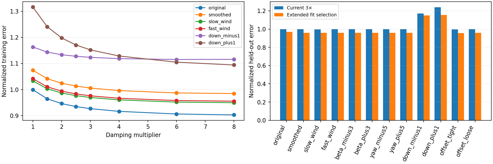

# Wind-sensitive as-built damping calibration

AI-assisted research, 16 October 2026. No runtime model, controller gain, or deployment changed.

## Finding

Changing wind did not make the fit prefer lower damping. All 12 wind assumptions selected 3× on the original 1–3× grid. An exploratory extension to 4×, 6× and 8× selected 8× in 11 variants and 6× in the constant −1 m/s down-wind variant. Most optima therefore remain at the search bound. This is not a physical identification of 8× damping.

| Wind history | Extended selection | Fit improvement vs 3× | Held-out improvement vs 3×, same wind | Held-out score at 3× | Held-out score at selected |
|---|---:|---:|---:|---:|---:|
| original | 8× (bound) | 2.59% | 3.14% | 1.000 | 0.969 |
| smoothed | 8× (bound) | 2.10% | 3.85% | 0.998 | 0.959 |
| slow_wind | 8× (bound) | 2.06% | 3.82% | 0.996 | 0.958 |
| fast_wind | 8× (bound) | 2.11% | 3.82% | 0.998 | 0.960 |
| beta_minus3 | 8× (bound) | 2.09% | 3.85% | 0.998 | 0.959 |
| beta_plus3 | 8× (bound) | 2.11% | 3.86% | 0.998 | 0.959 |
| yaw_minus5 | 8× (bound) | 2.09% | 3.85% | 0.998 | 0.959 |
| yaw_plus5 | 8× (bound) | 2.11% | 3.85% | 0.998 | 0.959 |
| down_minus1 | 6× | 0.73% | 1.80% | 1.171 | 1.150 |
| down_plus1 | 8× (bound) | 5.03% | 6.67% | 1.238 | 1.156 |
| offset_tight | 8× (bound) | 1.80% | 3.88% | 0.996 | 0.958 |
| offset_loose | 8× (bound) | 2.10% | 3.85% | 0.998 | 0.959 |

Positive improvement means lower error. Held-out score is normalized per window/initialization against the current 3× model under original wind; 1.0 is that reference. It is distinct from the training score, whose normalization is frozen to the original legacy fit-window errors. Scores combine rates (weight 1 each), bank and climb (weight 0.25 each); course is reported but not optimized.

## Absolute held-out errors

Arithmetic means over eight 30-second held-out windows and three initial canopy angles. Rates in degrees/s, bank/course in degrees, climb in m/s. Windows reuse historical flights and are not independent validation flights.

| Wind | Damping | Roll rate | Pitch rate | Yaw rate | Bank | Course | Climb |
|---|---:|---:|---:|---:|---:|---:|---:|
| original | 3× | 13.235 | 17.471 | 23.714 | 5.674 | 57.885 | 0.339 |
| original | 8× | 13.369 | 15.778 | 23.336 | 5.685 | 58.433 | 0.339 |
| smoothed | 3× | 13.132 | 17.466 | 23.661 | 5.674 | 55.139 | 0.340 |
| smoothed | 8× | 13.208 | 15.633 | 23.292 | 5.673 | 55.137 | 0.339 |
| slow_wind | 3× | 13.112 | 17.415 | 23.638 | 5.662 | 55.527 | 0.340 |
| slow_wind | 8× | 13.187 | 15.605 | 23.281 | 5.659 | 55.544 | 0.339 |
| fast_wind | 3× | 13.111 | 17.452 | 23.683 | 5.683 | 54.466 | 0.341 |
| fast_wind | 8× | 13.190 | 15.644 | 23.303 | 5.684 | 54.419 | 0.340 |
| down_minus1 | 3× | 13.052 | 17.379 | 23.831 | 5.733 | 57.126 | 1.049 |
| down_minus1 | 6× | 13.106 | 16.657 | 23.412 | 5.740 | 57.163 | 1.049 |
| down_plus1 | 3× | 13.423 | 21.518 | 23.989 | 5.653 | 53.437 | 1.060 |
| down_plus1 | 8× | 13.397 | 17.815 | 23.357 | 5.631 | 53.340 | 1.059 |



## Interpretation

- The hypothesis that corrected wind alone would remove the need for elevated damping is not supported by this experiment.
- At unchanged 3× damping, nominal smoothed wind changes the aggregate held-out score by only about −0.2%. Rate errors barely change; course error improves from 57.9° to 55.1°, mostly in Hood River. Horizontal sensitivity variants behave similarly. The assumed constant ±1 m/s vertical winds have much larger effects, especially on climb; they are sensitivity cases, not reconstructed thermal truth.
- With nominal smoothed wind, increasing damping from 3× to 8× improves the held-out composite by 3.85%, mainly through pitch-rate error (17.47 to 15.63°/s). Roll-rate error slightly worsens. Large absolute model errors remain.
- That improvement depends strongly on initial canopy angle: about 0.5%, 3.4% and 7.5% for 0.25, 0.35 and 0.45 rad respectively. Unobserved canopy initial state, unresolved aerodynamic/suspension mechanics and the short-horizon objective remain plausible confounders. Separate initialization transients from sustained dynamics before interpreting a fitted damping coefficient physically.
- A search-bound result is a warning about identifiability, not a reason to install an 8× coefficient. No new tune is promoted.
- The smoother is not wind truth: the preceding known-truth tests exposed errors and overconfidence in weakly observed or changing-wind cases. This study measures sensitivity to alternative histories rather than establishing which one is correct.
- Parameters other than the common pitch/yaw damping multiplier were fixed. This does not identify brake authority, drag or independent pitch/yaw damping, and it does not assess closed-loop controller stability or power efficiency.

## Frozen method and scope

The historical alternating starts were retained: four fit windows per flight at 10 seconds, four held-out windows per flight at 30 seconds. Fit canopy initialization is 0.35 rad; held-out checks use 0.25/0.35/0.45 rad. The 132 mm riser spacing, mass/inertia, routing, 60 mm assumed ring height, brake/propulsion parameters and all other settings were held fixed. Recorded RPM initializes the motor model; recorded voltage at the window start is held constant, preserving the previous method.

Original wind is frozen at each window start exactly as before. Smoothed winds are linearly interpolated from the saved 1 Hz trajectories and applied at every 40 ms integration interval. Each wind changes both airflow during replay and the initial canopy-state reconstruction. Vertical variants retain their ±1 m/s down components. Yaw/beta sensitivity variants change the reconstructed wind only; they do not rewrite the observed attitude or measured geometry.

The 12 histories are the original assumptions plus nominal smoother, slow/fast wind diffusion, ±3° sideslip, ±5° heading bias, ±1 m/s vertical wind, and tight/loose constant lateral-offset prior. These are one-at-a-time sensitivity choices, not a sampled probability distribution.

There are 768 fit replays, 576 held-out checks and eight legacy normalization replays, plus the separately recorded numerical/provenance audit. The expanded grid was chosen after all original-grid results hit 3×, before examining its held-out results. No wind variant was selected to minimize model error.

Smoothing uses the whole flight, including the held-out periods. Those periods are held out from damping selection, not from wind reconstruction; this is not an independent end-to-end prediction test.

## Numerical audit

All 768 fit and 576 held-out replays were finite with valid source inputs. Historical as-built held-out metrics reproduced within 3.9e-12 absolute error; constant-wind bulk and per-step replay matched exactly, as did the legacy normalization. Doubling integration substeps from 32 to 64 for four high-pitch-error extended checks changed metrics by at most 0.000123%. Runtime calibration was unchanged. See `audit.json` for hashes and detailed checks.

## Reproduce

Run from the repository root:

```bash
simulation/.venv/bin/python research/archive/wind-calibration-2026-10-16/run.py
simulation/.venv/bin/python research/archive/wind-calibration-2026-10-16/run.py --extended
simulation/.venv/bin/python research/archive/wind-calibration-2026-10-16/audit.py
/home/david/envs/venv-ardupilot/bin/python research/archive/wind-calibration-2026-10-16/report.py
```

Completed batch files are reused; use a fresh study directory to repeat runs after changing code or inputs. See `audit.json` for source/input hashes, original-fit reproduction, constant-wind API equivalence and integration-refinement results. All large source flight data remain in their existing local directory.
