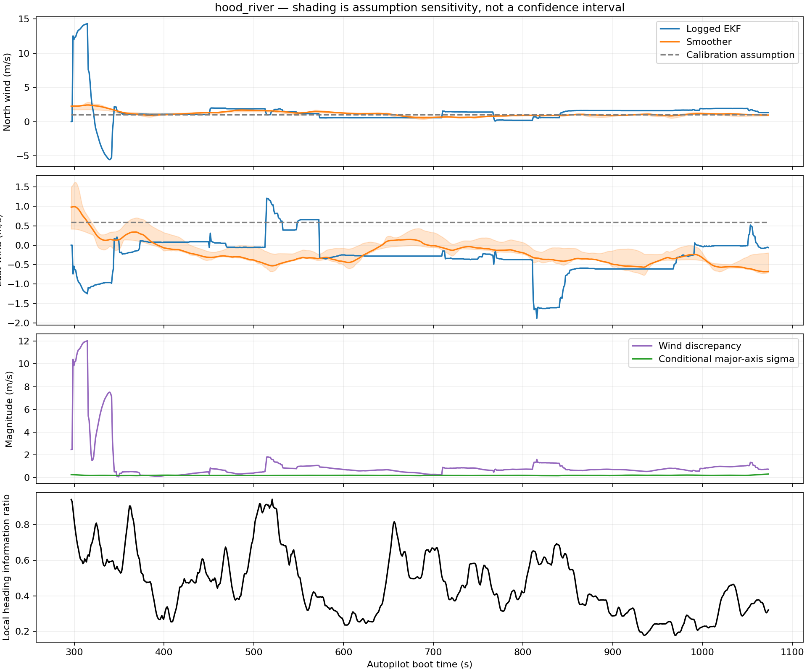
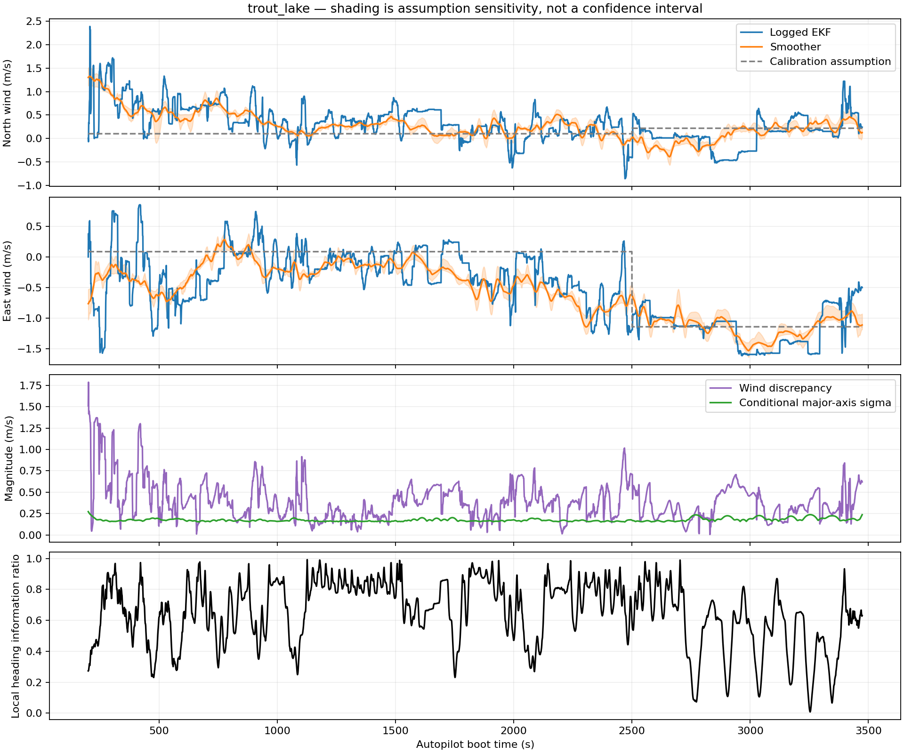

# Offline wind reconstruction, 16 October 2026

AI-assisted research implementation. No simulator parameters, controller gains, or deployment changed.

## Findings

Differences below are horizontal wind-vector distances, not wind-speed differences or errors against measured truth.

| Flight | Selected samples at 1 Hz | Median vs EKF | P90 vs EKF | Maximum vs EKF | Median vs calibration assumption |
|---|---:|---:|---:|---:|---:|
| hood_river | 778 | 0.70 m/s | 1.29 m/s | 12.04 m/s | 0.95 m/s |
| trout_lake | 3274 | 0.36 m/s | 0.65 m/s | 1.79 m/s | 0.42 m/s |

0.68The Hood River maximum is an early logged-EKF transient, not a typical disagreement. After excluding the first 60 seconds of selected flight, its median/P90/maximum discrepancy is /1.02The Hood River maximum is an early logged-EKF transient, not a typical disagreement. After excluding the first 60 seconds of selected flight, its median/P90/maximum discrepancy is /1.81 m/s.

Important provenance correction: the prior calibration did **not** directly use the logged EKF wind. `prepare_force_state.py` hard-coded Hood River wind N/E/D=(1.04,0.59,0) m/s; Trout Lake=(0.1,0.086,0), switching at boot time 2500 s to (0.217,-1.139,0). `audit_causal_resampling.py` copied that field into the causal replay inputs. The as-built fit then froze that wind at each replay-window start. The original derivation of those constants is not established by this audit. See `legacy-wind-preprocessing.py.txt` for the exact retained generating code. Reported EKF wind in this study comes separately from core-0 `XKF2.VWN/VWE`.

## Method

A robust iteratively reweighted Kalman filter followed by Rauch–Tung–Striebel smoothing. Horizontal wind is a random walk with default diffusion 0.05 m/s/sqrt(s). A single constant lateral-velocity nuisance offset per airborne segment has a 0.5 m/s prior sigma; it represents persistent sideslip/heading error, not a measured aerodynamic coefficient. A zero-mean 5 m/s prior on each wind component is deliberately broad. No logged EKF wind, calibration wind, trim airspeed, or aerodynamic forces enter the estimate.

The soft observation is (body-side-axis - tan(beta)*body-forward-axis) dot (ground velocity - wind) = offset. Measurement variance has a 0.5 m/s floor plus a 5-degree speed-scaled allowance, with Huber cutoff 1.5 sigma. Six reweighting/smoothing iterations are used. Base vertical wind is zero. Existing valid/airborne selections are split at gaps; only continuous spans of at least 30 s are retained. Data are subsampled from 25 Hz to 1 Hz, not treated as independent 25 Hz measurements. The existing payload IMU-to-CG correction uses measured geometry and body rates. Fused position is used only through existing flight selection, not counted as a second independent velocity measurement.

Sensitivity runs change wind diffusion to 0.02/0.1, fixed sideslip to ±3 degrees, yaw to ±5 degrees, vertical wind to ±1 m/s, and nuisance-offset prior sigma to 0.001/1 m/s, one at a time. These are assumed stress ranges, not measured probability distributions or exhaustive joint bounds. The plots shade their componentwise envelope. The formal covariance is conditional on this approximate measurement model and is not a calibrated confidence interval.

| Flight | Median maximum sensitivity shift | P90 shift | Weak local geometry fraction |
|---|---:|---:|---:|
| hood_river | 0.32 m/s | 0.42 m/s | 0.0% |
| trout_lake | 0.13 m/s | 0.19 m/s | 1.1% |

Local geometry is the eigenvalue ratio of horizontal side-axis information over ±30 s. Ratios below 0.1 are flagged weak. This detects directional ambiguity, but does not establish correctness of the sideslip or slow-wind assumptions. Both historical flights contain many turns.

## Known-truth checks and failures

| Constructed case | Median wind-vector error | Median major-axis conditional sigma |
|---|---:|---:|
| turning | 0.015 m/s | 0.20 m/s |
| straight | 1.200 m/s | 5.04 m/s |
| changing-wind | 0.065 m/s | 0.20 m/s |
| biased-attitude | 0.027 m/s | 0.20 m/s |

The exactly straight case correctly retains approximately 5 m/s uncertainty in unobservable wind. The 3-degree heading-bias case is substantially improved by the constant nuisance offset. Synthetic turning/ramp accuracy and straight-flight uncertainty checks are asserted in `run.py`.

Stress tests also use all 16 existing full 9-DOF trajectories with known wind, physical sideslip, gusts/thermals, and added 0.15 m/s navigation-velocity noise (fixed random seed 72). These expose significant limitations:
- AUTO: per-run median error spans 0.24–1.53 m/s; median across runs 0.70 m/s.
- CRUISE: per-run median error spans 0.36–3.60 m/s; median across runs 2.38 m/s.
- Formal covariance is overconfident in several realistic runs. Weak-heading flags identify many CRUISE failures, but even some geometrically supported intervals fail under changing wind/model-assumption violations.
- Therefore the flight reconstructions are exploratory alternatives, **not validated wind truth**. Do not automatically overwrite calibration inputs with them.

## Implications for the simulator (hypotheses, not a refit)

The following ten-second windows are the previously selected calibration/check starts. Airspeed means use payload CG velocity. The pressure ratio is the mean pointwise squared-speed ratio at unchanged density; it is not a fitted lift/drag coefficient or a predicted total-force ratio.

| Flight | Start s | Assumed-wind airspeed | Smoothed-wind airspeed | Dynamic-pressure ratio |
|---|---:|---:|---:|---:|
| hood_river | 300 | 3.28 m/s | 2.50 m/s | 0.54 |
| hood_river | 360 | 4.28 m/s | 4.22 m/s | 0.97 |
| hood_river | 480 | 3.75 m/s | 4.49 m/s | 1.48 |
| hood_river | 600 | 3.96 m/s | 4.51 m/s | 1.32 |
| hood_river | 690 | 3.36 m/s | 3.29 m/s | 0.96 |
| hood_river | 720 | 4.27 m/s | 3.79 m/s | 0.79 |
| hood_river | 930 | 4.00 m/s | 3.85 m/s | 1.05 |
| hood_river | 1020 | 4.41 m/s | 3.32 m/s | 0.57 |
| trout_lake | 600 | 4.60 m/s | 4.31 m/s | 0.88 |
| trout_lake | 840 | 4.21 m/s | 4.62 m/s | 1.20 |
| trout_lake | 900 | 4.56 m/s | 4.78 m/s | 1.13 |
| trout_lake | 1350 | 5.01 m/s | 4.74 m/s | 0.89 |
| trout_lake | 1920 | 4.82 m/s | 4.39 m/s | 0.83 |
| trout_lake | 2400 | 4.58 m/s | 4.93 m/s | 1.18 |
| trout_lake | 2790 | 4.13 m/s | 4.25 m/s | 1.06 |
| trout_lake | 2910 | 4.53 m/s | 4.53 m/s | 1.00 |

Plausible impacts:

- Airspeed enters dynamic pressure quadratically. The changes above are large enough to alter inferred aerodynamic force/torque authority substantially, with opposite signs in different windows; one global coefficient correction would not resolve them.
- Airflow direction also initializes the unobserved canopy attitude. Wind error can therefore appear as an initial suspension/pitch transient and be absorbed into joint damping. The existing 3× damping optimum at the search boundary is worth rechecking, but this study does not show that it is wrong or determine its replacement.
- Axial inflow enters the propulsion calculation, so wind assumptions can bias inferred thrust and shaft-power estimates. No electrical-efficiency correction is inferred here.
- Brake authority, drag, damping and inferred canopy state can trade off during fitting. Fixed as-built dimensions, masses and inertias should remain fixed while wind and initialization uncertainty are propagated.

Recommended next use: rerun the existing calibration over both the original assumptions and a family of these reconstructed winds, report parameter sensitivity and held-out-window errors, and retain unresolved uncertainty. Do not select a wind solely because it makes the aerodynamic model fit better.

## Reproduce

`OPENBLAS_NUM_THREADS=1 /home/david/envs/venv-ardupilot/bin/python research/archive/wind-smoother-2026-10-16/run.py`

`/home/david/envs/venv-ardupilot/bin/python research/archive/wind-smoother-2026-10-16/report.py`

Requires NumPy, SciPy and Matplotlib and the existing local preprocessed flight inputs. `geometry.json` records the IMU offsets from the current as-built profile. `input-hashes.json` identifies the flight inputs and direct EKF extracts. NPZ outputs include time, navigation inputs, wind/covariance, nuisance bias, sensitivity variants and observability. No firmware or physics files are changed.
