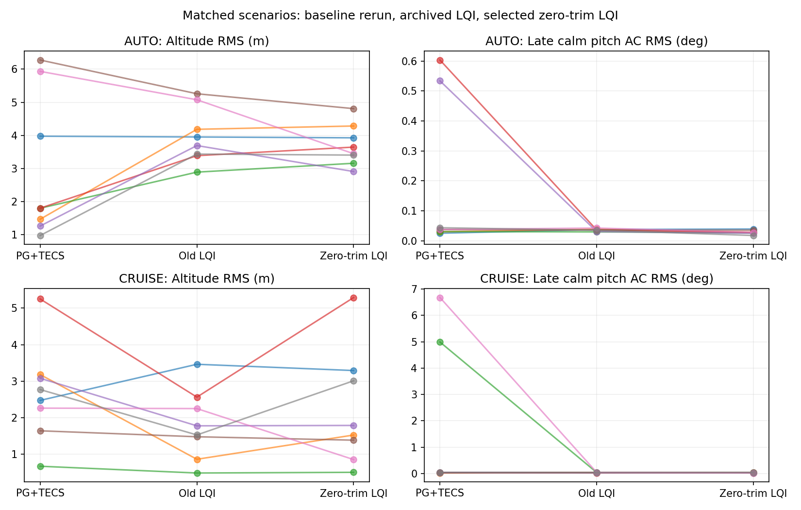

# Zero-trim controller: implementation and tuning results

Zero additional common-brake trim is viable in the tested simulator. The selected
candidate retains LQI's damping and comparable tracking, but it does **not**
eliminate persistent braking or establish an energy-efficiency improvement.

## Implementation

The trim solve fixes common brake at exactly zero and solves the remaining
equilibrium variables. For the as-built 132 mm model at 22.2 V this gives 44.59%
throttle, zero additional common brake, 5.20% differential brake and 4.383 m/s.
The differential trim still pulls one brake; zero common is not zero total brake.

The common-input linearization is right-sided: no impossible negative brake
travel is evaluated. The existing physical allocator enforces nonnegative common
brake, preserves the negative requested/applied residual for anti-windup, and
feeds the applied command to the observer. This is still constrained LQI, not MPC.
Local unconstrained poles are a synthesis check, not a constrained-stability proof.

## Three tuning iterations

Each iteration flew five existing scenarios, including both original oscillation
regressions, one AUTO mission, and two high-brake CRUISE cases. All 15 trial flights
completed inside the screening envelope.

| Iteration | Common effort cost | Pitch-rate weight | AUTO cross-track RMS | Decision |
|---|---:|---:|---:|---|
| 1 | 1000 | 30 | 3.58 m | Selected for full campaign |
| 2 | 10000 | 60 | 61.00 m | Rejected: navigation regression |
| 3 | 3000 | 30 | 43.87 m | Rejected: navigation regression |

The original LQI comparison was 3.36 m in that AUTO case. Larger common-brake
penalties reduced late-window braking but substantially damaged AUTO tracking.
The detailed borderline-screen decision for iteration 1 is recorded in README.md;
it did not pass every original relative threshold, and the full campaign was used
to investigate rather than conceal that limitation.

## Full paired campaign

Reran all 16 scenarios for both PG+TECS and selected zero-trim LQI: **32/32 flights
completed** without a screening stop. Compared against the archived old LQI on
the same 16 parameter/weather cases. The table shows medians across eight cases
per flight mode; tracking is measured during the disturbance window.

| Metric | PG+TECS rerun | Old LQI | Zero-trim LQI |
|---|---:|---:|---:|
| AUTO altitude error RMS | 1.80 m | 3.82 m | 3.55 m |
| AUTO cross-track error RMS | 4.15 m | 5.79 m | 4.75 m |
| CRUISE altitude error RMS | 2.62 m | 1.65 m | 1.66 m |
| CRUISE cross-track error RMS | 0.30 m | 0.45 m | 0.30 m |

All eight zero-trim CRUISE cases had late calm pitch AC RMS below 0.04 degrees.
The PG+TECS rerun had sustained large pitch motion in cases 05 and 13, with late
RMS 4.99 and 6.68 degrees. The original baseline campaign's oscillating cases
were 01 and 15 instead. Weather seeds and parameter draws are matched, but EKF
startup and trajectories are not bitwise identical. This variability limits
small-difference claims and means the baseline failure case IDs are not fixed.
AUTO motion also includes commanded turns and cannot be treated as free decay.
The selected tune also passed a separate normal-speed replay of nominal CRUISE:
late pitch AC RMS was 0.0394 degrees, pitch-rate RMS 0.106 degrees/s, and additional
common brake was zero in the late recovery window. The full trace and metrics
are retained in `validation/normal-speed-lqi.json` and `normal-speed-metrics.json`.

## Power and remaining braking

Using the same quasi-steady shaft-power reconstruction for both LQI versions,
the median **within-pair** power change is -0.2% in AUTO and +0.6% in CRUISE.
Individual changes range from -6.5% to +6.1% in AUTO and -14.3% to +23.6% in
CRUISE. Median paired energy-per-ground-path-km changes are -0.5% and +1.0%.
There is no consistent energy saving. These estimates are not battery power;
the new logs now retain RPM and voltage for subsequent mechanical-power analysis.

Several zero-trim cases still end with 14–26% additional common brake. Zero trim
changes the reference equilibrium, but does not force the integral/feedback
solution to remain at that equilibrium. The next investigation should record
the onboard references, observer estimates, integral states and allocation
residuals to identify why these alternate operating points persist before
making another controller change. Increasing the common-brake cost alone was
not a satisfactory fix in these trials.

## Verification and delivery

- Native ArduPlane and WASM builds pass.
- Five native controller unit tests pass, including the new negative-request /
  zero-applied-brake residual test.
- Native `ParagliderMIMO` integration test passes.
- Browser firmware/EKF handover, mode and steering integration test passes;
  largest measured throttle handover step was 2.4 percentage points (limit 8).
- The boundary-synthesis regression test passes; it rejects any negative
  common-brake evaluation and checks physical trim residual and drift.
- All 41 viewer unit tests and the TypeScript/Vite build pass.
- The selected header matches both repositories and the packaged firmware's
  source-hash manifest; the normal-speed 180-second recovery run passes.

Selected gains and local browser artifacts are updated. No public deployment or
PR was made. These finite simulations are sensitivity evidence, not flight
qualification or proof of robust stability. Tuning cases overlap the campaign.

[Full campaign table and paired changes](campaign/RESULTS.md)

