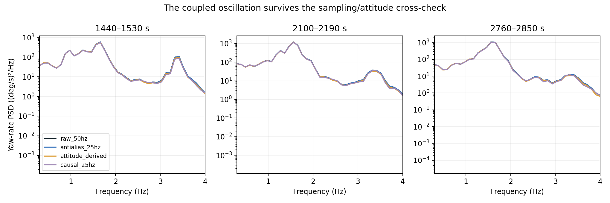
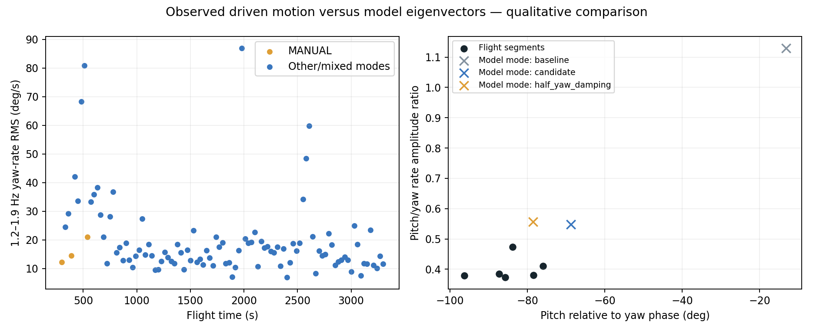

# Coupled pitch/yaw oscillation investigation

**The 1.5–1.7 Hz component is supported by both logged gyro and attitude motion, exists in MANUAL, and has a gyroscopic-looking pitch/yaw relationship. The Rust model already contains a nearby coupled mode.** The current evidence points toward a mismatch in excitation, damping, or operating-point dependence, rather than proving that another degree of freedom is needed. No simulator parameters or controller gains were changed.

## Sampling and measurement audit

The original extracted IMU instance-0 messages arrive at approximately 50 Hz, ATT and RCOU at 25 Hz. Previous replay preparation takes the latest available sample at each 25 Hz grid point. We compared that stream with native-rate gyro interpolation, anti-aliased 50→25 Hz conversion, and body rates derived from successive ATT quaternion rotations using actual timestamp differences and midpoint timestamps.

Across 1440–1530, 2100–2190, and 2760–2850 s, 1.2–1.9 Hz yaw-rate RMS from native-rate gyro is **13.76, 19.39, and 19.13 deg/s**, versus **13.58, 19.16, and 18.93 deg/s** from attitude-derived rates. Gyro/attitude coherence at 1.5625 Hz exceeds 0.9999 for yaw, with about 6 degrees phase difference. Anti-aliasing changes this band RMS negligibly. The broad peak shifts somewhat between segments: it should not be treated as an exactly fixed 1.5625 Hz oscillator.

Thus the peak was not created by our latest-sample replay resampling. ATT uses the same underlying IMU and EKF, so this is a kinematic consistency check, not independent optical truth. Upstream sensor processing or aliasing before the recorded 50 Hz stream cannot be conclusively excluded from these records alone.



## Does it require the autopilot loop?

No. Three surveyed windows entirely in logged MANUAL mode (300, 390, 540 s starts) have 1.2–1.9 Hz yaw-rate RMS of **12.28, 14.49, and 20.97 deg/s**. The log identifies firmware `3a2da6cf`; its `ArduPlane/mode_manual.cpp` passes pilot commands to outputs and resets the attitude controllers. Its paraglider mixer maps pilot roll and flare to brakes without an attitude-feedback term. This establishes that an AP attitude loop is not necessary for the component. It does not exclude pilot excitation, pilot feedback, or amplification by AP in other modes.

The 30-second survey covers 300–3330 s where the prior validity mask passes. It is a diagnostic survey, not a separately frozen validation dataset. Mode switches can occur inside windows; only wholly MANUAL windows support the manual comparison. Controller-loop causal attribution cannot be made from input/output coherence alone.

## Motion shape

Across the three manual windows and three representative later windows, pitch-rate amplitude is **0.37–0.47 times yaw-rate amplitude**, with pitch approximately **76–96 degrees behind yaw** at the selected band peak. This is near quadrature, rather than two channels simply duplicating one another through a fixed sensor-axis rotation. It is consistent with a precessional/gyroscopic coupled motion, but not unique proof of that mechanism.



## What the existing model contains

We solved straight-level relative equilibria at 22.2 V with fixed 6 mm nominal effective common pull, leaving both brake lines engaged. This avoids interpreting a numerical derivative across a slack/one-sided-brake kink. Each reported equilibrium has maximum residual below 1e-4 (actual residuals below 2e-13). A finite-difference Jacobian of the 4 ms Rust flow map gives the small-perturbation eigenmodes. Rotor speed is held at its trim value in the perturbation chart; motor-speed perturbations are excluded from this diagnostic. This is model-only analysis, not a flight damping estimate. Repeating the linearization with a 2 ms flow interval changes the selected baseline/candidate frequencies by less than 3e-8 Hz; see `resolution-check.json`.

| Variant | Nearby mode | Damping ratio | Pitch/yaw amplitude | Pitch relative phase |
|---|---:|---:|---:|---:|
| baseline | 1.764 Hz | 0.439 | 1.13 | -13.2 deg |
| candidate | 1.591 Hz | 0.436 | 0.55 | -68.8 deg |
| no_rotor_gyro | 1.766 Hz | 0.404 | 32.59 | 65.9 deg |
| diagonal_payload_inertia | 1.765 Hz | 0.438 | 1.13 | -12.6 deg |
| half_yaw_damping | 1.514 Hz | 0.477 | 0.56 | -78.5 deg |


The candidate contains a mode near **1.59 Hz** whose pitch/yaw relationship is closer to the observed one than the baseline mode. Removing rotor angular momentum leaves the nearby 1.77 Hz mode almost entirely pitch motion (yaw magnitude about 0.03 relative to pitch near 1.0). Removing payload inertia cross terms barely changes the coupled mode. In this model, rotor gyroscopic terms are therefore a strong source of the pitch/yaw coupling.

Halving yaw damping alone produces a mode near 1.51 Hz and a phase near -79 degrees. This is a useful sensitivity result, **not a fitted or accepted calibration**. The modal damping ratio actually rises in that comparison because coupled eigenmodes change shape: reducing one mechanical damping coefficient does not necessarily reduce the damping ratio of a selected mode.

Driven motion in flight is not the same as a free-mode eigenvector. At 1.5625 Hz, the model's pure differential-brake forced response has pitch/yaw amplitude 0.149 and phase +178.7 degrees for baseline, versus 0.188 and -162.4 degrees for the candidate. Those differ substantially from the flight association. The flight includes correlated common brake, throttle, pilot/controller feedback, disturbances, and changing trim, so this is not a direct causal transfer-function fit. It shows why matching a natural frequency alone would be insufficient.

## Interpretation and next experiment

1. **Sampling artifact from our 25 Hz preparation:** strongly disfavored by the native-rate and attitude checks.
2. **An AP-only feedback oscillation:** ruled out as a necessary explanation by the MANUAL segments and matching firmware path.
3. **A coupled aircraft response involving rotor angular momentum:** consistent with the quadrature motion and model sensitivities; still a hypothesis for the observed component.
4. **A missing model degree of freedom:** not established. A nearby mode is already present, particularly in the candidate, but its observed excitation/amplitude is not reproduced.

The next useful fit should target the complex pitch/yaw relationship and excitation of this existing mode across operating points, not merely its frequency or an integrated trajectory score. Start with manual segments to reduce automatic-controller confounding, retain commanded versus actual brake-motion uncertainty, and vary rotor angular momentum, yaw suspension terms, and input routing within physically justified bounds. Use held-out segments for validation. Compare common and differential input paths jointly; do not assume every yaw spectral peak is a pure differential-brake response.

The existing logs still do not uniquely identify free-decay damping. We should retain a damping uncertainty range rather than tuning to an assumed value. No production promotion or LQI retuning follows from this investigation alone.

## Reproduction and provenance

```sh
simulation/.venv/bin/python research/coupled-oscillation-2026-10-18/investigate.py
simulation/.venv/bin/python research/coupled-oscillation-2026-10-18/shape.py
simulation/.venv/bin/python research/coupled-oscillation-2026-10-18/modes.py
python research/coupled-oscillation-2026-10-18/report.py
```

The raw extracted message directory is resolved alongside `MICROAGU_REPLAY_DATA`. JSON source hashes and sampling cadence are recorded in `source-audit.json`; numerical results, surveyed windows, spectra, and model sensitivities are versioned. Matplotlib is needed only for the report plots. No core simulator, production profile, firmware, or browser runtime is modified.
