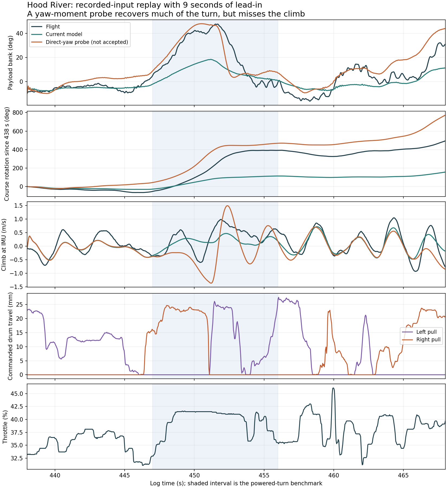

# Existing-flight fidelity investigation

18 October 2026. Historical 132 mm geometry; existing Hood River and Trout Lake logs only. The planned 185 mm hardware change remains a separate future configuration. No production physics, observer, controller gains or browser runtime were changed.

## What the current model misses

We now have an explicit recorded-input benchmark for the powered Hood River turn. Replay begins at 438 s, nine seconds before the 447–456 s assessment interval, and runs for 30 seconds. Flight-specific geometry, mass, brake slack/preload, recorded throttle and brake commands are retained. Wind and voltage use the historical replay assumptions. The three initial canopy-angle assumptions are 0.25, 0.35 and 0.45 rad.

| 447–456 s | Flight | Current model | Direct-yaw diagnostic |
|---|---:|---:|---:|
| Ground-course rotation | 443.92° | 141.87° | 424.64° |
| Peak absolute payload bank | 47.69° | 18.44° | 48.00° |
| Mean climb at IMU | +0.285 m/s | +0.162 m/s | −0.120 m/s |

Nominal initialization is 0.35 rad. Across the three initializations, current-model course rotation is 141.65–141.99° and bank peak 18.43–18.45°. The settled turn deficit is not explained by this tested initialization uncertainty. This does not rule out all hidden-state or wind errors.



The direct-yaw diagnostic uses the existing residual aerodynamic coefficient $C_{n\delta}=0.03$; its production value is zero. Its moment contribution is $q S b C_{n\delta}\delta$, where $\delta$ is effective right-minus-left brake travel divided by 72 mm. This is an existing model capability, not a newly validated force law. It nearly matches two scalar turn measures, but gets the vertical behavior wrong, recovers bank too early, and substantially worsens other development windows. It must not be presented as a successful replication.

## Frozen mechanism screen

Twenty-one configurations include the baseline and one-at-a-time variations in brake lift/drag, roll/yaw stiffness, yaw damping/static derivatives, canopy curvature, and residual brake roll/yaw and sideslip-force coefficients. These are diagnostic hypotheses, not a probabilistic uncertainty distribution. Zero production coefficients are tested with explicit additive values rather than multiplied by a scale.

The screen uses eight historical fit starts plus the powered-turn window. Ranking is the mean of six equally weighted normalized errors after discarding the first two seconds: roll/pitch/yaw rate, bank, ground course and vertical velocity. Each error is normalized against the baseline in that same window. The protocol is written before running candidates. Only the selected candidate proceeds to eight historical check windows at all three initial canopy angles. Those windows have been reused in earlier studies and are not independent flight validation.

The selected candidate increased brake drag by 50%. It reduced the development score by only 1.43%. On the check windows:

- Mean composite error **increased 0.42%**.
- Five of eight windows improved; the worst worsened **16.15%**.
- It failed the predeclared screen (at least 5% mean improvement, at least six improved windows, no window over 10% worse).

It was rejected. Even its nominal Hood River result only reached 169.62° course rotation and 23.56° bank. Adding drag is not an adequate explanation of the missing turning response.

The powered turn was deliberately included in development, not called held out. A later flight would still be needed to validate any promoted model independently.

## Exploratory brake-response follow-up

Inspection of the diagnostic trace suggested a response-timing discrepancy as well as an authority discrepancy. A second, explicitly exploratory screen tested residual yaw coefficients 0, 0.01, 0.02 and 0.03 with lumped brake-response time constants 0, 0.15 and 0.4 s, using the same nine development windows. The lag filters the commanded brake travel before the model's slack and routing calculations; it is a sensitivity proxy, not an identified servo or fabric transfer function.

The combination 0.03 / 0.4 s reaches 457.88° course rotation and 47.70° peak bank, but predicts −0.132 m/s mean climb and worsens the nine-window composite by 31.68%. A 0.15 s lag alone improves that development score by just 0.68%, without fixing turn authority. Neither is a promotion candidate. No reused dataset is relabeled as fresh validation after inspecting these results.

## What this narrows down

The current aircraft can produce much stronger turning with a modest extra residual yaw moment. That makes missing brake-induced moment or deformation effects a concrete hypothesis. It does not uniquely identify one: brake zero/slack, asymmetric canopy shape, propulsion coupling, wind and inertial assumptions can also alter the response.

The result argues against spending the next effort on another common damping multiplier or accepting a single global steering-gain increase. The existing rigid-panel law changes lift and drag with brake, but does not explicitly resolve brake-induced airfoil deformation, center-of-pressure movement or evolving asymmetric wing shape. Those are plausible next mechanisms, not discoveries established by this screen.

Next work should:

1. Separate low-frequency turning/energy response from high-frequency payload oscillation in the objective, retaining both instead of allowing one RMS metric to hide the other.
2. Fit a small physically constrained family of brake-induced roll/yaw/pitch moment and load-distribution changes, jointly with explicitly bounded effective brake-zero uncertainty. Previously inferred preload may compensate for missing aerodynamics; measured geometry stays fixed.
3. Require agreement in bank/yaw timing, turn rotation, ground velocity and vertical motion together, in both turn directions and in ordinary flight. Retain all rejected candidates.
4. Keep the 185 mm hardware prediction as a separate extrapolation, then repeat identification after that hardware flies. Retune LQI only after the accepted physics change has passed its regression campaign.

A parameter-only screen can locate sensitivities but cannot select the correct structural physics by itself. The current model and controller remain unchanged because no tested candidate passed the acceptance screen.

## Numerical and provenance checks

The four source input hashes match the previous as-built campaign. The current baseline reproduces its historical check metrics to a maximum absolute difference of $3.9\times10^{-12}$. Doubling integration substeps from 32 to 64 changes the powered-turn metrics by at most $3.9\times10^{-8}$ in their respective units. All 354 pipeline replays (including the follow-up and audit runs) are finite. Numerical correctness is not aerodynamic validation.

`audit.json` records the loaded native module and adapter hashes. `protocol.json`, `training.json`, `selection.json`, `checks.json`, `turn.json`, `yaw-probe.json` and `summary.json` retain the first screen. `lag-protocol.json`, `lag-training.json` and `lag-ranking.json` retain the exploratory follow-up. NPZ trajectories are generated locally and are not source flight logs.

From the repository root:

```bash
simulation/.venv/bin/python research/flight-fidelity-2026-10-18/run.py
simulation/.venv/bin/python research/flight-fidelity-2026-10-18/response_lag.py
simulation/.venv/bin/python research/flight-fidelity-2026-10-18/audit.py
python research/flight-fidelity-2026-10-18/plot.py
```

The plot environment needs NumPy, SciPy and Matplotlib. Set `MICROAGU_REPLAY_DATA` to the existing causal-input/propulsion NPZ directory if it is not at the historical path. The harness uses the Rust simulator through its installed Python binding and reuses the published initialization method. Check the native-module hash when reproducing results in another environment. Re-running overwrites this experiment's outputs only; the scripts never install parameters into the runtime.
