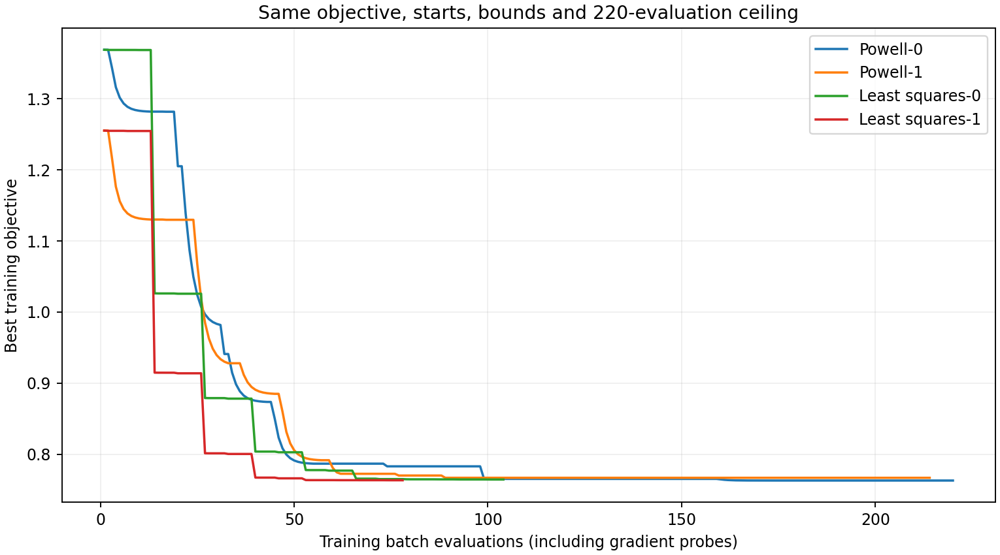
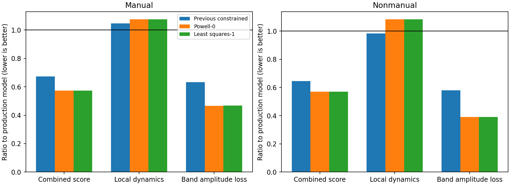
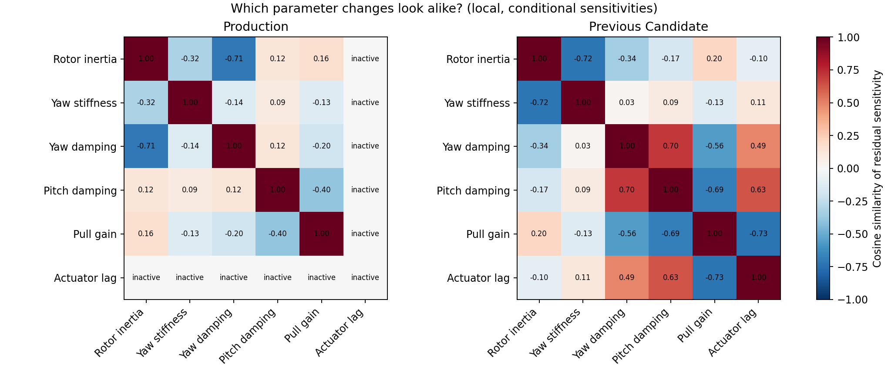

# Finite-difference fitting study — Trout Lake

Research only. No production physics, controller gains, browser runtime or deployment changed.

## Findings

Finite-difference least squares works with the existing Rust simulator and reaches essentially the same solution faster. Its best objective is 0.763407 versus Powell's 0.763021, a 0.051% difference. The two least-squares starts finish in 104 and 78 unique training batches; Powell uses 220 and 214. Including both starts, that is 182 versus 434 batches. These are two starts on one problem, not a general optimizer benchmark. Powell reached its function-call limit; least squares met its termination tolerances, which do not establish a global optimum.

The selected gradient candidate improves the combined validation score by about 43%, but local dynamics error rises 7.5% in manual windows and 8.3% in non-manual windows. Yaw-rate RMSE rises 9.4% and 7.8%, respectively. Its yaw oscillation RMS is 7.92 versus 21.85 deg/s observed in manual windows, and 7.17 versus 14.44 deg/s in non-manual windows. The faster optimizer has not resolved the model-fidelity problem. The previous constrained fit remains the better local-error compromise; no new candidate is promoted.

Numerical derivatives are usable. Halving the sensitivity step changes each active column by less than 0.01%. At the prior constrained candidate, the residual Jacobian has condition number 12.2 in normalized bound units: there is overlap among parameter effects, but no severe local rank deficiency. Pull gain and lag have sensitivity cosine -0.73, rotor inertia and yaw stiffness -0.72, and pitch/yaw damping +0.70. These are local directions, not posterior parameter correlations. At production's zero lag, lag sensitivity is exactly zero at this perturbation size because the sampled exponential filter is effectively instantaneous.

Allowing each training window its own unknown initial canopy angle removes at most 1.1% of any parameter's sensitivity-column norm; condition number remains 12.2. Within this local calculation and after discarding the first two seconds, initial canopy angle does not explain the fitting limitation. This does not eliminate wind or other unmodeled forcing as confounders. Doubling physics substeps from 32 to 64 changes checked rate RMSE by less than 1.2e-7 deg/s, so integration resolution is not the limiting issue here.

The new command-response check exposes a separate discrepancy: manual differential-command/yaw phase remains approximately 165 degrees wrong in the two windows meeting the coherence screen. The earlier pitch/yaw phase metric does not constrain this. In non-manual windows the equivalent phase error is about 29 degrees. The evidence is insufficient to infer a reversed aerodynamic response or an actuator delay: pilot/autopilot feedback, unmeasured forcing, and short records can all affect these associations.

## Recommended next experiment

Use finite-difference least squares for subsequent calibration, retaining multiple starts and an occasional Powell cross-check. A differentiable Rust rewrite is not justified by this six-parameter problem. Before expanding parameter bounds, investigate the manual command/yaw discrepancy across contiguous episodes: audit channel sign, routing, and timestamps, then compare frequency-dependent command/response behavior and residual motion across windows. Distinguish disturbance-driven motion from commanded response before adding a command-phase penalty. A single lag or further damping reduction should not be used to absorb a discrepancy whose physical source is unresolved. Keep local-rate constraints explicit in any next calibration; this study intentionally preserved the original objective to isolate the optimizer comparison.

## Protocol

Use the existing six-parameter, recorded-input, 20 s manual-flight fit. The production Trout Lake mass and 132 mm geometry are fixed. ArduPilot is not in the replay loop. Train on starts 280, 310, 535, 555 and 1988 s; evaluate on the previous three manual and nine non-manual windows, each at initial canopy angles 0.25, 0.35 and 0.45 rad. These are reused windows from the same flight, not new independent evidence.

Both optimizers use exactly the same residual objective, parameter bounds and two starts. Each start has a ceiling of 220 unique five-window simulation batches; finite-difference probes count toward this budget. Early convergence is allowed. Parameters are normalized by their bound widths. Powell uses a scalar objective; bounded trust-region least squares uses a bound-aware central-difference residual Jacobian with step 0.001 of the parameter range. All candidate choices are frozen using training scores before evaluating validation windows. Select the best training run per method, not the best validation run.

The sum of squared residuals reproduces the earlier objective:

$$
J=0.4J_{\mathrm{local}}+0.4J_{\mathrm{amplitude}}+0.2J_{\mathrm{phase}}+0.005\operatorname{mean}(\log^2 s_i).
$$

Local residuals are centered rate and angular-acceleration errors scaled by observed variability. Amplitude residuals are log RMS ratios in 1.2–1.9 Hz. Two sine/cosine residuals encode circular pitch/yaw phase error without an angle-wrap discontinuity. The five scale factors have weak log regularization; lag does not. This is the original unconstrained objective, not the second study's local-regression penalty. The prior constrained candidate is a reference, not an equal-budget optimizer competitor.

Every replay asserts equality between squared residual norm and the existing scalar score. Identifiability SVD excludes regularization residuals. Sensitivity columns use full-bound parameter units; these local, conditional diagnostics are not physical confidence intervals.

## Optimization

| Run | Simulation batches | Best objective | Batch wall seconds |
|---|---:|---:|---:|
| Powell-0 | 220 | 0.763021 | 41.0 |
| Powell-1 | 214 | 0.766868 | 40.2 |
| least_squares-0 | 104 | 0.764453 | 19.3 |
| least_squares-1 | 78 | 0.763407 | 14.7 |

## Evaluation

Ratios below one improve on production. Local error includes rate and angular acceleration. The combined score trades local performance against oscillation amplitude and inter-axis phase; it must not be interpreted as a percentage improvement in physical fidelity.

| Candidate | Windows | Combined ratio | Local ratio | Yaw-rate RMSE ratio | Pitch/yaw phase error (deg) |
|---|---|---:|---:|---:|---:|
| previous_constrained | manual | 0.674 | 1.047 | 1.065 | 43.2 |
| previous_constrained | nonmanual | 0.645 | 0.982 | 1.017 | 29.0 |
| Powell-0 | manual | 0.573 | 1.075 | 1.094 | 49.8 |
| Powell-0 | nonmanual | 0.570 | 1.083 | 1.078 | 32.9 |
| least_squares-1 | manual | 0.573 | 1.075 | 1.094 | 50.0 |
| least_squares-1 | nonmanual | 0.570 | 1.083 | 1.078 | 33.2 |

## Sensitivity and identifiability

See `sensitivity.json` for singular values, derivative-step consistency, column norms and weak directions. An inactive zero-lag column is a feature of the sampled exponential lag model: tiny time constants have numerically zero influence at the 40 ms input step. A nonzero starting lag is necessary for local derivative methods to explore this coordinate. The 40 ms second start provides that test without changing the simulator.

## Command-to-response timing

`timing-summary.json` records differential-command/yaw and common-command/pitch cross-spectral phase at the observed output peak in 1.2–1.9 Hz. Comparisons use the same nominal-initialization windows across models, with command standard deviation above 0.1 mm and both observed and simulated coherence at least 0.5. No timing score enters fitting or selection.

These short windows provide only a few Welch segments, so coherence and phase have substantial uncertainty. Manual pilot feedback can correlate commands with disturbances; non-manual windows additionally contain autopilot feedback. These are descriptive associations, not identified transfer functions, measured actuator delay, or causal plant damping. No phase is converted into a time delay because a coupled oscillatory response is not a pure delay.

## Reproduction

Run `simulation/.venv/bin/python research/gradient-fit-2026-10-18/run.py` from the repository. `report.py` needs NumPy and Matplotlib and only reads saved results. Raw input locations and the historical data loader are inherited from `manual-coupling-fit-2026-10-18/run.py`; set `MICROAGU_REPLAY_DATA` when necessary. Replay NPZ files are local regenerable artifacts; compact metrics, protocols, traces and figures are versioned.

## Command-response phase results

Mean absolute circular phase error in degrees; same screened windows for all models, nominal initial angle only.

| Windows | Path | Count | Production | Previous constrained | Powell | Least squares |
|---|---|---:|---:|---:|---:|---:|
| manual | differential_to_yaw | 2/3 | 167.9 | 164.3 | 164.9 | 164.9 |
| manual | common_to_pitch | 1/3 | 13.8 | 29.5 | 24.5 | 24.2 |
| nonmanual | differential_to_yaw | 8/9 | 23.5 | 28.8 | 29.2 | 29.2 |
| nonmanual | common_to_pitch | 8/9 | 64.8 | 23.9 | 28.8 | 29.1 |
