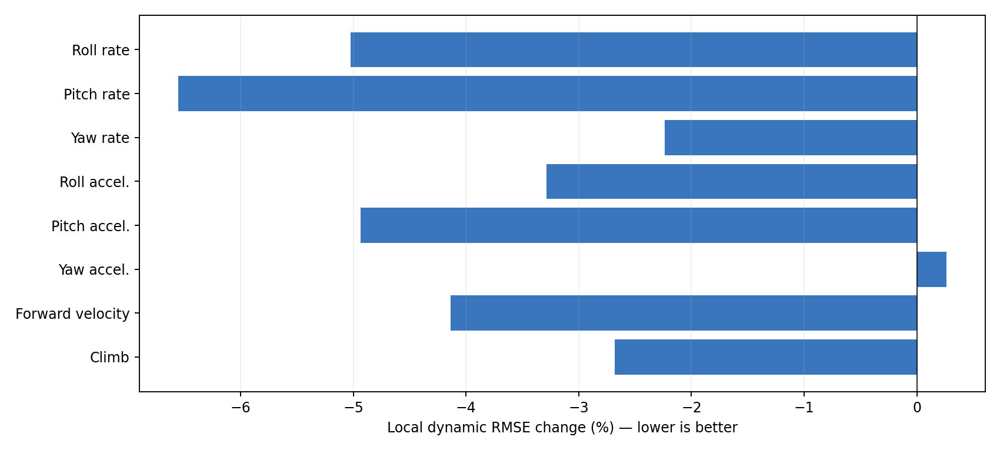
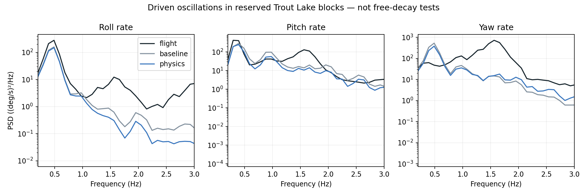

# Trout Lake control-relevant dynamics validation

**The candidate modestly improves local prediction, but does not yet demonstrate uniformly better control-relevant fidelity.** The decision is to retain it as a research candidate, with no production promotion or LQI retuning. This decision does **not** use accumulated course or earth-frame horizontal velocity error.

## Frozen comparison

No fitting occurred. The baseline and the previously selected Trout Lake candidate were frozen before running the protocol. Both use the actual historical 1.758 kg / 132 mm configuration. The same reserved blocks (1440–1530, 2100–2190, 2760–2850 s) supply 27 six-second replays at ten-second spacing. Each is run at three assumed initial canopy angles (0.25, 0.35, 0.45 rad), for 162 replays in total. These are repeated analyses of one flight, not independent flight validation.

The initial two seconds are excluded to reduce hidden-state initialization effects. A final 0.24 s is excluded for derivative support. Roll/pitch/yaw angular acceleration is computed using the same 11-sample, third-order Savitzky–Golay derivative on flight and simulated rates. This smooths the derivative; it is not an unsmoothed IMU acceleration measurement. Body-forward **ground** velocity and vertical climb are compared, avoiding a claim of measured airspeed.

The primary local metric removes each window's mean error, isolating transient mismatch from persistent bias. Raw errors and mean absolute window biases are retained separately. Rates use deg/s, angular accelerations deg/s², and velocity/climb m/s. No heading alignment or time shift is optimized to improve the scores.

## Local dynamics

| Channel | Baseline RMSE | Candidate RMSE | Change |
|---|---:|---:|---:|
| Roll rate | 6.908 | 6.561 | -5.0% |
| Pitch rate | 13.029 | 12.174 | -6.6% |
| Yaw rate | 19.168 | 18.740 | -2.2% |
| Roll accel. | 66.484 | 64.301 | -3.3% |
| Pitch accel. | 94.705 | 90.031 | -4.9% |
| Yaw accel. | 166.916 | 167.357 | +0.3% |
| Forward velocity | 0.275 | 0.264 | -4.1% |
| Climb | 0.284 | 0.276 | -2.7% |


The equally weighted mean channel ratio improves **3.57%**, short of the predeclared 5% improvement criterion. The worst channel is only 0.26% worse; this is a **modest local improvement**, not a dynamic failure. That arbitrary threshold alone would not justify claiming the candidate is physically worse.



## Oscillations and input/output response

The nine previous 30-second validation replays provide pooled Welch spectra after excluding two seconds at each end (25 Hz sample rate, 256-sample segments, 50% overlap). Frequency resolution is approximately 0.098 Hz. The 0.2–3 Hz band is compared in log-power space; band RMS values are also retained so small spectral tails cannot be mistaken for large total-energy errors.

| Rate axis | Flight dominant frequency | Baseline | Candidate | Baseline log-spectrum RMSE | Candidate |
|---|---:|---:|---:|---:|---:|
| Roll | 0.488 Hz | 0.488 Hz | 0.488 Hz | 8.65 dB | 11.99 dB |
| Pitch | 0.293 Hz | 0.391 Hz | 0.391 Hz | 4.03 dB | 4.57 dB |
| Yaw | 1.562 Hz | 0.488 Hz | 0.488 Hz | 9.62 dB | 8.67 dB |

The candidate improves yaw spectral mismatch but worsens roll and pitch mismatch, increasing mean log-spectrum error by 13.1%. Both models fail to reproduce the dominant yaw spectral peak in these records. This is a materially different concern from accumulated trajectory drift.

The mismatch also appears in substantial band energy, not just low-power spectral tails. In the 0.7–2 Hz band, flight/baseline/candidate rate RMS values are roll **2.60 / 1.27 / 1.09 deg/s**, pitch **8.31 / 6.49 / 5.02 deg/s**, and yaw **17.93 / 4.87 / 4.76 deg/s**. The candidate predicts less motion in a band already underrepresented by the baseline.

A post-comparison diagnostic at 1.5625 Hz finds yaw coherence of **0.95 with pitch rate, 0.76 with roll rate, and 0.65 with differential brake command**. These associations make the component a useful investigation target. Feedback can make commands respond to an oscillation rather than cause it; this does not identify its causal origin or prove a missing natural mode. Unmodeled disturbances and sensor processing must also be considered before treating all observed spectral power as a plant property. See `peak-coherence.json` and `coherence.py`.



Input/output cross-spectra compare differential brake, common brake, and throttle against body rates and climb over 0.2–2 Hz, retaining 38 input/output frequency bins with observed coherence at least 0.5. Descriptive magnitude error changes from 10.30 to 10.82 dB, and phase error improves from 51.94 to 50.15 degrees. The magnitude gate fails narrowly; the phase gate passes.

These are **closed-loop descriptive transfer estimates**, not causal open-loop plant gains. Correlated inputs, feedback, disturbances, sensor noise, and missing canopy state can bias them. They are useful to compare replay responses under the same command history, but do not establish a unique control delay or an isolated brake/throttle response. No step-response rise time or overshoot is claimed from arbitrary flight inputs.

## What is and is not identified

No observed three-second interval met the specified quiet-input limits (differential/common brake ranges below 2 mm and throttle range below 0.02). Even an interval meeting those limits would need sufficient initial excitation and disturbance screening before fitting a free decay. Therefore **this study does not identify a damping ratio or claim that halving model joint damping matches flight damping**. The proposed damping change remains an empirical fit variable.

The candidate's local error reduction persists without integrated course penalties. However, instantaneous waveform error alone can reward a model for suppressing motion it predicts with incorrect phase. The spectral comparison is needed to reveal that tradeoff. Frequency peaks of driven motion are not automatically natural modes.

Persistent biases are separate diagnostics: mean absolute window yaw-rate bias improves from 2.44 to 2.25 deg/s, while forward-velocity bias remains about 0.395 m/s and climb bias about 0.23 m/s. These are not estimates of true trim equilibria because the windows contain varying controls and disturbances.

## Decision and next step

Keep the candidate and its demonstrated local improvements, but do not adopt the whole parameter bundle as a better oscillatory plant yet. Three of six frozen gates pass; acceptance is false, as recorded in `summary.json`. Specifically, local mean improvement, spectral error, and descriptive magnitude gates fail; worst local channel, coherence coverage, and phase gates pass. No course-drift veto is used.

The next fitting objective should retain the local rate/acceleration terms while adding band-limited oscillation amplitude and phase constraints. Target the roll-spectrum regression and the shared missing yaw peak rather than accumulating trajectory error. Use training blocks for that objective and identify existing validation blocks as reused evidence. Before interpreting the 1.56 Hz yaw component as canopy dynamics, inspect its coherence with brake commands, other body rates, and sensor processing. If no clear free-decay segments exist in the wider logs, damping should remain an uncertainty range and a future flight-test objective.

No LQI campaign or browser update was launched because this candidate did not pass the dynamics comparison. Source and results are retained for the next fit.

## Reproduction

```sh
simulation/.venv/bin/python research/trout-lake-dynamics-2026-10-18/run.py
simulation/.venv/bin/python research/trout-lake-dynamics-2026-10-18/coherence.py
python research/trout-lake-dynamics-2026-10-18/report.py
```

Install the Rust Python extension and NumPy/SciPy; plotting requires Matplotlib. The previous Trout Lake study's 30-second NPZ replay artifacts must be present (regenerate with its `run.py` if needed). `MICROAGU_REPLAY_DATA` selects the historical input directory. JSON spectra are versioned alongside figures; raw NPZ files are ignored. `protocol.json`, `candidate.json`, and `source-hashes.json` record the comparison setup.
